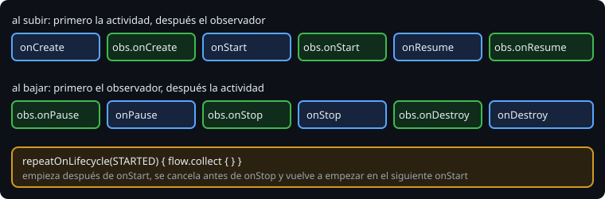

# Observar el ciclo de vida

> Sobrescribir `onStart` y `onStop` funciona en una actividad. Pero lo que empieza y para con la pantalla (la ubicación, un sensor, una suscripción) acaba repartido entre seis métodos de una clase que ya hace demasiado. `Lifecycle` permite a cualquier objeto enterarse del ciclo de vida por sí mismo.

## 🎯 Objetivos

- Escribir un observador con `DefaultLifecycleObserver` y registrarlo
- Predecir cuándo recibe los eventos respecto a los métodos de la actividad
- Ligar una corrutina al ciclo de vida con `lifecycleScope` y `repeatOnLifecycle`

## 1. `Lifecycle` y sus observadores

`ComponentActivity` es un `LifecycleOwner`: tiene un `lifecycle` con su estado actual y una lista de observadores.

```kotlin
class LocationTracker : DefaultLifecycleObserver {
    override fun onStart(owner: LifecycleOwner) { /* empezar a escuchar */ }
    override fun onStop(owner: LifecycleOwner) { /* dejar de escuchar */ }
}

// en onCreate
lifecycle.addObserver(LocationTracker())
```

El observador implementa solo los métodos que le interesan. La actividad solo lo registra, y lo que empieza y lo que para queda en la misma clase, donde se puede leer y probar junto.

## 2. Cuándo llegan los eventos



```text
onCreate → observer.onCreate → onStart → observer.onStart → onResume → observer.onResume
observer.onPause → onPause → observer.onStop → onStop → observer.onDestroy → onDestroy
```

> 🔬 Medido en el ejercicio 01: al subir, el observador se entera **después** del método de la actividad; al bajar, **antes**. Así el observador nunca trabaja con una actividad que aún no ha terminado de arrancar o que ya ha empezado a pararse.

Un observador que se registra tarde no se pierde nada. `addObserver` lo pone al día con los eventos que faltan hasta el estado actual:

> 🔬 Medido: registrado en `onResume`, recibe `onCreate`, `onStart` y `onResume` seguidos, justo al registrarse.

## 3. Corrutinas con ciclo de vida

En la fase 1 aprendiste que una corrutina vive en un `CoroutineScope`. Una actividad tiene uno, `lifecycleScope`, que se cancela en `onDestroy`:

```kotlin
lifecycleScope.launch {
    repeatOnLifecycle(Lifecycle.State.STARTED) {
        observations.collect { show(it) }
    }
}
```

`repeatOnLifecycle(STARTED)` ejecuta el bloque cada vez que la actividad llega a `STARTED` y lo cancela cada vez que baja de ahí. Un `Flow` solo se recoge mientras la pantalla se ve: no se gastan batería ni datos con la app en segundo plano.

> 🔬 Medido: el bloque empieza después de `onStart`, se cancela antes de `onStop` y vuelve a empezar en el siguiente `onStart`. `repeatOnLifecycle` está en `androidx.lifecycle:lifecycle-runtime-ktx` (2.11.0), que `androidx.activity` no trae; `lifecycleScope`, sí.

Recoger un `Flow` con `lifecycleScope.launch { flow.collect { } }`, sin `repeatOnLifecycle`, lo deja recogiendo hasta `onDestroy`, aunque la app esté en segundo plano. En Compose (fase 4) hay un equivalente, `collectAsStateWithLifecycle`.

## ✅ Comprueba

- [ ] ¿Qué ventaja tiene un `DefaultLifecycleObserver` frente a sobrescribir `onStart` y `onStop` en la actividad?
- [ ] Registras un observador en `onResume`. ¿Qué eventos recibe y cuándo?
- [ ] ¿Qué pasa con un `collect` lanzado en `lifecycleScope` sin `repeatOnLifecycle` cuando el usuario pulsa Inicio?
