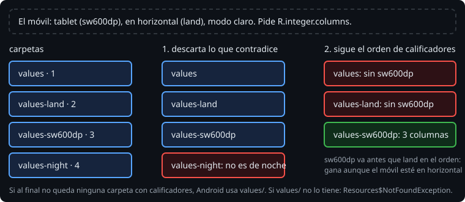

# Calificadores: cómo elige Android

> Una carpeta `values-es` tiene textos en español; `values-night`, colores para el modo oscuro; `values-sw600dp`, medidas para tablet. Lo que va detrás del guion es un **calificador**. Con ellos, la misma app se adapta al móvil sin un solo `if`, y Android vuelve a elegir cada vez que cambia la configuración (semana 16, teoría 02).

## 🎯 Objetivos

- Usar los calificadores más comunes y escribirlos en el orden correcto
- Predecir qué carpeta elige Android cuando varias encajan
- Probar recursos con calificadores en Robolectric

## 1. Los calificadores que más vas a usar

| Calificador | Ejemplo | Cuándo encaja |
| --- | --- | --- |
| Idioma y región | `es`, `es-rMX`, `b+es+419` | El idioma del usuario (teoría 03) |
| Ancho mínimo | `sw600dp` | El lado corto de la pantalla mide al menos 600 dp: tablets, plegables abiertos |
| Ancho disponible | `w840dp` | El ancho actual, que cambia al girar o al dividir la pantalla |
| Orientación | `land`, `port` | Horizontal o vertical |
| Modo oscuro | `night`, `notnight` | El tema del sistema |
| Densidad | `hdpi`, `xxhdpi`, `anydpi` | Los píxeles por dp; `anydpi`, para vectores (teoría 04) |
| Versión de Android | `v31` | Android 12 o superior |

Se combinan con guiones, **siempre en el orden de esa tabla** (la documentación tiene la lista completa): `values-es-sw600dp-land-night`. En otro orden, el build se para:

```text
.../res/values-night-land: Error: Invalid resource directory name
```

> 🔬 Medido en el ejercicio 01, paso 7c. `values-land-night` funciona. `values-land-es` tampoco vale: el idioma va primero.

## 2. Cómo elige



Para cada recurso que pide el código, Android mira las carpetas que lo definen:

1. **Descarta las que contradicen al móvil.** En vertical, `values-land` no sirve. Las que no dicen nada de un calificador no se descartan por él.
2. **Recorre los calificadores en el orden de la tabla.** Si alguna de las que quedan tiene el primero (por ejemplo, `sw600dp`), descarta las que no lo tienen, y sigue con el siguiente.
3. Lo que queda es la carpeta más específica. Si no queda ninguna con calificadores, usa `values/`.

Por eso el orden importa también al elegir. En una tablet en horizontal, con `values-land` (2 columnas) y `values-sw600dp` (3), gana `values-sw600dp`, porque el ancho mínimo va antes que la orientación:

> 🔬 Medido con Robolectric: `sw600dp-land` da 3 columnas. Si quieres otra cosa para la tablet en horizontal, crea `values-sw600dp-land`.

## 3. El idioma no es un calificador más

El idioma tiene sus propias reglas de parecido: si no hay carpeta para la región exacta, Android busca la más cercana de la misma lengua, antes de caer en `values/`.

| Móvil | Carpetas | Elige |
| --- | --- | --- |
| `es-rES` | `values`, `values-es`, `values-b+es+419` | `values-es` |
| `es-rAR` | las mismas | `values-b+es+419` |
| `es-rAR` | `values`, `values-es`, `values-es-rMX` | `values-es-rMX` |
| `fr` | `values`, `values-es` | `values` |

> 🔬 Medido con Robolectric en la sonda y en el ejercicio 01. Argentina recibe el texto de México porque los dos pertenecen al español de Latinoamérica (`es-419`): es la región más parecida que hay. Lo cuenta la teoría 03.

## 4. En los tests

Robolectric simula un móvil concreto. Si no se le dice otra cosa, está en **inglés de EE. UU.**, en vertical, con 320 dp de ancho mínimo y densidad 1.

> 🔬 Medido: `locale=[en_US] sw=320 density=1.0`.

```kotlin
@Test
@Config(qualifiers = "es")
fun spanishTranslatesTheApp() { /* todo el test, en español */ }

@Test
fun landscapeHasTwoColumns() {
    RuntimeEnvironment.setQualifiers("+land")  // con +: añade a lo que hay; sin +: lo sustituye
    assertEquals(2, resources.getInteger(R.integer.columns))
}
```

`@Config` en la clase vale para todos sus tests. En la Bitácora es imprescindible: su idioma por defecto es el español (`values/`), pero el móvil de Robolectric pide inglés, y si hay `values-en`, gana.

> 🔬 Medido en el proyecto: sin `@Config(qualifiers = "es")` en la clase, todos los tests en español fallan con el texto en inglés.

## ✅ Comprueba

- [ ] ¿Es válida `values-night-sw600dp`? ¿Por qué?
- [ ] Hay `values`, `values-land` y `values-night`, y el móvil está en horizontal y en modo oscuro. Cada carpeta define `columns` y `background`. ¿De dónde sale cada uno?
- [ ] ¿Por qué un test de una app en español puede ver textos en inglés?
