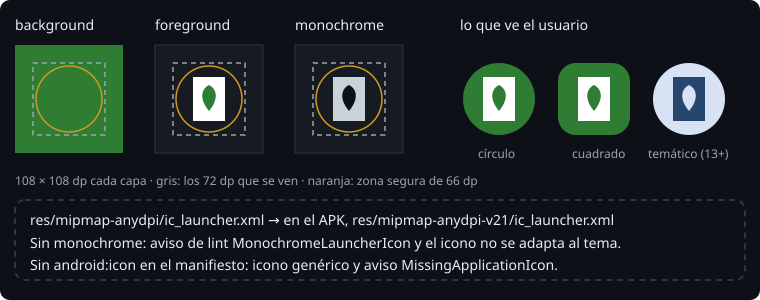

# El icono

> El icono es lo primero que ve el usuario de tu app, y no lo dibuja una sola vez: cada fabricante lo recorta con su forma (círculo, cuadrado redondeado, gota), el sistema lo anima, y desde Android 13 lo puede pintar con los colores del fondo de pantalla. Un **icono adaptativo** le da a Android las piezas para hacer todo eso.

## 🎯 Objetivos

- Construir un icono adaptativo con fondo, primer plano y versión monocroma
- Explicar por qué va en `mipmap` y con vectores
- Comprobar el icono en el APK y en un test

## 1. Capas, no una imagen



```xml
<!-- res/mipmap-anydpi/ic_launcher.xml -->
<adaptive-icon xmlns:android="http://schemas.android.com/apk/res/android">
    <background android:drawable="@color/ic_launcher_background" />
    <foreground android:drawable="@drawable/ic_launcher_foreground" />
    <monochrome android:drawable="@drawable/ic_launcher_foreground" />
</adaptive-icon>
```

| Capa | Qué es |
| --- | --- |
| `background` | El fondo: un color o una imagen sin transparencias |
| `foreground` | El dibujo, con fondo transparente |
| `monochrome` | Una silueta de un solo color. En Android 13 o superior, si el usuario activa los iconos temáticos, el sistema la pinta con los colores de su fondo de pantalla |

Cada capa mide 108 × 108 dp, pero no se ve entera. Según la documentación, la máscara deja ver los 72 dp centrales, y solo los 66 dp del centro se ven siempre, sea cual sea la forma: el dibujo importante va ahí. El margen sobrante es para los efectos de movimiento del sistema.

## 2. `mipmap-anydpi` y vectores

El icono va en `mipmap`, no en `drawable`: los lanzadores a veces lo muestran más grande de lo que pide la pantalla, y Android conserva las carpetas `mipmap` de todas las densidades por si acaso.

Con `minSdk 26`, todos los móviles de la Bitácora entienden los iconos adaptativos (llegaron en Android 8, API 26). Basta con un archivo en `mipmap-anydpi` y capas vectoriales (`<vector>`), que se dibujan nítidas a cualquier tamaño. No hacen falta PNG para cada densidad.

> 🔬 Medido en el ejercicio 02: en el APK, el archivo está en `res/mipmap-anydpi-v21/ic_launcher.xml`. aapt2 añade `-v21` porque `anydpi` apareció en Android 5 (API 21). Con `minSdk 26`, no cambia nada.

El manifiesto lo usa con `android:icon="@mipmap/ic_launcher"`. Sin esa línea, Android pone un icono genérico y lint avisa: `Should explicitly set android:icon, there is no default [MissingApplicationIcon]`.

## 3. Comprobarlo

En el APK:

```bash
apkanalyzer resources xml --file res/mipmap-anydpi-v21/ic_launcher.xml app-debug.apk
```

En un test de Robolectric, el icono es un `AdaptiveIconDrawable` de verdad:

```kotlin
val icon = context.getDrawable(R.mipmap.ic_launcher) as AdaptiveIconDrawable
assertNotNull(icon.monochrome)
```

> 🔬 Medido en la sonda. Sin `<monochrome>`, lint avisa con `[MonochromeLauncherIcon]`, un aviso que no para el build. El usuario que activa los iconos temáticos ve el tuyo con sus colores de siempre, distinto de todos los demás.

Si una capa apunta a un recurso que no existe, aapt2 para el build al enlazar:

```text
error: resource color/ic_launcher_background (aka dev.bitacora.agro:color/ic_launcher_background) not found.
```

> 🔬 Medido en el ejercicio 02.

## ✅ Comprueba

- [ ] ¿Qué tres capas tiene un icono adaptativo, y cuál es opcional?
- [ ] ¿Por qué el dibujo importante no puede llegar al borde de los 108 dp?
- [ ] ¿Por qué la Bitácora no necesita PNG del icono en cinco densidades?
