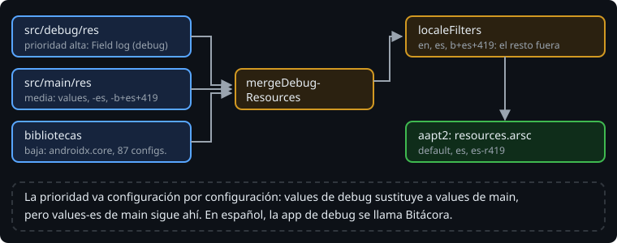

# Recursos en el build

> Los recursos que acaban en el APK no son solo los de tu carpeta `res/`. AGP junta los de cada *source set*, los de cada biblioteca y los que generan los plugins, y decide cuál gana cuando dos se llaman igual. Además, puede quitar los que sobran. Todo eso pasa en el build, y se configura en `build-logic`, como el resto.

## 🎯 Objetivos

- Explicar cómo se fusionan los recursos de los source sets y de las bibliotecas
- Recortar los idiomas del APK con `localeFilters` sin perder regiones
- Situar los recursos en el build de la Bitácora: convention plugin, lint y verificación

## 1. La fusión



Antes de aapt2, la tarea `mergeDebugResources` junta todas las fuentes de recursos de la variante. Si dos definen el mismo recurso **para la misma configuración**, gana la de más prioridad:

1. El tipo de build (`src/debug/res`)
2. `src/main/res`
3. Las bibliotecas, en el orden de las dependencias

> 🔬 Medido: `app_name` en `src/debug/res/values` da `Field log (debug)` en el APK de debug y `Field log` en el de release. Un texto con el mismo nombre que uno de `androidx.core` sustituye al de la biblioteca en el APK.

La prioridad se aplica configuración por configuración. El `values/` de debug sustituye al `values/` de main, pero no a `values-es`:

> 🔬 Medido en el ejercicio 02: en un móvil en español, la app de debug se llama `Bitácora`, la traducción de main. Para un nombre de debug en español hace falta `src/debug/res/values-es`.

Dentro de un mismo source set, el mismo nombre dos veces es un error, aunque esté en archivos distintos:

```text
[string/greeting] .../values/dup.xml	[string/greeting] .../values/strings.xml: Error: Duplicate resources
```

> 🔬 Medido en la sonda.

## 2. Solo tus idiomas

`androidx.activity` depende de `androidx.core`, que trae sus textos traducidos a decenas de idiomas. Todos acaban en tu APK, aunque tu app solo hable dos:

> 🔬 Medido en el ejercicio 02: sin filtro, `apkanalyzer resources configs --type string` lista 87 configuraciones.

```kotlin
android {
    androidResources {
        localeFilters += listOf("en", "es", "b+es+419")
    }
}
```

> 🔬 Medido: con el filtro quedan `default`, `es` y `es-r419`. Con `listOf("en", "es")` también desaparece `es-r419`: **un idioma en el filtro no incluye sus regiones**. Un usuario de Argentina vería `móvil` en lugar de `celular`, y ningún test de la app lo notaría si no lo prueba.

Así el usuario no ve pantallas del sistema a medio traducir en un idioma que tu app no habla. El tamaño casi no cambia (en la sonda de esta semana, unos 2,6 MB de APK de debug con filtro y sin él): los textos pesan poco al lado del código.

## 3. En el build de la Bitácora

| Qué | Dónde | Por qué |
| --- | --- | --- |
| `generateLocaleConfig = true` | `bitacora.android-application` | Toda app de la Bitácora declara sus idiomas |
| `localeFilters` | `app/build.gradle.kts` | Los idiomas son una decisión de cada app |
| `res/resources.properties` | `app/src/main/res` | El idioma de `values/` lo sabe quien escribe los textos |

Lint también pasa por el build. `./gradlew lint` ejecuta `lintDebug`, que se para con un `Error` como `MissingTranslation`. Dentro de `assembleRelease` solo se ejecuta `lintVitalRelease`, que se para con los fatales. Por eso los tests del proyecto ejecutan `lintDebug`.

> 🔬 Medido: lint también avisa de que hay una versión de AGP más nueva (`AndroidGradlePluginVersion`), así que consulta las versiones publicadas. Es un aviso y no para el build. En este bootcamp las versiones se eligen a mano en `docs/stack-versions.md`, y AGP 9.5.0 todavía tiene una `guava` con un aviso de seguridad abierto.

Lint tiene sus propias dependencias, pero ya estaban en la verificación: el comando que la regenera incluye `assembleRelease`, y `lintVitalRelease` las resuelve.

> 🔬 Medido en el proyecto: con los textos traducidos, el icono, `generateLocaleConfig` y `lintDebug` añadido al comando de escritura, `gradle/verification-metadata.xml` sale idéntico, con 359 componentes. Los recursos no son dependencias: todo lo de esta semana lo hacen herramientas que el build ya tenía.

## ✅ Comprueba

- [ ] `values/strings.xml` define `app_name` en `src/main` y en `src/debug`, y `values-es/strings.xml` solo en `src/main`. ¿Qué nombre tiene la app de debug en inglés? ¿Y en español?
- [ ] ¿Por qué `localeFilters += listOf("es")` no basta para una app con `values-b+es+419`?
- [ ] ¿Por qué `generateLocaleConfig` va en el convention plugin y `localeFilters` en la app?
