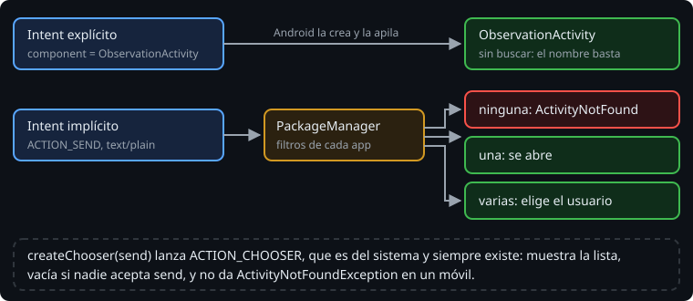

# Intents implícitos

> La Bitácora no tiene por qué saber mandar un correo, abrir un mapa o hacer una foto: hay apps que lo hacen mejor. Un Intent implícito no nombra una clase. Dice qué quieres hacer, y Android busca qué apps del móvil lo saben hacer.

## 🎯 Objetivos

- Describir una acción con `action`, `data`, `type` y `category`
- Compartir con el selector de Android y saber por qué no falla
- Comprobar si alguna app acepta un Intent, y qué pide Android 11 para verlo

## 1. Qué quieres hacer



Un Intent implícito tiene:

| Campo | Qué dice | Ejemplo |
| --- | --- | --- |
| `action` | El verbo | `ACTION_SEND`, `ACTION_VIEW`, `ACTION_DIAL` |
| `data` | Sobre qué, como `Uri` | `geo:-34.6037,-58.3816`, `tel:112` |
| `type` | El tipo MIME de lo que mandas | `text/plain`, `image/*` |
| `category` | Matices | `DEFAULT`, `BROWSABLE` |
| extras | Los datos | `EXTRA_TEXT`, `EXTRA_SUBJECT` |

```kotlin
// Abre un mapa en un punto
startActivity(Intent(Intent.ACTION_VIEW, "geo:$latitude,$longitude".toUri()))

// Comparte un texto
val send = Intent(Intent.ACTION_SEND).setType("text/plain").putExtra(Intent.EXTRA_TEXT, text)
```

`toUri()` es la extensión de `androidx.core.net`. Con `Uri.parse`, lint avisa con `[UseKtx]`.

> 🔬 Medido en el ejercicio 01.

## 2. Ninguna, una o varias

Android compara el Intent con los `intent-filter` de todas las apps instaladas (teoría 03). Pueden pasar tres cosas:

- **Ninguna** lo acepta: `startActivity` lanza `ActivityNotFoundException`, y si no la capturas, la app se cierra.
- **Una**: se abre esa.
- **Varias**: Android pregunta al usuario, que puede marcar una "siempre".

Para compartir, lo normal es enseñar siempre el **selector** (*chooser*), con todas las apps y sin opción de "siempre":

```kotlin
startActivity(Intent.createChooser(send, getString(R.string.share)))
```

`createChooser` envuelve tu Intent en otro, `ACTION_CHOOSER`, con el tuyo en `EXTRA_INTENT`. El selector es del sistema y siempre existe, así que en un móvil real no da `ActivityNotFoundException`, aunque ninguna app acepte lo que mandas: muestra la lista vacía.

> 🔬 Medido en el ejercicio 01: el Intent lanzado es `android.intent.action.CHOOSER`, y dentro va `android.intent.action.SEND` con el texto.

## 3. ¿Hay alguien?

Para decidir antes, por ejemplo para deshabilitar un botón, se pregunta al `PackageManager`:

```kotlin
fun canShare() = Intent(Intent.ACTION_SEND).setType("text/plain").resolveActivity(packageManager) != null
```

Desde Android 11 (API 30), una app no ve qué otras apps hay instaladas, salvo algunas del sistema. Es la **visibilidad de paquetes**: sin declararlo, `resolveActivity` devuelve `null` aunque haya diez apps de correo. Lo declaras en el manifiesto con `<queries>`, diciendo qué Intents te interesan:

```xml
<queries>
    <intent>
        <action android:name="android.intent.action.SEND" />
        <data android:mimeType="text/plain" />
    </intent>
</queries>
```

Robolectric no simula la visibilidad de paquetes: el test pasa con y sin `<queries>`.

> 🔬 Medido en el ejercicio 01, paso 7d. Lo de Android 11 sale de la guía oficial (webgrafía): sin emulador ni móvil, no se puede medir aquí.

`startActivity` y `createChooser` no necesitan `<queries>`. Solo lo necesitas para **preguntar**, no para **lanzar**.

## 4. Intents que llegan

La Bitácora también puede recibir Intents implícitos: un `ACTION_SEND` de otra app (un texto para una observación nueva) o un enlace (teoría 03). Lo que llega de fuera no es de fiar: un extra puede faltar, o tener otro tipo, o venir de una app que quiere hacer daño. Tu actividad comprueba lo que recibe y se cierra con `finish()` si no tiene sentido.

## ✅ Comprueba

- [ ] ¿Qué diferencia hay entre `startActivity(send)` y `startActivity(Intent.createChooser(send, ...))` si ninguna app acepta `send`?
- [ ] Tu `canShare()` devuelve `false` en un Android 14 con Gmail instalado. ¿Qué falta?
- [ ] ¿Por qué el test de `canShare()` no detecta que falta `<queries>`?
