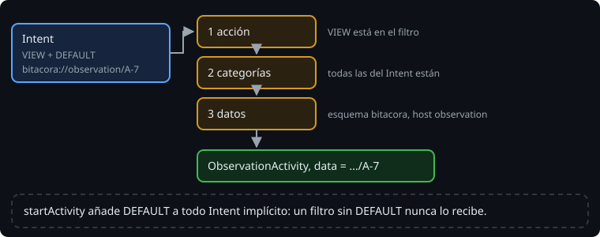

# Intent filters y deep links

> Para que Android le pase un Intent implícito a una actividad, la actividad tiene que decir qué acepta. Lo dice en el manifiesto, con un `intent-filter`. Es lo que ya hacía `MainActivity` para aparecer en el lanzador, y es lo que permite que un enlace `bitacora://observation/A-7` abra una observación concreta.

## 🎯 Objetivos

- Leer y escribir un `intent-filter` con `action`, `category` y `data`
- Saber qué es `android:exported` y cuándo es obligatorio
- Abrir una pantalla con un deep link, y tratar lo que llega como lo que es: datos de fuera

## 1. El filtro

```xml
<activity
    android:name=".ObservationActivity"
    android:exported="true">
    <intent-filter>
        <action android:name="android.intent.action.VIEW" />
        <category android:name="android.intent.category.DEFAULT" />
        <category android:name="android.intent.category.BROWSABLE" />
        <data
            android:host="observation"
            android:scheme="bitacora" />
    </intent-filter>
</activity>
```



Un Intent pasa el filtro si pasa las tres pruebas:

1. **Acción**: la del Intent está en el filtro.
2. **Categoría**: **todas** las del Intent están en el filtro. El filtro puede tener más.
3. **Datos**: el esquema, el host, el path y el tipo MIME del Intent encajan con algún `<data>`.

La trampa está en la categoría. `startActivity` le añade `CATEGORY_DEFAULT` a todo Intent implícito. Un filtro sin `DEFAULT` nunca lo recibe:

> 🔬 Medido en el ejercicio 01, paso 7c: sin `DEFAULT`, `queryIntentActivities(link, 0)` encuentra la actividad, pero con `MATCH_DEFAULT_ONLY` (lo que hace `startActivity`) no la encuentra, y `startActivity(link)` lanza `ActivityNotFoundException`.

`MAIN` + `LAUNCHER` es la excepción: el lanzador no busca con `DEFAULT`.

`BROWSABLE` deja que el enlace se abra desde el navegador o desde otra app que muestre enlaces.

## 2. `android:exported`

`exported="true"` significa que otras apps pueden abrir la actividad. Si tiene un `intent-filter`, desde Android 12 (`targetSdk` 31 o más) hay que decirlo siempre, sea `true` o `false`. Si no, el build se para en la fusión del manifiesto:

```text
Error:
	android:exported needs to be explicitly specified for element <activity#dev.bitacora.DetailActivity>. Apps targeting Android 12 and higher are required to specify an explicit value for `android:exported` when the corresponding component has an intent filter defined.
```

> 🔬 Medido en la sonda, con `processDebugMainManifest`.

Una actividad sin filtro que solo abre tu app lleva `exported="false"`: ninguna otra app puede abrirla, ni con un Intent explícito. Es lo que hace el proyecto con la pantalla de la observación.

## 3. Deep links

Un **deep link** es una `Uri` que abre una pantalla concreta, no la principal. Con el filtro de arriba:

```text
bitacora://observation/A-7
```

abre `ObservationActivity`, y `intent.data` es esa `Uri`. El código está en el último segmento:

```kotlin
val code = intent.data?.lastPathSegment // "A-7"
```

> 🔬 Medido en el ejercicio 01: `queryIntentActivities` encuentra `ObservationActivity` para `bitacora://observation/A-7`, y ninguna para `bitacora://map/A-7` (otro host).

Cualquier app puede montar ese enlace, con lo que quiera dentro: `bitacora://observation`, sin código, o un código de diez mil caracteres. Una actividad exportada valida lo que recibe y, si no sirve, se cierra:

```kotlin
val code = intent.data?.lastPathSegment ?: run {
    finish()
    return
}
```

Con `return` dentro de `onCreate`, la actividad no llega a montar su pantalla.

## 4. App Links

Un esquema propio (`bitacora://`) lo puede declarar cualquier app. Si dos lo declaran, Android pregunta al usuario. Los **App Links** usan `https://` con un dominio tuyo y `android:autoVerify="true"`: Android comprueba en `https://tu-dominio/.well-known/assetlinks.json` que la app es tuya, y abre tu app sin preguntar. Necesitan un dominio y la firma de la app (semana 20), así que la Bitácora se queda por ahora con su esquema propio.

## ✅ Comprueba

- [ ] Tu filtro no tiene `DEFAULT`. ¿Lo encuentra `queryIntentActivities(intent, 0)`? ¿Y `startActivity`?
- [ ] ¿Qué pasa si quitas `android:exported` de una actividad con filtro? ¿Y de una sin filtro?
- [ ] ¿Por qué una actividad exportada no debe fiarse de `intent.data`?
