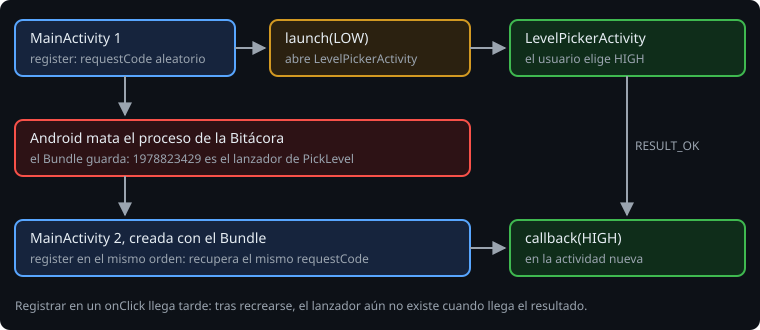

# Activity Result

> Abrir otra pantalla es la mitad. La otra mitad es que te devuelva algo: el nivel que eligió el usuario, la foto que escogió, la observación editada. La API de Activity Result lo hace con un contrato que dice qué entra y qué sale, y con un registro que no pierde la respuesta aunque Android mate tu proceso mientras el usuario elige.

## 🎯 Objetivos

- Lanzar una pantalla y recibir su resultado con `registerForActivityResult`
- Usar los contratos de AndroidX y escribir uno propio
- Devolver un resultado desde la otra pantalla
- Explicar por qué el registro va al crear la actividad, y qué pasa si el proceso muere

## 1. El lanzador

```kotlin
class MainActivity : ComponentActivity() {
    private val pickLevel = registerForActivityResult(PickLevel()) { picked ->
        if (picked != null) level = picked
    }

    fun changeLevel() = pickLevel.launch(level)
}
```

`registerForActivityResult` recibe un **contrato** y un **callback**, y devuelve un `ActivityResultLauncher`. `launch(input)` abre la otra pantalla. Cuando esta termina, Android llama al callback con la salida.

Antes se usaba `startActivityForResult` y `onActivityResult`, con un `requestCode` y un `when` gigante. Están deprecados, y con `allWarningsAsErrors` el build se para:

```text
e: .../MainActivity.kt:55:17 'fun startActivityForResult(intent: Intent, requestCode: Int): Unit' is deprecated. This method has been deprecated in favor of using the Activity Result API
```

> 🔬 Medido en la sonda.

## 2. Al crear, no al pulsar

El registro va **como propiedad** (o en `onCreate`), nunca dentro del `setOnClickListener`:

```text
java.lang.IllegalStateException: LifecycleOwner dev.bitacora.MainActivity@1af7de7c is attempting to register while current state is RESUMED. LifecycleOwners must call register before they are STARTED.
```

> 🔬 Medido en la sonda y en el ejercicio 02, paso 7a.

El motivo es la muerte del proceso (semana 16). Mientras el usuario elige en otra app, Android puede matar el de la Bitácora. Cuando vuelve, crea una `MainActivity` nueva y le entrega el resultado. Para entregarlo, el callback tiene que existir **antes** de que la actividad arranque, y eso solo pasa si se registra al crearla, siempre en el mismo orden.



## 3. El registro y los `requestCode`

Cada actividad tiene un `ActivityResultRegistry`. Al registrar, el lanzador recibe un `requestCode` aleatorio. El registro guarda en el `Bundle` del estado a qué lanzador corresponde cada uno:

> 🔬 Medido en el ejercicio 02, paso 7b: dos `launch` del mismo lanzador usan el mismo `requestCode` (`1978823429`); otro lanzador, otro (`2021906294`); y otra actividad, otro distinto (`673296307`).

En el test de muerte del proceso, la actividad recreada con el `Bundle` acepta el resultado (`dispatchResult` devuelve `true`) y llama al callback. Una actividad nueva sin ese `Bundle` no lo reconoce y devuelve `false`.

> 🔬 Medido en la sonda y en el ejercicio 02.

## 4. Los contratos de AndroidX

`ActivityResultContracts` trae los habituales. No tienes que acordarte de las acciones:

| Contrato | Entrada | Salida | Intent |
| --- | --- | --- | --- |
| `StartActivityForResult` | `Intent` | `ActivityResult` (código + Intent) | El tuyo |
| `GetContent` | tipo MIME (`"image/*"`) | `Uri?` | `ACTION_GET_CONTENT`, categoría `OPENABLE` |
| `TakePicturePreview` | `Unit` | `Bitmap?` | `MediaStore.ACTION_IMAGE_CAPTURE` |
| `TakePicture` | `Uri` donde guardar | `Boolean` | `ACTION_IMAGE_CAPTURE` |
| `RequestPermission` | permiso | `Boolean` | (semana 19) |

> 🔬 Medido en la sonda: `GetContent().createIntent(context, "image/*")` es `android.intent.action.GET_CONTENT` con tipo `image/*` y categoría `OPENABLE`; `TakePicturePreview` es `android.media.action.IMAGE_CAPTURE`.

`GetContent` devuelve una `Uri` `content://`: un permiso temporal para leer el archivo de otra app, no el archivo. Lees con `contentResolver.openInputStream(uri)`. Si no hay ninguna app que lo acepte, `launch` lanza `ActivityNotFoundException`, como `startActivity`.

> 🔬 Medido en el ejercicio 02, paso 7e.

## 5. Un contrato propio

Para una pantalla tuya, el contrato dice cómo se monta el Intent y cómo se lee la respuesta:

```kotlin
class PickLevel : ActivityResultContract<Level, Level?>() {
    override fun createIntent(context: Context, input: Level): Intent =
        Intent(context, LevelPickerActivity::class.java).putExtra(EXTRA_LEVEL, input.name)

    override fun parseResult(resultCode: Int, intent: Intent?): Level? =
        if (resultCode == Activity.RESULT_OK) intent?.getStringExtra(EXTRA_LEVEL)?.let(Level::valueOf) else null
}
```

Así, quien lanza no ve ni el Intent ni los extras: da un `Level` y recibe un `Level?`. Y el contrato es una clase que se prueba sola (teoría 05).

## 6. Devolver un resultado

La otra pantalla pone el resultado y se cierra:

```kotlin
fun choose(level: Level) {
    setResult(RESULT_OK, Intent().putExtra(EXTRA_LEVEL, level.name))
    finish()
}
```

Si el usuario vuelve atrás sin elegir, nadie llama a `setResult`: el resultado es `RESULT_CANCELED` (`0`) sin datos, y el contrato devuelve `null`. `RESULT_OK` es `-1`.

> 🔬 Medido en el ejercicio 02: elegir da `-1` con el nivel; volver atrás, `0` y `null`. Con `finish()` sin `setResult`, también `0` (paso 7d).

## ✅ Comprueba

- [ ] ¿Por qué falla `registerForActivityResult` dentro de un `setOnClickListener`, y en qué estado dice que está la actividad?
- [ ] El usuario está eligiendo una foto, y Android mata la Bitácora. ¿Quién recibe la `Uri` cuando vuelve?
- [ ] ¿Qué devuelve `PickLevel` si el usuario vuelve atrás? ¿Por qué no hace falta que la otra pantalla lo diga?
