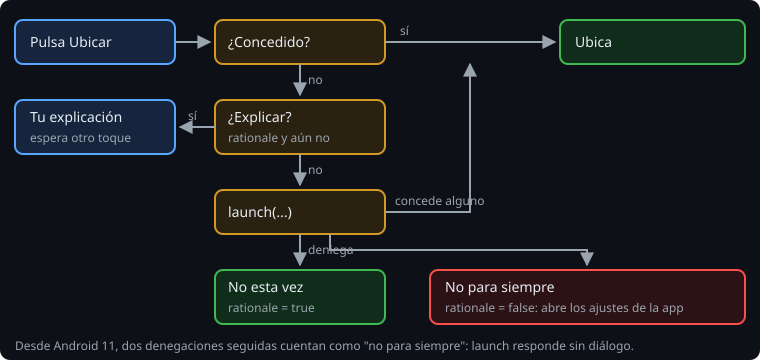

# Pedir un permiso

> Pedir un permiso es una conversación con el usuario, y se puede hacer mal de muchas formas: pedirlo al abrir la app sin que se sepa para qué, insistir después de un "no", o dejar al usuario sin salida cuando ya no se puede preguntar más. La API es corta. Lo que lleva trabajo es el flujo.

## 🎯 Objetivos

- Pedir uno o varios permisos con los contratos de Activity Result
- Recorrer el flujo completo: concedido, explicación, petición, denegado y denegado para siempre
- Llevar al usuario a los ajustes cuando ya no se puede preguntar
- Hacer que lint compruebe que nadie usa lo que protege un permiso sin mirar antes

## 1. El contrato

Pedir un permiso es una pantalla del sistema que devuelve un resultado: va con Activity Result, como en la semana 18.

```kotlin
private val requestLocation = registerForActivityResult(ActivityResultContracts.RequestMultiplePermissions()) { granted ->
    // granted: Map<String, Boolean>, un valor por permiso pedido
}

requestLocation.launch(arrayOf(ACCESS_COARSE_LOCATION, ACCESS_FINE_LOCATION))
```

`RequestPermission` pide uno y devuelve un `Boolean`. `RequestMultiplePermissions` pide varios a la vez y devuelve un mapa:

> 🔬 Medido en la sonda: con la aproximada concedida y la precisa denegada, el mapa es `{ACCESS_COARSE_LOCATION=true, ACCESS_FINE_LOCATION=false}`.

Si el permiso ya está concedido, el contrato no abre ningún diálogo: responde que sí, sin preguntar. La respuesta llega por el hilo principal, después de `launch`:

> 🔬 Medido en la sonda: con el permiso concedido antes, `lastRequestedPermission` es `null` y el callback recibe `true` en cuanto se procesa la cola del hilo principal.

## 2. El flujo



```kotlin
fun onLocate() {
    when {
        granted(ACCESS_COARSE_LOCATION) -> locate()
        shouldShowRequestPermissionRationale(ACCESS_FINE_LOCATION) && !explained -> {
            explained = true
            status.setText(R.string.rationale)
        }
        else -> requestLocation.launch(arrayOf(ACCESS_COARSE_LOCATION, ACCESS_FINE_LOCATION))
    }
}
```

`shouldShowRequestPermissionRationale` devuelve `true` cuando el usuario ya ha dicho "no" una vez y Android cree que conviene explicar para qué sirve el permiso antes de volver a pedirlo. La primera vez, y cuando el usuario ya ha dicho "no" para siempre, devuelve `false`.

Esa ambigüedad se resuelve en el callback. Después de una denegación:

- `shouldShowRequestPermissionRationale` es `true`: el usuario dijo "no" esta vez. Se puede volver a pedir más adelante.
- Es `false`: dijo "no" para siempre. Desde Android 11, dos denegaciones seguidas cuentan como "no volver a preguntar": `launch` ya no muestra el diálogo y devuelve `false` directamente.

Cuando ya no se puede preguntar, la única salida es la pantalla de ajustes de la app:

```kotlin
startActivity(Intent(Settings.ACTION_APPLICATION_DETAILS_SETTINGS, "package:$packageName".toUri()))
```

> 🔬 Medido en el ejercicio 01: el Intent es `android.settings.APPLICATION_DETAILS_SETTINGS` con `package:dev.bitacora.agro`.

## 3. Cuándo pedir

- **Cuando el usuario hace algo que lo necesita**, no al abrir la app. Si pulsa "Ubicar", entiende por qué aparece el diálogo.
- **La app sigue funcionando sin él.** La observación se guarda igual, sin ubicación. Un permiso denegado no puede dejar la pantalla rota ni en un bucle de peticiones.
- **Explicar es texto tuyo**, en tu pantalla, no un diálogo del sistema: el sistema solo pregunta sí o no.

## 4. Lint vigila

Las APIs que necesitan un permiso llevan una anotación (`@RequiresPermission`). Lint comprueba que antes de llamarlas, **en el mismo método**, haya una comprobación:

```text
MainActivity.kt:77: Error: Call requires permission which may be rejected by user: code should explicitly check to see if permission is available (with checkPermission) or explicitly handle a potential SecurityException [MissingPermission]
```

> 🔬 Medido en el ejercicio 01, paso 7a: con `ContextCompat.checkSelfPermission(...)` al principio del método, lint pasa. Si la comprobación está en una función tuya (`granted(...)`), lint no la ve y para el build.

`@SuppressLint("MissingPermission")` lo silencia, pero esconde justo el fallo que lint busca: una llamada sin comprobar acaba en `SecurityException` y cierra la app.

## ✅ Comprueba

- [ ] ¿Qué devuelve `shouldShowRequestPermissionRationale` la primera vez? ¿Y después de un "no"? ¿Y después de dos?
- [ ] El usuario dijo "no" dos veces. ¿Qué pasa si la app vuelve a llamar a `launch`?
- [ ] ¿Por qué lint no acepta una comprobación hecha en otra función?
