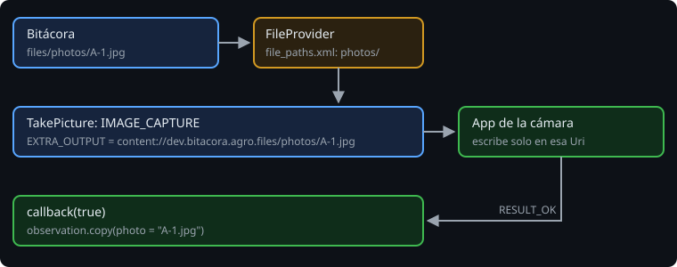

# Cámara y fotos

> Hay tres formas de que una observación tenga foto: pedirle una a la app de la cámara, dejar que el usuario elija una de la galería, o meter la cámara dentro de la app. Las dos primeras no necesitan ningún permiso. La tercera, sí. La Bitácora usa la primera, y el truco está en cómo se le presta un archivo a otra app sin abrirle la puerta a todos los demás.

## 🎯 Objetivos

- Elegir entre la app de la cámara, el selector de fotos y la cámara dentro de la app
- Prestar un archivo con `FileProvider` y una `Uri` `content://`
- Hacer una foto con `TakePicture` que sobreviva a la muerte del proceso

## 1. Tres caminos

| Camino | Permiso | Qué obtienes |
| --- | --- | --- |
| La app de la cámara (`TakePicture`) | Ninguno | La foto completa, en el archivo que le das |
| El selector de fotos (`PickVisualMedia`) | Ninguno | Una `Uri` para leer una foto que ya existe |
| La cámara dentro de tu app (CameraX) | `CAMERA` | Control total: vista previa, enfoque, análisis |

Con `TakePicture`, quien usa la cámara es la app de la cámara, que ya tiene su permiso. Tu app no lo necesita.

Hay una trampa: si tu manifiesto **declara** `CAMERA` (porque otra pantalla usa CameraX, por ejemplo) y el usuario no lo ha concedido, abrir la app de la cámara con `ACTION_IMAGE_CAPTURE` lanza `SecurityException` (documentación de `MediaStore.ACTION_IMAGE_CAPTURE`, webgrafía). Si declaras `CAMERA`, lo pides antes también para `TakePicture`. La Bitácora no lo declara.

## 2. `FileProvider`

`TakePicture` recibe la `Uri` del archivo donde la cámara tiene que guardar la foto. Ese archivo es de la Bitácora (`filesDir/photos/A-1.jpg`), y la app de la cámara no puede escribir en las carpetas de otra app. Un `file://` tampoco vale: desde Android 7, sacar uno de tu app en un Intent lanza `FileUriExposedException`.



`FileProvider`, de `androidx.core`, convierte el archivo en una `Uri` `content://` y da permiso solo a la app que recibe el Intent, solo para ese archivo y solo mientras lo usa.

```xml
<provider
    android:name="androidx.core.content.FileProvider"
    android:authorities="${applicationId}.files"
    android:exported="false"
    android:grantUriPermissions="true">
    <meta-data
        android:name="android.support.FILE_PROVIDER_PATHS"
        android:resource="@xml/file_paths" />
</provider>
```

```xml
<!-- res/xml/file_paths.xml: solo esta carpeta se puede prestar -->
<paths>
    <files-path name="photos" path="photos/" />
</paths>
```

```kotlin
val file = File(filesDir, "photos/${observation.code}.jpg").apply { parentFile?.mkdirs() }
takePicture.launch(FileProvider.getUriForFile(this, "$packageName.files", file))
```

> 🔬 Medido en la sonda y en el proyecto:
> - La `Uri` es `content://dev.bitacora.agro.files/photos/A-1.jpg`: la autoridad, el `name` de `file_paths.xml` y el archivo.
> - `TakePicture` lanza `android.media.action.IMAGE_CAPTURE` con la `Uri` en `EXTRA_OUTPUT` y los permisos de lectura y escritura de esa `Uri` (`flags=3`).
> - Devuelve `true` si la cámara guardó la foto, y `false` si el usuario volvió atrás.

`exported="false"` y `grantUriPermissions="true"` no son opcionales: `FileProvider` no funciona exportado. Nadie puede leer tus archivos salvo la app a la que se los prestas.

## 3. La cámara mata tu app

La app de la cámara necesita mucha memoria. Mientras el usuario hace la foto, es normal que Android mate el proceso de la Bitácora. Al volver, la pantalla se crea de nuevo y el resultado llega a la actividad nueva, como en la semana 18.

Lo que la pantalla sabía antes de abrir la cámara tiene que estar en el Intent o en el estado guardado. En el proyecto, el nombre de la foto ya hecha se guarda en `onSaveInstanceState`:

> 🔬 Medido en el proyecto: con la foto pedida, el estado guardado y la actividad recreada, `dispatchResult(requestCode, RESULT_OK, null)` llega al callback de `TakePicture` en la pantalla nueva, que ya tiene la observación.

## 4. `FileProvider` en Robolectric

Robolectric da a cada test una carpeta de datos distinta, pero `FileProvider` guarda en una variable estática (`sCache`) las carpetas que leyó la primera vez:

```text
java.lang.IllegalArgumentException: Failed to find configured root that contains /tmp/robolectric-.../files/photos/A-1.jpg
```

> 🔬 Medido en el proyecto: el primer test pasa y los siguientes fallan con ese mensaje. Vaciar `sCache` con reflexión antes de cada test lo resuelve.

## ✅ Comprueba

- [ ] ¿Por qué la Bitácora no declara `CAMERA`, y qué pasaría si lo declarase sin pedirlo?
- [ ] ¿Qué gana `content://` frente a `file://`?
- [ ] La cámara guardó la foto, pero la Bitácora murió mientras tanto. ¿Qué tiene que estar guardado para que la observación no la pierda?
