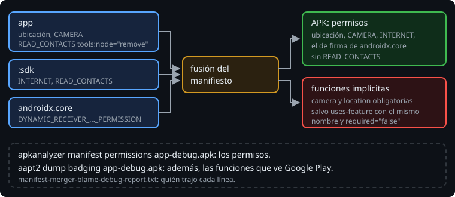

# Permisos en el build

> El manifiesto de tu APK no es el tuyo: es el tuyo fusionado con el de cada biblioteca. Un SDK de analítica puede añadir un permiso que tu app nunca usa, y un permiso puede hacer que Google Play esconda tu app en los móviles sin GPS. Las dos cosas se ven en el APK y se corrigen en el manifiesto.

## 🎯 Objetivos

- Encontrar de dónde viene cada permiso del APK y quitar los que sobran
- Entender las funciones de hardware (`uses-feature`) que se deducen de los permisos
- Comprobar todo eso en el APK, con `apkanalyzer` y `aapt2`

## 1. La fusión del manifiesto



Como los recursos en la semana 17, los manifiestos se fusionan: el de la app, el de cada tipo de build y el de cada biblioteca. Los permisos de una biblioteca acaban en tu APK:

> 🔬 Medido en el ejercicio 02: el módulo `:sdk` declara `INTERNET` y `READ_CONTACTS`, y los dos aparecen en `apkanalyzer manifest permissions` de la app.

Para saber quién trajo cada línea, AGP escribe un informe de la fusión:

```text
app/build/intermediates/manifest_merge_blame_file/debug/processDebugMainManifest/manifest-merger-blame-debug-report.txt
```

```text
23    <uses-permission android:name="android.permission.READ_CONTACTS" />
23-->[:sdk] .../sdk/build/intermediates/merged_manifest/debug/processDebugManifest/AndroidManifest.xml:9:5-72
```

> 🔬 Medido en el ejercicio 02, paso 7a.

Un permiso que no quieres se quita desde tu manifiesto, con un marcador de la fusión:

```xml
<manifest xmlns:android="http://schemas.android.com/apk/res/android"
    xmlns:tools="http://schemas.android.com/tools">

    <uses-permission
        android:name="android.permission.READ_CONTACTS"
        tools:node="remove" />
```

Quitarlo no cambia el código del SDK. Si de verdad lo necesita, fallará al usarlo (`SecurityException`), y eso es mejor que pedir los contactos de tus usuarios sin saberlo.

## 2. Funciones de hardware

Google Play solo enseña tu app a los móviles que tienen las funciones de hardware que pide. Algunas se deducen de los permisos:

```bash
$ANDROID_HOME/build-tools/36.0.0/aapt2 dump badging app-debug.apk
```

```text
uses-feature: name='android.hardware.camera'
uses-implied-feature: name='android.hardware.camera' reason='requested android.permission.CAMERA permission'
uses-feature: name='android.hardware.location'
uses-implied-feature: name='android.hardware.location' reason='requested android.permission.ACCESS_COARSE_LOCATION permission, and requested android.permission.ACCESS_FINE_LOCATION permission'
```

> 🔬 Medido en la sonda.

`CAMERA` implica que la app **necesita** cámara, y los permisos de ubicación, que necesita ubicación. Una tablet sin cámara no vería la Bitácora en Google Play. Si la app funciona sin ellas, se dice en el manifiesto:

```xml
<uses-feature android:name="android.hardware.camera" android:required="false" />
<uses-feature android:name="android.hardware.location" android:required="false" />
```

Y la app comprueba en ejecución si las tiene (`packageManager.hasSystemFeature(...)`).

El nombre tiene que ser el mismo que el de la función implícita:

> 🔬 Medido en la sonda: con `android.hardware.camera.any` como no obligatoria, `aapt2` sigue mostrando `uses-feature: name='android.hardware.camera'`, que viene de `CAMERA`. Igual con `android.hardware.location.gps`, que deja `android.hardware.location` como obligatoria. Solo los nombres exactos (`android.hardware.camera` y `android.hardware.location`) quitan las implícitas.

## 3. En la Bitácora

El proyecto no añade ninguna dependencia: `FileProvider`, `LocationManagerCompat` y los contratos de permisos están en `androidx.core` y `androidx.activity`, que ya estaban. La verificación de dependencias no cambia (semana 14).

> 🔬 Medido en el proyecto: `--write-verification-metadata` no cambia `gradle/verification-metadata.xml`.

El APK lleva los dos permisos de ubicación y el de firma de `androidx.core`, y no lleva `CAMERA`. Un test de `BuildTest.kt` lo comprueba, así que un permiso nuevo, tuyo o de una biblioteca, para los tests hasta que alguien lo decida.

## ✅ Comprueba

- [ ] Tu APK lleva `READ_CONTACTS` y tu código no lo usa. ¿Cómo sabes de dónde viene y cómo lo quitas?
- [ ] ¿Por qué una app con `CAMERA` desaparece de Google Play en las tablets sin cámara?
- [ ] ¿Por qué no basta con `android.hardware.camera.any` como no obligatoria?
