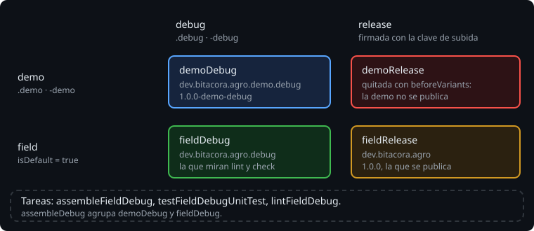

# Flavors y variantes

> Un tipo de build cambia cómo se construye la app. Un flavor cambia qué app se construye: una demo con datos de ejemplo, una versión gratuita y otra de pago, una para cada cliente. Los dos se cruzan, y cada combinación es una variante con sus propias tareas. Pocas líneas en el build multiplican lo que Gradle tiene que construir, así que hay que saber cuántas variantes hay y quitar las que sobran.

## 🎯 Objetivos

- Declarar una dimensión y sus flavors
- Saber qué variantes salen y cómo se llaman sus tareas
- Quitar las que no quieres y elegir la que miran `lint` y `check`

## 1. Dimensión y flavors

```kotlin
flavorDimensions += "environment"
productFlavors {
    create("demo") {
        dimension = "environment"
        applicationIdSuffix = ".demo"
        versionNameSuffix = "-demo"
    }
    create("field") {
        dimension = "environment"
    }
}
```

Todo flavor pertenece a una dimensión.

> 🔬 Medido en el ejercicio 01: sin `flavorDimensions`, el build falla con `All flavors must now belong to a named flavor dimension.` Con una sola dimensión declarada, un flavor sin `dimension` va a esa.

Con una sola dimensión, cada variante tiene un flavor y un tipo de build. Con dos (por ejemplo `environment` y `tier`, gratis o de pago), tendría uno de cada dimensión.

Un flavor admite casi lo mismo que `defaultConfig`: `applicationIdSuffix`, `versionNameSuffix`, `minSdk`, `buildConfigField`... Los sufijos se suman, primero el del flavor y después el del tipo de build:

> 🔬 Medido en la sonda: `demoDebug` es `dev.bitacora.agro.demo.debug`, con versión `1.0.0-demo-debug`.

## 2. La matriz



Dos flavors por dos tipos de build son cuatro variantes: `demoDebug`, `demoRelease`, `fieldDebug` y `fieldRelease`. Cada una tiene sus tareas, con el nombre de la variante dentro:

| Tarea | Qué hace |
| --- | --- |
| `assembleFieldDebug` | Construye una variante |
| `assembleDebug` | Las de debug de todos los flavors |
| `assembleField` | Las de todos los tipos de build de `field` |
| `testFieldDebugUnitTest` | Los tests de la JVM de una variante |
| `lintFieldDebug` | Lint de una variante |

Las tareas de siempre que nombran un tipo de build sin el flavor dejan de existir, y Gradle no adivina:

> 🔬 Medido en la sonda: `./gradlew :app:lintDebug` falla con `Cannot locate tasks that match ':app:lintDebug' as task 'lintDebug' is ambiguous in project ':app'. Candidates are: ... 'lintDemoDebug', ... 'lintFieldDebug', ...`. Igual con `testDebugUnitTest`. `assembleDebug` sigue existiendo, porque agrupa las variantes.

Los tests de la JVM, solo para debug:

> 🔬 Medido en la sonda: `./gradlew test` ejecuta `testDemoDebugUnitTest` y `testFieldDebugUnitTest`; no hay `testFieldReleaseUnitTest`. Cada test de `src/test` se ejecuta una vez por flavor. `./gradlew test --tests ...` falla con `Unknown command-line option '--tests'`: `test` solo agrupa, y `--tests` se le pasa a la tarea de una variante, `testFieldDebugUnitTest --tests ...`.

## 3. Quitar variantes

La demo no se publica. Su release no sirve de nada, pero Gradle la configura igual. Se quita antes de que exista:

```kotlin
androidComponents {
    beforeVariants(selector().withFlavor("environment" to "demo").withBuildType("release")) { it.enable = false }
}
```

> 🔬 Medido en la sonda: sin `demoRelease`, `./gradlew :app:assembleDemoRelease` falla con `Cannot locate tasks that match ':app:assembleDemoRelease' as task 'assembleDemoRelease' not found in project ':app'.`, y `assembleRelease` construye solo `fieldRelease`.

`androidComponents` es la API de variantes de AGP. Ya la usaste en la semana 12: el plugin de `build-info` añade sus assets a cada variante con `onVariants`. `beforeVariants` actúa antes, cuando todavía se puede decidir si la variante existe ([teoría 04](04-buildconfig-y-la-api-de-variantes.md)).

## 4. La variante por defecto

Algunas tareas no recorren todas las variantes: eligen una. `lint` y `check` son las importantes:

> 🔬 Medido en la sonda: `./gradlew :app:lint --dry-run` ejecuta `lintDemoDebug`, y ningún lint de `field`. `check` igual. La Bitácora de verdad se quedaría sin lint.

Sin decirle nada, AGP eligió `demo`. Para elegir tú:

```kotlin
create("field") {
    dimension = "environment"
    isDefault = true
}
```

> 🔬 Medido en la sonda: con `isDefault = true` en `field`, `lint` ejecuta `lintFieldDebug`.

Android Studio también abre por defecto la variante marcada con `isDefault`.

## ✅ Comprueba

- [ ] Con dos flavors, dos tipos de build y `demoRelease` quitada, ¿cuántas variantes hay? ¿Cuántas veces se ejecuta cada test de `src/test` con `./gradlew test`?
- [ ] ¿Por qué deja de funcionar `lintDebug` y sigue funcionando `assembleDebug`?
- [ ] ¿Qué variante mira `check` si no dices nada? ¿Por qué importa?
