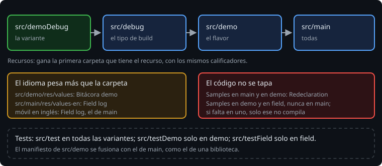

# Source sets por variante

> Cambiar un sufijo es fácil. Lo interesante es que una variante tenga otro código, otros textos u otros tests. Cada flavor y cada tipo de build tiene su carpeta en `src/`, al lado de `main`. Los recursos de una carpeta tapan los de otra, en un orden fijo; el código no se tapa: se suma, y una clase repetida no compila.

## 🎯 Objetivos

- Poner código, recursos y manifiesto en la carpeta de una variante
- Saber qué recurso gana cuando hay varios, y por qué el idioma puede cambiarlo
- Separar los tests de cada flavor

## 1. Una carpeta por variante

Además de `src/main`, AGP lee estas carpetas, si existen:

```
app/src/
├── main/          # todas las variantes
├── demo/          # flavor demo
├── field/         # flavor field
├── debug/         # tipo de build debug
├── demoDebug/     # solo la variante demoDebug
├── test/          # tests de la JVM de todas las variantes
├── testDemo/      # tests de la JVM solo de demo
└── testField/     # tests de la JVM solo de field
```

Cada una tiene la misma forma que `main`: `kotlin/`, `res/`, `assets/`, `AndroidManifest.xml`.

## 2. Los recursos se tapan



Si varias carpetas tienen el mismo recurso, gana la más concreta: la variante, después el tipo de build, después el flavor, y por último `main`.

> 🔬 Medido en la sonda, con `app_name` en cuatro carpetas: en `demoDebug` gana `src/demoDebug`; sin ella, `src/debug`, aunque exista `src/demo`; en `fieldDebug`, `src/debug`.

Solo hace falta poner lo que cambia. `src/demo/res/values/strings.xml` puede tener solo `app_name`, y el resto de textos sale de `main`.

Cuidado con los idiomas. El orden de las carpetas decide entre recursos con los **mismos** calificadores. Si `main` tiene una traducción (`values-en`) y el flavor solo tiene `values`, en un móvil en inglés gana la de `main`: un calificador que coincide con el móvil pesa más que la carpeta (semana 17).

> 🔬 Medido en el ejercicio 01: sin `src/demo/res/values-en`, la demo en inglés se llama `Field log`, el nombre de `main`. El test falla con `expected:<Field log[ demo]> but was:<Field log[]>`.

Cada traducción que tapes la tienes que tapar en todos los idiomas.

## 3. El código se suma

Las clases de `src/main/kotlin` y de `src/demo/kotlin` se compilan juntas en `demoDebug`. No se tapan:

> 🔬 Medido en el ejercicio 01: con `Samples` en `main` y en `demo`, la compilación falla con `Redeclaration:` en los dos archivos.

Para que una clase sea distinta en cada flavor, va en la carpeta de **cada** flavor, y no en `main`. El código de `main` la usa sin saber cuál es:

```kotlin
// src/demo/kotlin/dev/bitacora/Samples.kt
object Samples {
    val observations = listOf(Observation("A-1", Level.HIGH, "riego roto en el sector norte"), ...)
}

// src/field/kotlin/dev/bitacora/Samples.kt
object Samples {
    val observations = emptyList<Observation>()
}
```

Si se te olvida en un flavor, solo falla ese:

> 🔬 Medido en la sonda: sin `src/field/.../Samples.kt`, `compileDemoDebugKotlin` pasa y `compileFieldDebugKotlin` falla con `Unresolved reference 'Samples'`.

Por eso `./gradlew build` construye todas las variantes: una que no compila se nota antes de publicar.

## 4. El manifiesto también se fusiona

El manifiesto de `src/demo` se fusiona con el de `main`, como el de una biblioteca (semana 19). Así, un flavor puede tener un permiso, una actividad o un `intent-filter` que el otro no tiene. Se comprueba igual: en el APK de la variante y con el informe de la fusión de esa variante (`manifest_merge_blame_file/fieldDebug/...`).

## 5. Tests por flavor

`src/test` se ejecuta en todas las variantes de debug. Si un test vale para un solo flavor, va en `src/testDemo` o `src/testField`:

> 🔬 Medido en la sonda: un test en `src/testDemo` aparece en `testDemoDebugUnitTest` y no en `testFieldDebugUnitTest`.

En el proyecto lo notarás enseguida. Cuando la demo arranca con tres observaciones de ejemplo, los tests que dan por hecho una Bitácora vacía fallan en demo:

> 🔬 Medido en el proyecto: con las observaciones de ejemplo en demo, `testDemoDebugUnitTest` falla en 14 de 23 tests y `testFieldDebugUnitTest` pasa.

Esos tests son de la Bitácora de campo. Su sitio es `src/testField`. La demo tiene los suyos.

## ✅ Comprueba

- [ ] `app_name` está en `src/main`, `src/demo` y `src/debug`. ¿Cuál sale en `demoDebug`? ¿Y en inglés, si solo `main` tiene `values-en`?
- [ ] ¿Por qué puedes tapar un texto de `main` desde `src/demo` y no puedes tapar una clase?
- [ ] ¿Dónde pondrías un test que solo vale para la demo?
