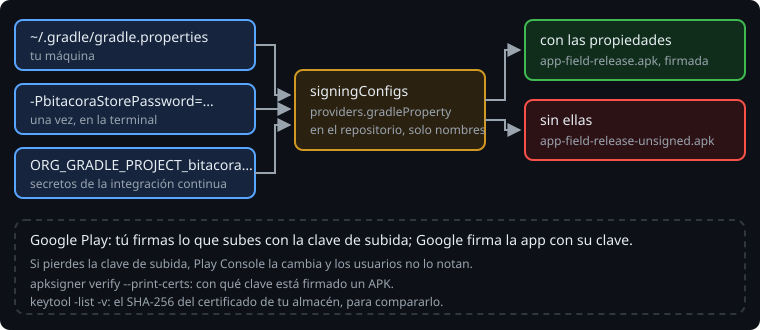

# Firma

> Android no instala un APK sin firmar, y no actualiza una app con un APK firmado por otra clave. La firma dice quién hizo la app, y es la misma toda su vida. Hasta ahora firmaba la clave de debug de tu máquina sin que lo supieras. La de release es otra cosa: si se pierde, ya no puedes actualizar la app con esa clave; si se filtra, otro puede firmar en tu nombre. Por eso no va en el repositorio, ni ella ni sus contraseñas.

## 🎯 Objetivos

- Ver con qué clave está firmado un APK
- Crear una clave de subida y firmar el release sin que las contraseñas entren en el repositorio
- Entender la firma de apps de Google Play: tu clave de subida y la de Google

## 1. La clave de debug

La primera vez que construyes, AGP crea `~/.android/debug.keystore`, con una clave que firma todos tus APK de debug. Es la misma para todas tus apps y todas tus variantes de debug:

```bash
./gradlew :app:signingReport
```

```text
Variant: fieldDebug
Config: debug
Store: /home/tú/.android/debug.keystore
Alias: AndroidDebugKey
SHA-256: 47:C9:05:50:...
----------
Variant: fieldRelease
Config: none
```

> 🔬 Medido en la sonda. `Config: none` es un release sin firma: sale `app-field-release-unsigned.apk`.

Cada máquina tiene la suya. Un APK de debug construido en otra máquina no actualiza el tuyo: hay que desinstalar antes (documentación oficial).

## 2. Ver la firma

`apksigner` (en `build-tools`) verifica un APK como lo haría Android al instalarlo:

```bash
$ANDROID_HOME/build-tools/36.0.0/apksigner verify --print-certs -v app-field-debug.apk
```

```text
Verified using v1 scheme (JAR signing): false
Verified using v2 scheme (APK Signature Scheme v2): true
Verified using v3 scheme (APK Signature Scheme v3): false
Signer #1 certificate DN: C=US, O=Android, CN=Android Debug
Signer #1 certificate SHA-256 digest: 47c905501d9f...
```

> 🔬 Medido en la sonda. Sin firma: `DOES NOT VERIFY` y `ERROR: Missing META-INF/MANIFEST.MF`.

Los esquemas son versiones del formato de firma. v1 (JAR) es el de Android 6 y anteriores, y AGP solo lo añade si la app se instala en ellos:

> 🔬 Medido en el ejercicio 02: con `minSdk = 26`, solo v2; con `minSdk = 23`, v1 y v2.

## 3. La clave de subida

```bash
keytool -genkeypair -keystore ~/claves/bitacora-upload.jks -alias upload \
    -keyalg RSA -keysize 2048 -validity 10000 -dname "CN=Bitacora upload, O=Tu nombre, C=ES"
```

`keytool` viene con el JDK y pide las contraseñas. El archivo es un almacén PKCS12 con una clave privada y su certificado. `-validity 10000` son unos 27 años: Google Play exige que la clave sea válida hasta después de 2033 (documentación oficial).

> 🔬 Medido en la sonda: `keytool -list -v` da el mismo SHA-256 del certificado que `apksigner`. Así compruebas que un APK está firmado con tu clave.

El almacén va **fuera** del proyecto, y con copia de seguridad.

## 4. Firmar sin secretos en el repositorio



Lo que nunca se hace:

```kotlin
signingConfigs {
    create("release") {
        storeFile = file("upload.jks")
        storePassword = "bitacora123"   // cualquiera que clone el repositorio la tiene
        keyAlias = "upload"
        keyPassword = "bitacora123"
    }
}
```

Las contraseñas y la ruta del almacén llegan como propiedades de Gradle:

```kotlin
val storeFile = providers.gradleProperty("bitacoraStoreFile")
signingConfigs {
    create("release") {
        this.storeFile = storeFile.orNull?.let(::file)
        storePassword = providers.gradleProperty("bitacoraStorePassword").orNull
        keyAlias = providers.gradleProperty("bitacoraKeyAlias").orNull
        keyPassword = providers.gradleProperty("bitacoraKeyPassword").orNull
    }
}
buildTypes {
    release {
        if (storeFile.isPresent) signingConfig = signingConfigs.getByName("release")
    }
}
```

Sin las propiedades, el release sale sin firmar y el build funciona en cualquier máquina. Si asignas la configuración sin el almacén, falla:

> 🔬 Medido en la sonda: `Keystore file not set for signing config release`. Con la ruta de un archivo que no existe: `Keystore file '.../app/upload.jks' not found for signing config 'release'.`

Las propiedades pueden venir de tres sitios, y ninguno es el repositorio:

| Dónde | Para quién |
| --- | --- |
| `~/.gradle/gradle.properties` | Tu máquina. Está fuera de todos tus proyectos |
| `-PbitacoraStorePassword=...` | Una vez, en la terminal (queda en el historial del shell) |
| `ORG_GRADLE_PROJECT_bitacoraStorePassword` | Un servidor de integración continua, con sus secretos como variables de entorno |

> 🔬 Medido en la sonda: con las cuatro `ORG_GRADLE_PROJECT_bitacora*` en el entorno y sin `-P`, el release sale firmado con la clave de subida.

Por eso los nombres no llevan puntos (`bitacoraStoreFile`, no `bitacora.storeFile`): un shell no deja exportar una variable con un punto en el nombre.

Si una contraseña está mal, el build para al empaquetar:

> 🔬 Medido en la sonda: con la del almacén mal, `KeytoolException: Failed to read key <alias> from store "...": keystore password was incorrect`. Con la de la clave mal: `Get Key failed: Given final block not properly padded. Such issues can arise if a bad key is used during decryption.`

Las propiedades son entradas de la configuración: si cambian, Gradle no reutiliza la caché de configuración (semana 13).

> 🔬 Medido en la sonda: `Calculating task graph as configuration cache cannot be reused because Gradle property 'bitacoraStoreFile' has changed.`

Gradle guarda la caché de configuración cifrada en `.gradle/configuration-cache` (documentación oficial). Aun así, `.gradle/` no se sube nunca al repositorio.

## 5. Firmar a mano

AGP firma con `apksigner`, que puedes usar tú sobre un APK sin firmar:

```bash
zipalign -c -v 4 app-field-release-unsigned.apk          # ya alineado: Verification successful
apksigner sign --ks ~/claves/bitacora-upload.jks --ks-key-alias upload --out app-field-release.apk app-field-release-unsigned.apk
```

> 🔬 Medido en la sonda: el APK sin firmar de AGP ya está alineado. `apksigner sign` firma con v2 y v3, y escribe al lado un `.idsig` (v4, para instalar mientras se descarga). AGP, con `minSdk = 26`, solo v2.

## 6. La firma de Google Play

Con un AAB (fase 7), Google Play firma la app que llega a los móviles con **su** clave, la clave de firma de la app, que guarda Google. Tú firmas lo que subes con tu **clave de subida**, y Google comprueba que eres tú (documentación oficial).

La diferencia importa cuando algo sale mal:

- Si pierdes la clave de subida, o se filtra, pides en Play Console que la cambien. Los usuarios no notan nada, porque la app sigue firmada con la clave de Google.
- Sin la firma de Google Play, la clave que firma los APK es la de la app: perderla significa no poder actualizar nunca esa app.

## ✅ Comprueba

- [ ] ¿Cómo compruebas que un APK está firmado con tu clave de subida y no con la de debug?
- [ ] ¿Por qué el release sale sin firmar en vez de fallar cuando no están las propiedades?
- [ ] Un compañero sube `upload.jks` al repositorio "porque es privado". ¿Qué haces, y qué cambia si usáis la firma de Google Play?
