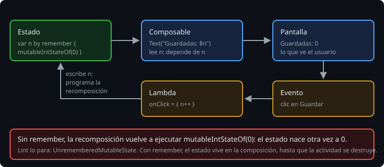

# Estado y recomposición

> Un composable no cambia la pantalla: la describe. Si el texto de un contador tiene que pasar de 0 a 1, no le dices al `Text` que cambie; cambias el número, y Compose vuelve a llamar a la función que lo lee. Eso es la recomposición. Para que funcione, el número tiene que ser un estado de Compose, y tiene que sobrevivir a la propia recomposición. Lo primero es `mutableStateOf`; lo segundo, `remember`.

## 🎯 Objetivos

- Entender la recomposición: la pantalla es una función del estado
- Guardar estado con `mutableStateOf` y `remember`
- Reconocer el error de crear estado sin `remember`, en lint y en la pantalla

## 1. La pantalla es una función del estado



Con vistas, cada cambio eran dos pasos: cambiar el dato y acordarte de cambiar la vista (`summary.text = ...`). Si se te olvidaba el segundo, la pantalla mentía. En Compose solo hay un paso: cambias el dato. Compose sabe qué composables lo leyeron en la última pasada y vuelve a ejecutar esos, con el valor nuevo.

Para eso, el dato tiene que ser observable por Compose. `mutableStateOf` crea un `MutableState<T>`: leer su `value` dentro de un composable lo apunta como dependencia, y escribirlo programa una recomposición de quien lo leyó.

```kotlin
val count = mutableStateOf(0)
Text("${count.value}")                // lee: este Text depende de count
Button(onClick = { count.value++ })   // escribe: programa la recomposición
```

Con `by` se lee y se escribe como una variable. Hacen falta dos imports, que el IDE no siempre añade:

```kotlin
import androidx.compose.runtime.getValue
import androidx.compose.runtime.setValue

var count by mutableStateOf(0)
```

> 🔬 Medido en el ejercicio 01: sin `import androidx.compose.runtime.getValue`, el compilador da `Property delegate must have a 'getValue(Nothing?, KMutableProperty0<*>)' method`.

Para números hay versiones sin boxing: `mutableIntStateOf`, `mutableLongStateOf`, `mutableFloatStateOf`, `mutableDoubleStateOf`.

## 2. remember

Una recomposición vuelve a ejecutar la función entera. Si la función crea el estado, lo crea otra vez, con el valor inicial:

```kotlin
@Composable
fun Forgetful() {
    var n by mutableIntStateOf(0)          // cada recomposición, otra vez 0
    Button(onClick = { n++ }) { Text("olvida: $n") }
}
```

> 🔬 Medido en la sonda: tras pulsar el botón, la pantalla sigue diciendo `olvida: 0`. El clic sube `n` a 1, eso programa una recomposición, y la recomposición crea un `n` nuevo que vale 0.

`remember` guarda un valor en la composición, en el sitio donde se llamó, y lo devuelve igual en las recomposiciones siguientes. La lambda solo se ejecuta la primera vez:

```kotlin
var n by remember { mutableIntStateOf(0) }
```

Este error es tan común que lint lo para:

> 🔬 Medido en la sonda y en el ejercicio 01: `lintDebug` falla con `Error: Creating a state object during composition without using remember [UnrememberedMutableState from androidx.compose.runtime]`. La regla viene dentro de la biblioteca `runtime`, no de AGP: la trae el BOM.

En el ejercicio 01, quitar el `remember` del nivel hace que al pulsar "Alta" no se quede marcado: `savingNeedsATextAndALevel` y otros tres fallan.

## 3. Lo que guarda remember, y dónde

`remember` guarda el valor en la composición. Mientras el composable siga en pantalla, el valor sigue ahí. Cuando sale de la composición (por ejemplo, un `if` que deja de pintarlo), se pierde. Y cuando la actividad se destruye, se pierde la composición entera:

> 🔬 Medido en la sonda: un contador con `remember` y otro con `rememberSaveable`, los dos a 1. Tras `ActivityScenario.recreate()`, que es lo que hace un giro, el de `remember` vale 0 y el de `rememberSaveable`, 1.

Lo que tiene que sobrevivir a un giro es la [teoría 03](03-remembersaveable.md).

## 4. Cuándo recompone

No hace falta pensar en ello para que la pantalla sea correcta: si el estado cambia, lo que lo lee se vuelve a pintar. Sí hace falta para no hacer trabajo de más:

- Un composable puede ejecutarse muchas veces, en cualquier orden. No escribas en él nada que no sea pintar: ni guardar en disco, ni llamar a la red, ni cambiar un estado mientras se pinta.
- Compose se salta los composables cuyos parámetros no han cambiado. Qué cuenta como "no han cambiado" (la estabilidad de los tipos) y cómo medirlo con los informes del compilador es la semana 26.

## ✅ Comprueba

- [ ] ¿Qué diferencia hay entre `count.value++` en un `MutableState` y `summary.text = ...` en una vista?
- [ ] Sin `remember`, ¿por qué el contador vuelve a 0 justo después de sumar uno?
- [ ] ¿Qué se pierde al girar el móvil si el estado está en `remember`?
