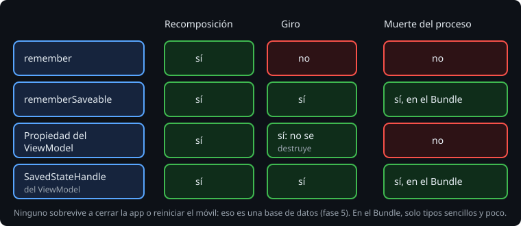

# rememberSaveable

> En la semana 16 viste que un giro destruye la actividad y que Android puede matar el proceso cuando la app está detrás. Lo que no se guardó en el `Bundle` se pierde. En Compose pasa lo mismo, con otra forma: `remember` vive en la composición, y la composición muere con la actividad. `rememberSaveable` guarda además el valor en el `Bundle`, y lo devuelve en la composición nueva.

## 🎯 Objetivos

- Saber qué sobrevive a qué: recomposición, giro y muerte del proceso
- Usar `rememberSaveable` y conocer su límite: lo que cabe en un `Bundle`
- Probarlo con `StateRestorationTester` y con la actividad de verdad

## 1. Qué sobrevive a qué



| Dónde está el estado | Recomposición | Giro | Muerte del proceso |
| --- | --- | --- | --- |
| `remember` | sí | no | no |
| `rememberSaveable` | sí | sí | sí |
| Propiedad del `ViewModel` | sí | sí | no |
| `SavedStateHandle` del `ViewModel` | sí | sí | sí |

> 🔬 Medido en la sonda y en los ejercicios: tras `recreate()`, un contador en `remember` vuelve a 0 y uno en `rememberSaveable` sigue en 1. Tras matar el proceso (`saveInstanceState` y una actividad nueva con ese `Bundle`), el borrador en `rememberSaveable` vuelve (ejercicio 01). Un `ViewModel` que lo guarda en un `MutableStateFlow` propio pasa el giro y pierde el borrador al matar el proceso; con el `SavedStateHandle`, lo recupera (ejercicio 02, paso 6).

Las dos últimas filas son la [teoría 05](05-viewmodel-y-stateflow.md). Las dos primeras son estado de la pantalla: lo que el usuario está escribiendo, qué está marcado, si una sección está abierta.

## 2. rememberSaveable

Se usa igual que `remember`:

```kotlin
var text by rememberSaveable { mutableStateOf("") }
var level by rememberSaveable { mutableStateOf<Level?>(null) }
var saved by rememberSaveable { mutableIntStateOf(0) }
```

Al destruirse la actividad, Compose guarda cada valor en el `Bundle` del estado de la actividad, con una clave que sale del sitio de la llamada. En la actividad nueva, el `rememberSaveable` del mismo sitio lo encuentra y lo devuelve.

> 🔬 Medido en el ejercicio 01: con `remember` en vez de `rememberSaveable` en el texto, fallan `theDraftSurvivesARotation` y `theDraftSurvivesProcessDeath`, y pasan los otros 7. El usuario no lo nota hasta que gira el móvil o vuelve a la app después de un rato: entonces lo que escribía ha desaparecido.

## 3. Solo lo que cabe en un Bundle

Un `Bundle` guarda tipos sencillos: números, `String`, arrays, listas de esos tipos, `Parcelable` y `Serializable`. Un `enum` es `Serializable`, así que `Level` cabe. Una `data class` cualquiera, no:

```kotlin
data class Draft(val text: String, val level: Level?)
var draft by rememberSaveable { mutableStateOf(Draft("", null)) }
```

> 🔬 Medido en el ejercicio 01 (paso 5c): `IllegalArgumentException: MutableState containing Draft(text=, level=null) cannot be saved using the current SaveableStateRegistry. The default implementation only supports types which can be stored inside the Bundle. Please consider implementing a custom Saver for this class`. Falla al pintar la pantalla, no al girarla: los 6 tests que pintan `DraftScreen` fallan.

Tres salidas, de más sencilla a más trabajo:

1. Guardar cada campo por separado, como hace el ejercicio 01.
2. Hacer la clase `Parcelable` con `@Parcelize` ([semana 18](../../week-18-intents_y_activity_result/1-teoria/01-intents-explicitos.md)).
3. Escribir un `Saver`, que dice cómo pasar el objeto a algo que cabe en un `Bundle` y cómo volver. `listSaver` y `mapSaver` lo hacen con una lista o un mapa:

```kotlin
val DraftSaver = listSaver<Draft, Any?>(
    save = { listOf(it.text, it.level) },
    restore = { Draft(it[0] as String, it[1] as Level?) },
)
var draft by rememberSaveable(stateSaver = DraftSaver) { mutableStateOf(Draft("", null)) }
```

> 🔬 Medido en el ejercicio 01: con el `Draft` y este `DraftSaver`, los 9 tests pasan.

El `Bundle` del estado viaja en un `Binder` con un límite de tamaño ([semana 16](../../week-16-actividades_y_ciclo_de_vida/1-teoria/03-guardar-el-estado.md)). Guarda en él lo que el usuario está haciendo, no los datos de la app: un borrador sí, mil observaciones no.

## 4. Probarlo

Para un composable suelto, `StateRestorationTester` simula el viaje por el `Bundle` sin crear otra actividad:

```kotlin
val tester = StateRestorationTester(rule)
tester.setContent { DraftScreen() }
rule.onNodeWithText("Descripción").performTextInput("plaga")
tester.emulateSavedInstanceStateRestore()
rule.onNodeWithText("plaga").assertExists()
```

Para la actividad de verdad, como en la semana 16: `Robolectric.buildActivity`, `saveInstanceState` y otra actividad con ese `Bundle`. La regla `createEmptyComposeRule()` encuentra lo que pinten las actividades del test ([teoría 04](04-el-estado-baja-los-eventos-suben.md)):

```kotlin
val first = Robolectric.buildActivity(MainActivity::class.java).setup()
rule.onNodeWithText("Descripción").performTextInput("plaga")
val saved = Bundle()
first.pause().stop().saveInstanceState(saved).destroy()
Robolectric.buildActivity(MainActivity::class.java).setup(saved)
rule.onNodeWithText("plaga").assertExists()
```

## ✅ Comprueba

- [ ] ¿Qué pierde el usuario si el texto que escribe está en `remember`? ¿Cuándo lo nota?
- [ ] ¿Por qué `rememberSaveable` acepta un `Level?` y no un `Draft`?
- [ ] ¿Qué diferencia hay entre probar con `StateRestorationTester` y con dos actividades de Robolectric?
