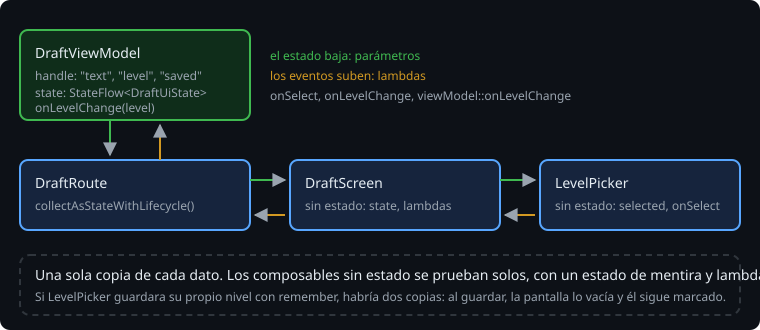

# El estado baja, los eventos suben

> Un composable con estado dentro es cómodo hasta que alguien de fuera necesita ese estado: para vaciarlo al guardar, para enseñarlo en otra parte, para probarlo. Entonces hay dos copias del mismo dato, y tarde o temprano dicen cosas distintas. La solución es subir el estado (*state hoisting*): el composable recibe el valor y una función para avisar de los cambios, y el estado vive arriba, en un solo sitio. Esta teoría es ese patrón y cómo se prueba un composable.

## 🎯 Objetivos

- Separar composables sin estado (pintan y avisan) de composables con estado
- Reconocer el error de tener dos fuentes de verdad
- Probar composables con `createComposeRule`, por su texto y su semántica

## 1. Sin estado y con estado



Un composable **sin estado** recibe todo lo que pinta y avisa de lo que pasa. No decide nada:

```kotlin
@Composable
fun LevelPicker(selected: Level?, onSelect: (Level) -> Unit) {
    Column {
        for (level in Level.entries) {
            Row(Modifier.selectable(selected = level == selected, onClick = { onSelect(level) }, role = Role.RadioButton)) {
                RadioButton(selected = level == selected, onClick = null)
                Text(stringResource(level.label))
            }
        }
    }
}
```

Es el mismo patrón que `TextField(value, onValueChange)` de Material: el campo no cambia su texto; avisa del texto nuevo, y quien lo usa decide.

Un composable **con estado** guarda el estado y se lo pasa a los de sin estado:

```kotlin
@Composable
fun DraftScreen() {
    var level by rememberSaveable { mutableStateOf<Level?>(null) }
    LevelPicker(selected = level, onSelect = { level = it })
    Button(onClick = { /* guardar */; level = null }) { Text(stringResource(R.string.save)) }
}
```

El estado baja como parámetros; los eventos suben como lambdas. Es el flujo de datos en una sola dirección (*unidirectional data flow*): para saber por qué la pantalla dice algo, miras un solo sitio.

## 2. Dos fuentes de verdad

Si `LevelPicker` guardara su propia copia del nivel, empezaría con el `selected` de fuera y después iría por su cuenta:

```kotlin
var current by remember { mutableStateOf(selected) }  // la lambda solo se ejecuta la primera vez
```

> 🔬 Medido en el ejercicio 01 (paso 5d): fallan `thePickerDoesNotChangeOnItsOwn` y `savingCountsAndClearsTheDraft`. El segundo es el interesante: al guardar, `DraftScreen` deja su nivel en `null`, pero el selector sigue marcando "Alta", porque su copia no se enteró. Dos sitios con el mismo dato, y la pantalla miente.

Regla práctica: sube el estado hasta el composable más bajo que lo necesite entero (el que lo lee y el que lo cambia). Si además tiene que sobrevivir a la muerte del proceso o lo usa la lógica de la app, súbelo hasta el `ViewModel` ([teoría 05](05-viewmodel-y-stateflow.md)).

## 3. Probar un composable

`ui-test-junit4` trae las reglas de JUnit 4 para Compose. Con Robolectric funcionan en la JVM, como los tests de actividades de las semanas 16 a 20:

| Regla | Qué pinta |
| --- | --- |
| `createComposeRule()` | Lo que le des con `rule.setContent { ... }`, en una actividad vacía |
| `createAndroidComposeRule<MainActivity>()` | La actividad que le digas; `rule.activity` es la actividad |
| `createEmptyComposeRule()` | Nada: encuentra lo que pinten las actividades que lances tú |

Se importan de `androidx.compose.ui.test.junit4.v2`:

> 🔬 Medido en la sonda: `androidx.compose.ui.test.junit4.createComposeRule` está deprecada en Compose 1.12 (`Use androidx.compose.ui.test.junit4.v2.createComposeRule instead`), y con `allWarningsAsErrors` el test no compila. La de `v2` usa `StandardTestDispatcher`, como los tests de corrutinas de la semana 6.

Los nodos se buscan como los ve el usuario, por su texto, y sobre ellos se actúa o se comprueba:

```kotlin
@get:Rule
val rule = createComposeRule()

@Test
fun thePickerTellsWhatWasChosen() {
    var chosen: Level? = null
    rule.setContent { LevelPicker(selected = null, onSelect = { chosen = it }) }
    rule.onNodeWithText("Alta").performClick()
    assertEquals(Level.HIGH, chosen)
}
```

- Buscar: `onNodeWithText`, `onAllNodes(...)`, `onNodeWithTag` (con `Modifier.testTag`, cuando no hay texto).
- Actuar: `performClick`, `performTextInput`.
- Comprobar: `assertExists`, `assertDoesNotExist`, `assertIsSelected`, `assertIsEnabled`, `assertIsNotEnabled`.

La regla espera sola a que Compose termine de pintar antes de buscar: no hace falta `idle()`.

Un composable sin estado se prueba sin actividad, sin `ViewModel` y sin Android de por medio: le das un estado y miras lo que pinta; le das lambdas y miras de qué avisa. Es la razón práctica para subir el estado.

## 4. La semántica

Los tests no ven píxeles: ven el árbol de semántica, el mismo que usa TalkBack. Cada nodo tiene propiedades (texto, si está seleccionado, si está activo, su papel) y acciones (clic, escribir). Por defecto, un nodo pulsable junta la semántica de sus hijos: la `Row` con `selectable` tiene el texto del nivel y el estado de seleccionado, y `onNodeWithText("Alta")` la encuentra a ella.

> 🔬 Medido en el ejercicio 01: con el `selectable` en el `RadioButton` en vez de en la `Row`, `onNodeWithText("Media").assertIsSelected()` falla con `Failed to assert the following: (Selected = 'true')`: el nodo del texto ya no es el seleccionable.

La accesibilidad a fondo, con tests propios, es la semana 26.

## 5. La actividad vacía

`createComposeRule` necesita una actividad donde pintar. La pone `ui-test-manifest`, que añade `androidx.activity.ComponentActivity` al manifiesto:

> 🔬 Medido en la sonda: sin `ui-test-manifest`, los tests con `createComposeRule` fallan con `Unable to resolve activity for Intent { act=android.intent.action.MAIN cat=[android.intent.category.LAUNCHER] cmp=dev.bitacora.agro/androidx.activity.ComponentActivity }`. Los de `createAndroidComposeRule<MainActivity>` pasan: su actividad ya está en el manifiesto.

Los tests de la JVM usan el manifiesto de la variante que prueban, así que la dependencia va en `debugImplementation`, no en `testImplementation`:

> 🔬 Medido en la sonda: con `testImplementation(libs.compose.ui.test.manifest)`, el mismo `Unable to resolve activity`. Con `debugImplementation`, pasan. El precio: el APK de debug lleva esa actividad, con `android:exported="true"`. El de release no la lleva (`apkanalyzer manifest print`, en el proyecto).

Y si la actividad no pinta con Compose, la regla no encuentra nada:

> 🔬 Medido en el starter del proyecto: con la `MainActivity` de vistas, los tests nuevos fallan con `IllegalStateException: No compose hierarchies found in the app`.

## ✅ Comprueba

- [ ] ¿Por qué `LevelPicker` no tiene `remember` dentro? ¿Qué test lo comprueba?
- [ ] ¿Qué regla usarías para probar `LevelPicker`? ¿Y para matar el proceso de `MainActivity`?
- [ ] ¿Por qué `ui-test-manifest` va en `debugImplementation`, y qué consecuencia tiene en el APK?
