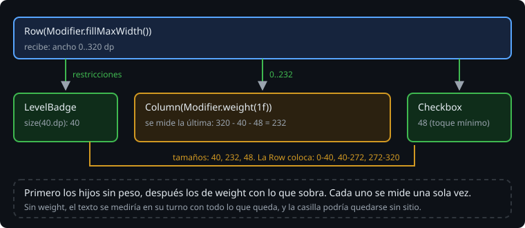

# Column, Row y Box

> En la semana 21 la pantalla de la Bitácora era una `Column` con todo dentro, un elemento debajo de otro, cada uno con el ancho de su texto. Sirve para empezar, pero una pantalla de verdad reparte el espacio: la insignia mide lo que mide, la descripción se queda con lo que sobra, la casilla va al final. Compose lo hace con tres layouts y una sola regla de medida. Esta teoría es esa regla y los parámetros con que se reparte el espacio.

## 🎯 Objetivos

- Entender cómo mide Compose: las restricciones bajan, los tamaños suben, y se mide una sola vez
- Colocar con `Column`, `Row` y `Box`, y repartir con `Arrangement`, `Alignment` y `weight`
- Comprobar en un test dónde ha quedado cada cosa, en dp

## 1. Cómo mide Compose



Cada layout recibe de su padre unas **restricciones**: un ancho y un alto mínimos y máximos. Con ellas mide a sus hijos, uno a uno, y cada hijo dice qué tamaño ha elegido dentro de lo permitido. Con esos tamaños, el padre decide su propio tamaño y coloca a los hijos. Las restricciones bajan, los tamaños suben.

Cada hijo se mide **una sola vez** por pasada. Por eso una pantalla de Compose con muchos niveles anidados no se vuelve lenta, como pasaba con las vistas, que podían medir dos veces cada nivel. Y por eso hay cosas que no se pueden hacer, como meter una lista que se desplaza dentro de otra ([teoría 03](03-listas-perezosas.md)).

Los tres layouts básicos:

| Layout | Coloca a los hijos | Su tamaño |
| --- | --- | --- |
| `Column` | Uno debajo de otro | El ancho del más ancho; el alto, la suma |
| `Row` | Uno al lado de otro | El ancho, la suma; el alto del más alto |
| `Box` | Uno encima de otro, en la esquina de arriba a la izquierda | El del más grande |

## 2. Repartir el espacio

Lo que sobra en la dirección principal se reparte con `Arrangement`; la otra dirección se alinea con `Alignment`:

```kotlin
Row(Modifier.width(300.dp), horizontalArrangement = Arrangement.SpaceBetween, verticalAlignment = Alignment.CenterVertically) {
    Box(Modifier.size(40.dp))
    Box(Modifier.size(40.dp))
    Box(Modifier.size(40.dp))
}
```

> 🔬 Medido en la sonda: los tres cuadrados empiezan en 0, 130 y 260 dp. Sobran 300 - 3 × 40 = 180 dp, y `SpaceBetween` los pone en los dos huecos de en medio: 90 en cada uno.

`Arrangement.spacedBy(12.dp)` pone un hueco fijo entre cada dos hijos. En una `Column` se usan `verticalArrangement` y `horizontalAlignment`; en un `Box`, `contentAlignment` para todos o `Modifier.align(...)` para uno.

## 3. weight: lo que sobra

`Modifier.weight(1f)` solo existe dentro de una `Row` o una `Column`. El hijo con peso se mide el último, con lo que dejan los demás:

```kotlin
Row(Modifier.fillMaxWidth()) {
    Box(Modifier.size(40.dp))                  // 40
    Text("descripción", Modifier.weight(1f))   // lo que sobra
    Text("A-1")                                // lo que mide su texto
}
```

> 🔬 Medido en la sonda, con la pantalla de 320 dp de Robolectric: el cuadrado va de 0 a 40, la descripción de 40 a 317 y "A-1" de 317 a 320.

Con varios pesos, lo que sobra se reparte en proporción: tres botones con `weight(1f)` miden lo mismo. Es lo que hace la fila de niveles del proyecto.

Sin `weight`, cada hijo se mide en orden con lo que queda. Si el primero es un texto largo, se lo lleva todo, y los de detrás se quedan sin sitio.

> 🔬 Medido en el ejercicio 01 (paso 5b): sin el `weight` del texto, con una descripción corta la casilla queda pegada al texto (empieza en 113 dp en vez de en 268); con una larga, la casilla se queda con 0 dp de ancho en el borde (304).

## 4. Comprobar dónde ha quedado cada cosa

La regla de Compose da los límites de cada nodo en dp, respecto a la raíz:

```kotlin
rule.onNodeWithTag("row").assertLeftPositionInRootIsEqualTo(0.dp).assertWidthIsEqualTo(320.dp)
val box = rule.onNode(isToggleable()).getUnclippedBoundsInRoot()   // DpRect(left, top, right, bottom)
```

`Modifier.testTag("row")` pone una etiqueta para encontrar un nodo que no tiene texto. Se la pasa el test a través del parámetro `modifier` ([teoría 02](02-modifiers.md)), así la pantalla de verdad no lleva etiquetas.

En la JVM, la pantalla de Robolectric mide 320 × 470 dp con densidad 1, así que 1 dp es 1 px y las cuentas salen redondas. Con el texto hay que tener cuidado:

> 🔬 Medido en la sonda: Robolectric no pinta las letras de verdad. `Text("hola")` mide 4 dp de ancho, un dp por carácter. Los tests de esta semana comprueban dónde **empieza** un texto, nunca cuánto mide; los tamaños se comprueban con cajas de tamaño fijo.

## ✅ Comprueba

- [ ] ¿Qué baja y qué sube al medir? ¿Cuántas veces se mide cada hijo?
- [ ] Tres botones de 88 dp con `spacedBy(12.dp)` en una fila con 16 dp de margen a cada lado. ¿Dónde empieza cada uno?
- [ ] ¿Por qué la descripción lleva `weight(1f)` y la insignia no?
