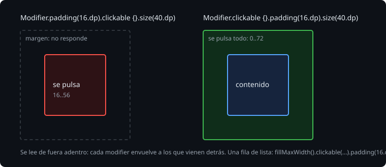

# Modifiers

> Un composable dice qué se pinta; un `Modifier` dice cómo se coloca, cuánto mide, cómo se pinta por fuera y qué hace al tocarlo. Se encadenan, y el orden de la cadena importa: no es una lista de propiedades, es una serie de envoltorios, del de fuera al de dentro. Esta teoría es ese orden, los modifiers de tamaño y la regla para escribir composables que acepten un `Modifier`.

## 🎯 Objetivos

- Leer una cadena de modifiers de fuera adentro y predecir lo que hace
- Elegir entre `size`, `requiredSize`, `fillMaxWidth` y el tamaño mínimo de toque
- Escribir composables con el parámetro `modifier` como manda la convención, y lo que dice lint si no

## 1. El orden importa



Cada modifier envuelve a los que vienen detrás. `padding(16.dp).clickable {}` deja un margen y, dentro del margen, la zona que se pulsa. `clickable {}.padding(16.dp)` hace la zona que se pulsa y, dentro de ella, el margen:

```kotlin
Box(Modifier.padding(16.dp).clickable {}.size(40.dp))   // se pulsan los 40 de dentro
Box(Modifier.clickable {}.padding(16.dp).size(40.dp))   // se pulsan los 72: 16 + 40 + 16
```

> 🔬 Medido en la sonda: el nodo que se pulsa va de 16 a 56 dp en el primero, y de 0 a 72 en el segundo.

En una fila de una lista, el usuario espera que la fila entera responda, también el borde. Por eso la fila de la Bitácora es `fillMaxWidth().clickable(...).padding(16.dp)`: primero el tamaño, luego el toque, luego el margen.

> 🔬 Medido en el ejercicio 01 (paso 5a): con `padding(16.dp).clickable(...)`, falla `theWholeRowIsTouchable` con `Actual left is 16.0.dp, expected 0.0.dp`. Los 16 dp de cada borde no responden.

Lo mismo con el fondo: `background(color).padding(16.dp)` pinta también el margen; `padding(16.dp).background(color)` lo deja sin pintar.

## 2. El tamaño

| Modifier | Qué pide |
| --- | --- |
| `size(40.dp)` | 40 × 40, si las restricciones del padre lo dejan; si no, lo más parecido |
| `requiredSize(40.dp)` | 40 × 40 siempre, aunque se salga del padre |
| `width`, `height` | Solo una dirección |
| `fillMaxWidth()`, `fillMaxSize()` | Todo el máximo que deja el padre |
| `wrapContentSize()` | Lo que mida el contenido, aunque el padre pida más |

> 🔬 Medido en la sonda: dentro de una caja de 30 dp, `size(40.dp)` mide 30 × 30; `requiredSize(40.dp)` mide 40 y se sale 5 dp por cada lado (va de -5 a 35), centrado sobre los 30 que le dieron.

`size` respeta las restricciones ([teoría 01](01-column-row-y-box.md)); `requiredSize` las ignora. Casi siempre quieres `size`.

## 3. El tamaño mínimo de toque

Material reserva 48 dp para todo lo que se pulsa, aunque se vea más pequeño. Es la recomendación de accesibilidad de Android: un dedo no acierta en menos.

> 🔬 Medido en la sonda: un `Checkbox` dibuja 24 dp, pero ocupa 48 en la fila; su nodo empieza 12 dp más adentro (de 12 a 36). En el ejercicio 01, la casilla ocupa de 256 a 304 y se ve de 268 a 292.

Lo hace `Modifier.minimumInteractiveComponentSize()`, que los componentes de Material ya llevan. Si haces un botón propio con `clickable`, añádelo tú.

## 4. El parámetro modifier

Un composable que pinta algo acepta un `Modifier` de quien lo llama, para que este decida dónde va y cuánto ocupa. La convención:

```kotlin
@Composable
fun LevelBadge(level: Level, modifier: Modifier = Modifier) {
    Box(modifier.size(40.dp).background(level.color), contentAlignment = Alignment.Center) { ... }
}
```

- se llama `modifier` y vale `Modifier` por defecto;
- es el primer parámetro opcional;
- se aplica una vez, al elemento de fuera, y **primero** en la cadena: lo de quien llama envuelve a lo tuyo.

> 🔬 Medido en el ejercicio 01 (paso 5c): con `Modifier.size(40.dp).then(modifier)`, el margen de 8 dp que pasa el test queda dentro del cuadrado, y falla `theCallersModifierGoesOutside` con `Actual width is 24.0.dp, expected 40.0.dp`: 40 - 8 - 8.

Lint lo comprueba con las reglas que trae la propia biblioteca de Compose:

> 🔬 Medido en la sonda: con el parámetro llamado `mod`, `./gradlew :app:lintDebug` da `Warning: Modifier parameter should be named modifier [ModifierParameter from androidx.compose.ui]`. Es un aviso: no para el build.

Los hijos de dentro no reciben el `modifier` de fuera; cada uno empieza su cadena con `Modifier`.

## ✅ Comprueba

- [ ] `background(Color.Red).padding(16.dp)` y `padding(16.dp).background(Color.Red)`: ¿cuál pinta el margen?
- [ ] ¿Por qué el `modifier` de quien llama va primero en la cadena, y no al final?
- [ ] Un icono de 24 dp con `clickable`. ¿Cuánto mide la zona que se pulsa? ¿Qué le añadirías?
