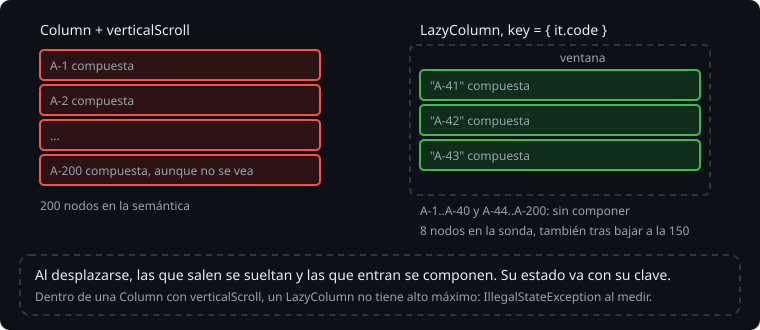

# Listas perezosas

> Una sesión de campo larga son cientos de observaciones. Una `Column` con un `Text` por cada una las compone todas, aunque solo se vean seis; con `verticalScroll` además se puede bajar, pero el coste es el mismo. `LazyColumn` solo compone las que caben, y va componiendo las nuevas, y soltando las viejas, al desplazarse. Es el `RecyclerView` de las vistas, sin adaptador. Esta teoría es cómo se escribe, qué cuesta cada opción y cómo se prueba.

## 🎯 Objetivos

- Distinguir una `Column` con `verticalScroll` de un `LazyColumn`, y medir la diferencia
- Escribir un `LazyColumn` con `item`, `items` y `stickyHeader`
- Reconocer el error de anidar dos cosas que se desplazan en la misma dirección
- Probar una lista que no compone lo que no se ve

## 1. Column o LazyColumn



```kotlin
Column(Modifier.verticalScroll(rememberScrollState())) {
    observations.forEach { Text(it) }
}

LazyColumn {
    items(observations) { Text(it) }
}
```

> 🔬 Medido en la sonda, con 200 textos con 16 dp de margen: la `Column` tiene los 200 nodos en el árbol de semántica; el `LazyColumn`, 8. Tras `performScrollToIndex(150)`, sigue teniendo 8, y uno es el 150.

Regla práctica: `Column` (con `verticalScroll` si hace falta) para un formulario o una pantalla de pocos elementos fijos; `LazyColumn` para todo lo que crece con los datos. Para filas en horizontal, `Row` y `LazyRow`; para rejillas, `LazyVerticalGrid`.

## 2. El DSL del LazyColumn

Dentro de `LazyColumn { }` no se escriben composables sino una descripción de los elementos:

```kotlin
LazyColumn(Modifier.fillMaxSize()) {
    item { Text("Hoy") }                                      // un elemento
    items(observations, key = { it.code }) { observation ->   // uno por observación
        ObservationRow(observation)
    }
    stickyHeader { Text("Alta · 3") }                         // se queda arriba mientras su grupo se ve
}
```

El contenido de cada `item` es un composable normal, que se compone cuando el elemento entra en pantalla. La `key` es la [teoría 04](04-claves-y-estado-de-los-items.md).

`stickyHeader` se queda pegada arriba hasta que llega la siguiente. Agrupar con ella es un `groupBy` y un bucle:

```kotlin
for ((level, group) in observations.groupBy { it.level }) {
    stickyHeader(key = level.name) { Text("${stringResource(level.label)} · ${group.size}") }
    items(group, key = { it.code }) { ObservationRow(it) }
}
```

> 🔬 Medido en el ejercicio 02: con Compose 1.12, `stickyHeader` ya no pide `@OptIn` (compila con `allWarningsAsErrors`). En el árbol de semántica, la cabecera fija va **al final**, después de las filas, porque se pinta encima de ellas: un test que lea los textos en el orden del árbol la encuentra la última. Para el orden en pantalla, compara su `top`.

## 3. Dos listas en la misma dirección

Un `LazyColumn` necesita un alto máximo para saber cuántos elementos caben. Dentro de una `Column` con `verticalScroll`, el alto máximo es infinito:

> 🔬 Medido en la sonda: `Column(Modifier.verticalScroll(...)) { LazyColumn { ... } }` lanza `IllegalStateException: Vertically scrollable component was measured with an infinity maximum height constraints, which is disallowed. One of the common reasons is nesting layouts like LazyColumn and Column(Modifier.verticalScroll())`.

El propio mensaje da la salida: lo que iba encima de la lista, como `item { }` dentro del `LazyColumn`. O, como en el proyecto, fuera de la lista, en una `Column` que no se desplaza, y la lista con `Modifier.weight(1f)` para quedarse con el alto que sobra.

## 4. Probar una lista perezosa

Lo que no se ve no existe en el árbol: `onNodeWithText("observación 300").assertDoesNotExist()` pasa al principio. Para llegar a un elemento, se desplaza la lista:

```kotlin
rule.onNode(hasScrollAction()).performScrollToIndex(10)
rule.onNode(hasScrollAction()).performScrollToKey("A-300")
rule.onNodeWithText("observación 300").assertExists()
```

`hasScrollAction()` encuentra el nodo que se desplaza: la lista. `performScrollToKey` necesita que los elementos tengan clave.

> 🔬 Medido en el ejercicio 02 (paso 6a): sin `key`, `performScrollToKey("A-300")` falla con `IllegalArgumentException: Failed to scroll to the item identified by "A-300", couldn't find the key.`

> 🔬 Medido en el proyecto: en la pantalla de Robolectric, a la lista de la Bitácora le quedan 144 dp entre el resumen y "Compartir" (de 258 a 402), y cada fila mide 56: se componen 3, la tercera a medias. Con la demo, la cuarta observación no existe hasta bajar a ella. En un móvil de verdad caben más, pero la idea es la misma.

## ✅ Comprueba

- [ ] Una pantalla de ajustes con 12 opciones fijas. ¿`Column` o `LazyColumn`? ¿Y la lista de observaciones?
- [ ] ¿Por qué un `LazyColumn` dentro de una `Column` con `verticalScroll` falla al medir, y no al compilar?
- [ ] ¿Cómo compruebas en un test que la observación 300 está en la lista, si no se ve?
