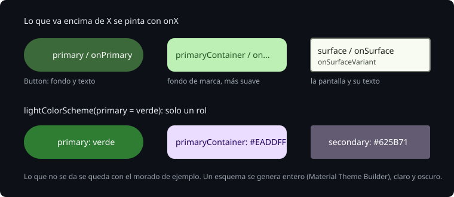

# MaterialTheme y los roles de color

> Hasta ahora la Bitácora pintaba con el tema que Material trae por defecto: el morado de ejemplo de Google. Un tema es lo que deciden juntos los colores, la tipografía y las formas de toda la app, para que ningún componente tenga que decidirlos solo. En Material 3, los colores no se eligen por componente sino por **rol**: un botón no es "verde", es `primary`, y su texto es `onPrimary`. Esta teoría explica qué son esos roles, cómo los leen los componentes y qué pasa cuando defines solo uno.

## 🎯 Objetivos

- Explicar los roles de color y las parejas `X` / `onX`
- Saber de dónde saca un componente de Material su color, y un `Text` el suyo
- Definir un esquema de color entero y saber qué pasa si solo defines `primary`

## 1. Los roles



Un `ColorScheme` es una lista de colores con nombre. Los principales, por parejas:

| Rol | Para qué | Su pareja |
| --- | --- | --- |
| `primary` | Lo más importante: el botón principal | `onPrimary`, el texto y los iconos encima |
| `primaryContainer` | Un fondo con la marca, sin gritar tanto | `onPrimaryContainer` |
| `secondary`, `tertiary` | Acentos, con sus `Container` | `onSecondary`, `onTertiary`... |
| `surface` | El fondo de la pantalla y de las tarjetas | `onSurface`, el texto normal |
| `surfaceVariant` | Fondos que se distinguen un poco | `onSurfaceVariant`, el texto secundario |
| `error` | Lo que está mal | `onError` |
| `outline` | Bordes, como el de un `OutlinedTextField` | — |

La regla de las parejas: lo que va **encima** de un `X` se pinta con `onX`. Así el contraste lo decide quien diseña el esquema, una vez, y no cada pantalla.

`MaterialTheme(colorScheme = ...)` pone un esquema a disposición de todo lo que va dentro. Se lee con `MaterialTheme.colorScheme.primary`. Sin `MaterialTheme`, o con `MaterialTheme {}` sin esquema, sale el de ejemplo.

> 🔬 Medido en la sonda: sin esquema, `primary` es `#6750A4` (morado), `onPrimary` `#FFFFFF`, `surface` `#FEF7FF` y `onSurface` `#1D1B20`.

## 2. Los componentes leen el tema

Un `Button` no tiene un color fijo: pinta su fondo con `primary` y su contenido con `onPrimary`. Si cambias el tema, cambian todos los botones.

> 🔬 Medido en la sonda, con `GraphicsMode.NATIVE` (sección 4): un `Button` con "Hola" mide 80 × 40 dp. El píxel (5, 20), en el borde, es `#6750A4`; el del centro, sobre la letra, `#FFFFFF`.

Un `Text` no pinta con un rol: usa `LocalContentColor`, el color "de lo que va encima" que ha dejado quien lo contiene. Lo dejan `Surface`, `Scaffold`, `Button`... cada uno con la pareja de su fondo.

> 🔬 Medido en la sonda: fuera de cualquier `Surface`, `LocalContentColor` vale `#000000`, negro, aunque el tema sea oscuro. Dentro de un `Surface` con el esquema oscuro, vale `#E6E0E9`, el `onSurface` oscuro. La [teoría 02](02-modo-oscuro.md) explica por qué esto importa.

Si haces un componente propio con un fondo, pinta su contenido con la pareja: `contentColorFor(fondo)` la busca en el esquema.

## 3. Un esquema entero, no un color

`lightColorScheme()` y `darkColorScheme()` crean un esquema; lo que no les das, se queda con el valor de ejemplo.

```kotlin
val Green = lightColorScheme(primary = Color(0xFF2E7D32))  // solo primary
```

> 🔬 Medido en la sonda: con solo `primary`, `onPrimary` sigue siendo `#FFFFFF`, pero `primaryContainer` es `#EADDFF` y `secondary` `#625B71`: morados. Un botón verde junto a un fondo morado.

Por eso un esquema se genera entero a partir de un color de la marca, con [Material Theme Builder](https://material-foundation.github.io/material-theme-builder/), que calcula todos los roles con el contraste correcto en claro y en oscuro. El `Color.kt` de la Bitácora es eso: un verde (`#386A20`) y los 19 roles principales, para el claro y para el oscuro.

## 4. Probar colores en la JVM

Robolectric no pinta: por defecto, `captureToImage()` no tiene píxeles de verdad. Con `@GraphicsMode(GraphicsMode.Mode.NATIVE)` en la clase, usa los gráficos nativos de Android (vienen en `nativeruntime`, que ya trae Robolectric 4.17) y sí:

```kotlin
@GraphicsMode(GraphicsMode.Mode.NATIVE)
class ThemeTest {
    @Test
    fun aButtonPaintsThePrimary() {
        rule.setContent { BitacoraTheme(dynamicColor = false) { Button({}, Modifier.testTag("b")) { Text("Añadir") } } }
        assertEquals(LightColors.primary, rule.onNodeWithTag("b").captureToImage().toPixelMap()[5, 20])
    }
}
```

> 🔬 Medido: `nativeruntime` 4.17 y `nativeruntime-dist-compat` 1.0.19 ya estaban en el `verification-metadata.xml` del proyecto desde la semana 16. Esta semana no entra ninguna dependencia nueva.

Mira el píxel en un sitio que sepas qué tiene: el borde de un botón, no el centro, donde está la letra. Con densidad 1, un píxel es un dp.

Para comprobar el esquema sin pintar, léelo dentro del contenido: `rule.setContent { BitacoraTheme { primary = MaterialTheme.colorScheme.primary } }`.

## ✅ Comprueba

- [ ] ¿Con qué rol pinta un `Button` su fondo, y con cuál su texto?
- [ ] Defines `lightColorScheme(primary = verde)`. ¿De qué color es `primaryContainer`?
- [ ] ¿De dónde saca su color un `Text` que no recibe `color`?
