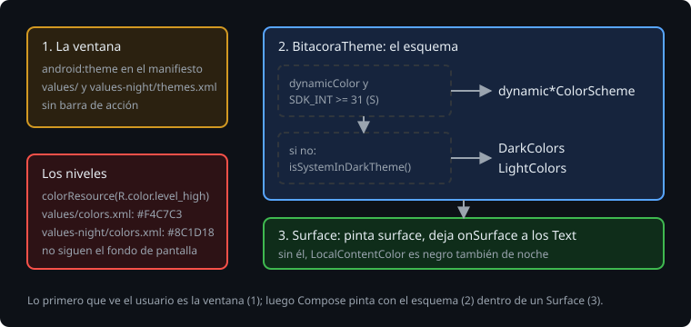

# Modo oscuro

> En el campo, de noche o en una nave, una pantalla blanca deslumbra. Android tiene un modo oscuro de sistema, y una app que lo respeta tiene que cambiar en tres sitios: el esquema de color de Compose, el fondo de la ventana que se ve antes de que Compose pinte, y los colores propios que no son del tema. Esta teoría es esos tres sitios, y el fallo que sale si te olvidas de uno.

## 🎯 Objetivos

- Elegir el esquema claro u oscuro con `isSystemInDarkTheme`
- Explicar por qué una pantalla necesita un `Surface` y qué pasa sin él
- Dar a la ventana un tema de día y otro de noche, y a los colores propios su versión de noche

## 1. El esquema



`isSystemInDarkTheme()` lee la configuración (`uiMode`) y devuelve si el sistema está en oscuro. El tema elige con él:

```kotlin
@Composable
fun BitacoraTheme(darkTheme: Boolean = isSystemInDarkTheme(), content: @Composable () -> Unit) {
    MaterialTheme(colorScheme = if (darkTheme) DarkColors else LightColors, content = content)
}
```

`darkTheme` es un parámetro con valor por defecto, no una llamada dentro: así un test o una vista previa pueden pedir el oscuro sin tocar el sistema. En Robolectric, el sistema en oscuro es el calificador `night`:

> 🔬 Medido en la sonda: con `@Config(qualifiers = "night")`, `isSystemInDarkTheme()` es `true`. Sin él, `false`. Se combina con el idioma: `"es-night"`.

> 🔬 Medido en la sonda: `darkColorScheme()` sin argumentos tiene `primary` `#D0BCFF`, `surface` `#141218` y `onSurface` `#E6E0E9`. En oscuro, `primary` es más claro, no más oscuro: tiene que destacar sobre un fondo oscuro.

## 2. El Surface

`MaterialTheme` pone el esquema a disposición, pero no pinta nada: ni el fondo, ni el color del texto. Eso lo hace un `Surface`, que pinta `surface` y deja `onSurface` en `LocalContentColor` ([teoría 01](01-materialtheme-y-los-roles-de-color.md)).

> 🔬 Medido en la sonda, de noche con el esquema oscuro: sin `Surface`, el texto sale `#000000` y el fondo es el de la ventana, `#FAFAFA` (la actividad vacía de `ui-test-manifest`, que no tiene tu tema). Con `Surface`, el fondo es `#141218` y el texto `#E6E0E9`.

En el móvil, con una ventana oscura, eso es texto negro sobre negro. Por eso la raíz de cada pantalla es un `Surface(Modifier.fillMaxSize())`, o un `Scaffold`, que lleva uno.

> 🔬 Medido en el ejercicio 01 (paso 6b): con un `Box` en vez del `Surface`, falla `theScreenIsDarkAtNight` con `expected:<Color(0.0627451, 0.078431375, 0.05882353, ...)> but was:<Color(0.98039216, 0.98039216, 0.9803921...)>`: el fondo oscuro de la marca (`#10140F`) contra el claro de la ventana.

## 3. La ventana

Antes de que Compose pinte el primer fotograma, Android enseña la ventana de la actividad con el fondo de su tema, el de `android:theme` en el manifiesto. Hasta ahora la Bitácora no declaraba ninguno.

> 🔬 Medido en el proyecto de la semana 22: sin `android:theme`, la actividad tiene una barra de acción de la plataforma (`WindowDecorActionBar`, visible) con el título, el mismo que la pantalla pinta debajo. El fondo de la ventana es `#EEEDF4`, de día y de noche.

Un tema de ventana para una app de Compose es pequeño: sin barra de acción, porque el título lo pinta Compose, y con un fondo que siga al modo del sistema. Sin AppCompat, con los temas de la plataforma:

```xml
<!-- res/values/themes.xml -->
<style name="Theme.Bitacora" parent="android:Theme.Material.Light.NoActionBar" />
<!-- res/values-night/themes.xml -->
<style name="Theme.Bitacora" parent="android:Theme.Material.NoActionBar" />
```

```xml
<application android:theme="@style/Theme.Bitacora" ...>
```

> 🔬 Medido en el proyecto: con ese tema, `actionBar` es `null`, y el fondo de la ventana es `#FAFAFA` de día y `#303030` de noche.

`values-night` es un calificador de recursos como `values-en` ([semana 17](../../week-17-recursos_y_configuraciones/README.md)): Android elige la carpeta según el modo del sistema. Hay un tema `DayNight` en la plataforma (`Theme.DeviceDefault.DayNight`), pero es de la API 29, y la Bitácora empieza en la 26.

## 4. Los colores propios

Los niveles de la Bitácora tienen su color, y no es un rol de Material: dice lo grave que es una observación. Un rosa claro para "Alta" se ve bien de día y deslumbra de noche. Como cualquier recurso, un color puede tener su versión de noche:

```xml
<!-- res/values/colors.xml -->       <color name="level_high">#FFF4C7C3</color>
<!-- res/values-night/colors.xml --> <color name="level_high">#FF8C1D18</color>
```

`colorResource(R.color.level_high)` lo lee en Compose, según la configuración de ese momento.

> 🔬 Medido en la sonda: `colorResource(R.color.level_high)` da `#F4C7C3` de día y `#8C1D18` con `night`.

> 🔬 Medido en el ejercicio 01 (paso 6d): sin `values-night/colors.xml`, falla `theBadgeHasItsNightColor` con `Values should be different. Actual: Color(0.95686275, 0.78039217, 0.7647059, ...)`: de noche, el mismo rosa de día.

## ✅ Comprueba

- [ ] ¿Por qué `darkTheme` es un parámetro con `isSystemInDarkTheme()` por defecto, y no una llamada dentro del tema?
- [ ] Una pantalla con el tema oscuro y sin `Surface`: ¿de qué color sale el texto, y por qué?
- [ ] ¿Qué se ve antes de que Compose pinte, y dónde se decide su color?
