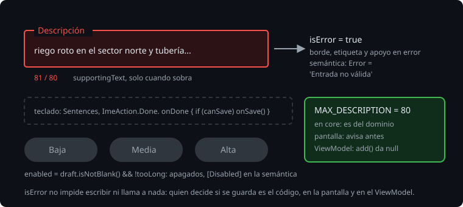

# El formulario

> Un formulario es donde el usuario se equivoca: una descripción vacía, o tan larga que no cabe en el informe. Material 3 da los componentes para decírselo antes de guardar: un campo que marca el error y explica por qué, un teclado con el botón de acción adecuado, una elección de nivel que se ve como una sola elección, y un botón que no se puede pulsar mientras falte algo. Esta teoría es esos componentes, cómo se prueban y dónde va la regla.

## 🎯 Objetivos

- Configurar un `OutlinedTextField`: etiqueta, texto de apoyo, error y teclado
- Elegir entre botones, botones segmentados y chips según lo que se elige
- Poner la regla de validación en un solo sitio y probarla en la pantalla y en el `ViewModel`

## 1. El campo



```kotlin
OutlinedTextField(
    value = draft,
    onValueChange = onDraftChange,
    label = { Text(stringResource(R.string.description_hint)) },
    supportingText = { Text(stringResource(R.string.counter, draft.length, MAX_DESCRIPTION)) },
    isError = draft.length > MAX_DESCRIPTION,
    singleLine = true,
    keyboardOptions = KeyboardOptions(capitalization = KeyboardCapitalization.Sentences, imeAction = ImeAction.Done),
    keyboardActions = KeyboardActions(onDone = { if (canSave) onSave() }),
)
```

- `label`: lo que se pide, dentro del campo cuando está vacío y encima cuando tiene texto.
- `supportingText`: una línea debajo, para la cuenta o para explicar el error.
- `isError`: pinta el borde, la etiqueta y el texto de apoyo con `error`, y lo dice en la semántica.
- `keyboardOptions`: cómo es el teclado. Con `Sentences`, empieza las frases con mayúscula; con `ImeAction.Done`, su botón de acción es "Hecho".
- `keyboardActions`: qué pasa al pulsar ese botón.

> 🔬 Medido en la sonda: con `isError = true`, el nodo del campo tiene `Error = 'Invalid input'` en inglés y `Error = 'Entrada no válida'` con `@Config(qualifiers = "es")`. Es lo que lee TalkBack. El texto del campo en el árbol junta la etiqueta y el de apoyo: `Text = '[Descripción, 0 / 10]'`.

`isError` no impide nada: el campo sigue aceptando texto, y `onDone` se llama igual.

> 🔬 Medido en la sonda: con 22 caracteres y un máximo de 10 (en error), `performImeAction()` llama a `onDone`. En el ejercicio 02 (paso 5a), sin el `if (canSave)`, falla `doneDoesNotSaveWhatCannotBeSaved` con `expected:<0> but was:<1>`.

Un campo con texto de apoyo es más alto: en una pantalla llena, eso se nota.

> 🔬 Medido en el proyecto: en Robolectric, a 288 dp de ancho, un `TextField` mide 68 dp; un `OutlinedTextField`, 76; con `supportingText`, 116. Con la cuenta siempre visible y una barra superior de 64 dp, a la lista de la Bitácora le quedaban 66 dp y la segunda fila no se componía: fallaba `aRowShowsItsBadgeAndPlace`, de la semana 22. Por eso la Bitácora enseña la cuenta solo cuando sobra (`supportingText = if (tooLong) { ... } else null`) y no lleva `TopAppBar`.

`TopAppBar` es además experimental en Material 3 1.4.0:

> 🔬 Medido en la sonda: sin `@OptIn(ExperimentalMaterial3Api::class)`, `This material API is experimental and is likely to change or to be removed in the future.` Es un error de compilación, no un aviso.

## 2. Elegir el nivel

| Componente | Semántica | Para qué |
| --- | --- | --- |
| Tres `Button` | `Role.Button` | Tres acciones: "añadir como Baja", "como Media"... (la Bitácora) |
| `SingleChoiceSegmentedButtonRow` con `SegmentedButton` | `Role.RadioButton`, `Selected` | Una opción entre pocas, que se elige y luego se guarda |
| `FilterChip` | `Role.Checkbox` | Filtros que se suman |

> 🔬 Medido en la sonda: cada `SegmentedButton` tiene `Role = 'RadioButton'` y `Selected = 'true'` o `'false'`, y su fila es un `SelectableGroup`. En el ejercicio 02 (paso 5c), con `FilterChip`, falla `theLevelsAreOneChoice` con `Failed to assert the following: (Role = 'RadioButton') ... Role = 'Checkbox'`.

La semántica no es un detalle: es lo que TalkBack anuncia, un botón de opción marcado o una casilla. `SegmentedButton` es estable en 1.4.0; `SegmentedButtonDefaults.itemShape(index, count)` redondea solo los extremos.

## 3. El botón que no se puede pulsar

`enabled = false` lo pinta apagado y no responde. En la semántica queda `[Disabled]`, y en un test, `assertIsNotEnabled()`.

```kotlin
val tooLong = state.draft.length > MAX_DESCRIPTION
Button(onClick = { onAdd(level) }, enabled = state.draft.isNotBlank() && !tooLong) { ... }
```

> 🔬 Medido en el proyecto: con un borrador de espacios, los tres niveles dan `assertIsNotEnabled()`; `performClick()` sobre uno no añade nada.

## 4. Dónde va la regla

El máximo de 80 caracteres es del dominio: lo mismo valdría para un informe o una sincronización. Por eso `MAX_DESCRIPTION` vive en `core`, y lo usan los dos que lo necesitan:

- la pantalla, para avisar antes: error, cuenta y botones apagados;
- el `ViewModel`, para no guardarlo nunca, venga de donde venga la llamada: `add` devuelve `null` con más de 80.

La pantalla es una ayuda; el `ViewModel` es la regla. Un test de cada uno.

## ✅ Comprueba

- [ ] ¿Qué cambia `isError` en lo que ve el usuario, y qué en lo que oye TalkBack? ¿Qué no impide?
- [ ] Elegir el nivel antes de guardar: ¿`Button`, `SegmentedButton` o `FilterChip`? ¿Qué `Role` tiene cada uno?
- [ ] ¿Por qué la regla de los 80 caracteres está en `core` y el `ViewModel` la comprueba aunque la pantalla ya apague los botones?
