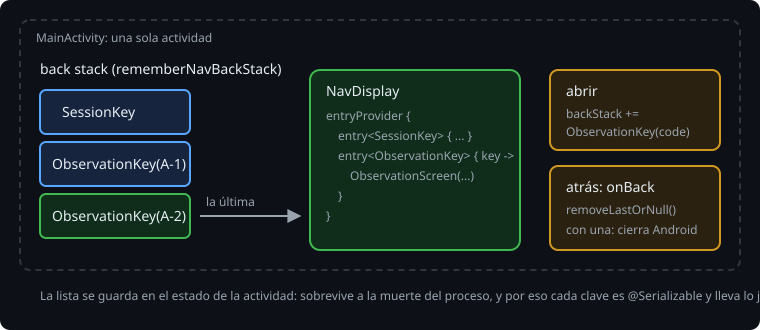

# De actividades a destinos

> Desde la semana 18, la observación se abría en su propia actividad. `MainActivity` mandaba un `Intent` con la observación en los extras, `ObservationActivity` devolvía el resultado con `setResult`, y Android llevaba la pila de actividades. Con Compose, cada pantalla es una función, y no hace falta una actividad para cada una. Esta teoría es el modelo de Navigation 3: el back stack es una lista tuya, y un `NavDisplay` pinta la última clave.

## 🎯 Objetivos

- Explicar qué cambia al pasar de una actividad por pantalla a una actividad con destinos
- Escribir un `NavDisplay` con su back stack y su `entryProvider`
- Saber qué entra en el build con Navigation 3

## 1. Una actividad, varios destinos

Con una actividad por pantalla, la navegación era de Android: `startActivity` apilaba, atrás desapilaba, y lo que pasaba de una pantalla a otra tenía que caber en un `Intent`. Cada actividad tenía su ventana, su tema y su entrada en el manifiesto.

Con Compose, una pantalla es un composable. Para cambiar de pantalla basta con pintar otro. Lo que falta es quién recuerda por dónde va el usuario, qué pasa al pulsar atrás y cómo sobrevive eso a la muerte del proceso. Eso es una biblioteca de navegación.

Hay dos de Google:

- **Navigation Compose** (2.x), la de siempre: un `NavController` que lleva la pila por dentro, con rutas.
- **Navigation 3** (1.x): el back stack es una lista que es tuya. Para navegar, la cambias.

La Bitácora usa Navigation 3, 1.2.0.

## 2. El back stack es una lista



Cada destino tiene una clave: un tipo de Kotlin que implementa `NavKey`. El back stack es una lista de claves, y lo que se ve es la última:

```kotlin
@Serializable data object SessionKey : NavKey
@Serializable data class ObservationKey(val code: String) : NavKey

val backStack = rememberNavBackStack(SessionKey)
backStack += ObservationKey("A-2")   // abre A-2
backStack.removeLastOrNull()         // vuelve
```

No hay rutas en texto ni argumentos que leer de un `Bundle`: la clave lleva el código y el compilador comprueba su tipo. El `@Serializable` es para la muerte del proceso ([teoría 02](02-claves-y-muerte-del-proceso.md)).

## 3. NavDisplay

`NavDisplay` recibe el back stack y una función que, para cada clave, dice qué pintar:

```kotlin
NavDisplay(
    backStack = backStack,
    onBack = { backStack.removeLastOrNull() },
    entryProvider = entryProvider {
        entry<SessionKey> { SessionScreen(observations, onOpen = { backStack += ObservationKey(it.code) }) }
        entry<ObservationKey> { key -> ObservationScreen(observations.first { it.code == key.code }, ...) }
    },
)
```

`entryProvider { entry<T> { } }` es un DSL: una entrada por tipo de clave, y la de `ObservationKey` recibe la clave con su código. Las pantallas no saben nada de la navegación: reciben datos y avisan con lambdas (`onOpen`, `onChoose`). Quien decide adónde se va es el que tiene el back stack.

> 🔬 Medido en el proyecto: al abrir una observación, `shadowOf(activity).nextStartedActivity` es `null`. Ya no se arranca otra actividad: cambia el destino.

> 🔬 Medido en la sonda: una clave sin su `entry` en el `entryProvider` (`backStack += OrphanKey`) da `IllegalStateException: Unknown screen OrphanKey` en cuanto se pinta. Cada tipo de clave necesita su entrada.

## 4. Lo que entra en el build

```toml
navigation3 = "1.2.0"
navigation3-runtime = { module = "androidx.navigation3:navigation3-runtime", version.ref = "navigation3" }
navigation3-ui = { module = "androidx.navigation3:navigation3-ui", version.ref = "navigation3" }
```

`runtime` tiene las claves, el back stack y los decoradores; `ui`, el `NavDisplay`. Y el plugin de serialización de Kotlin (`org.jetbrains.kotlin.plugin.serialization`, con la versión de Kotlin), que genera el serializador de cada clave.

> 🔬 Medido en el proyecto: con las dos bibliotecas, en `verification-metadata.xml` entran `navigation3-runtime` y `navigation3-ui` 1.2.0 (y sus `-android`) y `navigationevent`, `navigationevent-compose` 1.1.1 (y sus `-android`), que es lo que lleva atrás en Compose. `kotlinx-serialization` ya estaba. Sin avisos en OSV para ninguno.

## ✅ Comprueba

- [ ] Con una actividad por pantalla, ¿quién lleva la pila? ¿Y con Navigation 3?
- [ ] ¿Por qué las pantallas reciben lambdas en vez del back stack?
- [ ] ¿Qué pasa si añades al back stack una clave sin su `entry`?
