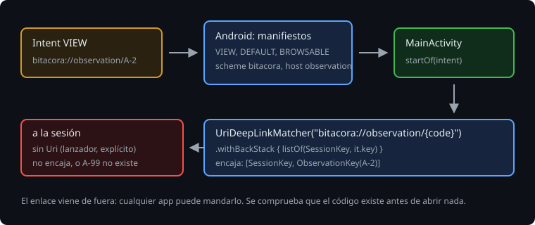

# Enlaces

> Un enlace abre una pantalla concreta de la app desde fuera: un mensaje del capataz con `bitacora://observation/A-2`, un aviso, otra app. Con una actividad por pantalla, el enlace apuntaba a esa actividad. Ahora solo hay una, y es ella la que lee el enlace y decide con qué back stack empieza. Esta teoría es el `intent-filter`, el `UriDeepLinkMatcher` de Navigation 3 y la regla de todo lo que viene de fuera: comprobarlo antes de usarlo.

## 🎯 Objetivos

- Declarar en el manifiesto los enlaces que abre la app
- Convertir un `Intent` en el back stack con que empieza la app
- Tratar un enlace como entrada que no es de fiar

## 1. El intent-filter



Android abre un enlace con un `Intent` `ACTION_VIEW` con su `Uri`, y busca en los manifiestos quién lo acepta:

```xml
<activity android:name=".MainActivity" android:exported="true">
    <intent-filter>
        <action android:name="android.intent.action.VIEW" />
        <category android:name="android.intent.category.DEFAULT" />
        <category android:name="android.intent.category.BROWSABLE" />
        <data android:scheme="bitacora" android:host="observation" />
    </intent-filter>
</activity>
```

- `DEFAULT`: `startActivity` con un `Intent` implícito solo encuentra actividades con esa categoría.

  > 🔬 Medido en el ejercicio 02 (paso 6d): sin `DEFAULT`, `queryIntentActivities(intent, MATCH_DEFAULT_ONLY)` da `[]` y falla `androidSendsTheLinksToTheBitacora`.

- `BROWSABLE`: el navegador, al pulsar un enlace en una página, añade esa categoría al `Intent`.

  > 🔬 Medido en la sonda: sin `BROWSABLE`, un `Intent` con `addCategory(CATEGORY_BROWSABLE)` no encuentra la Bitácora, y uno sin ella sí. Ningún test del ejercicio 02 lo nota (paso 6e).

Un esquema propio como `bitacora://` lo puede declarar cualquier app: si dos lo hacen, Android pregunta. Para enlaces `https://` de un dominio tuyo, sin preguntar, están los App Links, que piden demostrar que el dominio es tuyo. Quedan fuera de esta semana.

Para probarlo en un emulador:

```bash
adb shell am start -W -a android.intent.action.VIEW -d "bitacora://observation/A-1"
```

## 2. Del Intent al back stack

Navigation 3 trae un buscador de enlaces en `androidx.navigation3.runtime.deeplink`. Un `UriDeepLinkMatcher` lleva un patrón y el serializador de la clave: saca `{code}` de la `Uri` y construye `ObservationKey(code)`. `withBackStack` dice qué queda debajo:

```kotlin
private val observationLink = UriDeepLinkMatcher("bitacora://observation/{code}".toUri(), ObservationKey.serializer())
    .withBackStack { listOf(SessionKey, it.key) }

fun startOf(intent: Intent, exists: (String) -> Boolean): List<NavKey> {
    if (intent.data == null) return listOf(SessionKey)
    val match = observationLink.match(DeepLinkRequest(intent))
    return match?.backStack?.takeIf { exists(match.key.code) } ?: listOf(SessionKey)
}
```

`DeepLinkRequest(intent)` necesita `import androidx.navigation3.runtime.deeplink.invoke`: es una función de extensión con forma de constructor. Y la sesión debajo es para atrás: quien llega por un enlace y vuelve espera la lista, no salir de la app.

> 🔬 Medido en el ejercicio 02 (paso 6c): sin `withBackStack`, el back stack empieza en `[ObservationKey(code=A-2)]`, y atrás cierra la app.

> 🔬 Medido en el ejercicio 02: `bitacora://observation/`, `bitacora://observation/A-2/fotos` y `bitacora://session/A-2` no encajan: `match` da `null`.

La guarda de `intent.data` no es de adorno:

> 🔬 Medido en la sonda: `DeepLinkRequest` acepta el `Intent` del lanzador, porque la acción `MAIN` le basta, pero con un `Intent` explícito, sin acción ni `Uri` (el de `Robolectric.buildActivity`, o el de otra pantalla de tu app), lanza `IllegalArgumentException: DeepLinkRequest must have either a uri or extras.`

`MainActivity` llama a `startOf(intent)` en `onCreate` y empieza el back stack con eso: `rememberNavBackStack(*start.toTypedArray())`. Tras la muerte del proceso, `rememberNavBackStack` devuelve lo guardado y no vuelve a mirar el `Intent`.

## 3. Lo que viene de fuera

Cualquier app puede mandar un `Intent` a una actividad exportada, con cualquier código. `A-99` no existe:

> 🔬 Medido en el ejercicio 02 (paso 6b): sin el `takeIf { exists(...) }`, `bitacora://observation/A-99` abre la app y se cierra con `ArrayIndexOutOfBoundsException: Index -1 out of bounds for length 3`.

Es un fallo pequeño, pero muestra la regla: un enlace es una entrada sin confianza, como un formulario. Se comprueba que encaja, que el código existe y, cuando lo haya, que el usuario puede verlo. Lo que no pasa la comprobación abre la sesión, sin enseñar nada.

## ✅ Comprueba

- [ ] ¿Para qué es cada categoría del `intent-filter`? ¿Qué pasa sin `DEFAULT`?
- [ ] ¿Por qué un enlace empieza con la sesión debajo?
- [ ] ¿Qué dos `Intent` que no son un enlace llegan a `startOf`, y qué hace `DeepLinkRequest` con cada uno?
- [ ] ¿Qué comprueba la Bitácora de un enlace antes de abrirlo, y por qué?
