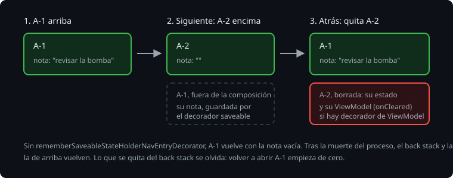

# El estado de cada destino

> Cuando un destino queda tapado por otro, sale de la composición, y todo su `remember` se va con él. Al volver, el usuario espera encontrar lo que escribió. Y cuando un destino se quita del back stack, lo que tenía tiene que borrarse, o la memoria crece con cada pantalla abierta. Esta teoría es cómo Navigation 3 da a cada entrada su estado con decoradores: el de `rememberSaveable` y el de `ViewModel`.

## 🎯 Objetivos

- Explicar qué guarda `rememberSaveableStateHolderNavEntryDecorator` y cuándo lo borra
- Dar a cada entrada su `ViewModel` cuando haga falta, y saber cuándo no
- Probar el estado de un destino tapado y de uno cerrado

## 1. Decoradores

`NavDisplay` envuelve cada entrada con una lista de decoradores, `entryDecorators`. Cada uno da a la entrada algo propio mientras está en el back stack, y lo limpia cuando sale.



## 2. rememberSaveable por entrada

```kotlin
NavDisplay(
    backStack = backStack,
    onBack = { backStack.removeLastOrNull() },
    entryDecorators = listOf(rememberSaveableStateHolderNavEntryDecorator()),
    entryProvider = ...,
)
```

Está en `androidx.navigation3.runtime`. Con él, cada entrada tiene su sitio para `rememberSaveable`, con la clave como nombre.

> 🔬 Medido en la sonda, con una nota en un `rememberSaveable` de la observación: A-1, escribir "hola", abrir A-2, atrás. Sin el decorador, A-1 vuelve con la nota vacía; con él, con "hola".

> 🔬 Medido en la sonda: en los dos casos, cerrar A-1 (atrás hasta la lista) y volver a abrirla da la nota vacía. Lo que se quita del back stack se olvida.

> 🔬 Medido en la sonda: tras la muerte del proceso, con A-1 arriba, la nota vuelve con el decorador y sin él: la entrada de arriba está en la composición cuando se guarda el estado. La diferencia está en las tapadas.

`entryDecorators` tiene un valor por defecto que ya trae este decorador:

> 🔬 Medido en el ejercicio 01: sin el parámetro `entryDecorators`, los 9 tests siguen en verde. Con `entryDecorators = emptyList()`, falla `aCoveredObservationKeepsItsNote`.

La Bitácora lo escribe para que se vea, y porque al añadir otro decorador la lista se sustituye entera.

## 3. Un ViewModel por entrada

Dentro de una entrada, `viewModel()` busca el dueño más cercano. Sin nada más, es la actividad.

> 🔬 Medido en la sonda: sin decorador de `ViewModel`, A-1 y A-2 reciben el mismo `ViewModel` (el mismo `identityHashCode`), que no se borra al cerrarlas.

`lifecycle-viewmodel-navigation3` (2.11.0, con la versión de lifecycle) trae `rememberViewModelStoreNavEntryDecorator()`, que da a cada entrada su `ViewModelStore`:

```kotlin
entryDecorators = listOf(rememberSaveableStateHolderNavEntryDecorator(), rememberViewModelStoreNavEntryDecorator())
```

> 🔬 Medido en la sonda: con él, A-1 y A-2 tienen cada una su `ViewModel`, y al volver de A-2 se llama a `onCleared` del de A-2. Al volver, A-1 tiene el mismo que antes.

> 🔬 Medido en la sonda: con la lista en un `when`, fuera de la llamada a `NavDisplay`, Kotlin no infiere el tipo (`Cannot infer type for type parameter 'T'`): hace falta `rememberSaveableStateHolderNavEntryDecorator<NavKey>()` y lo mismo en el otro.

La Bitácora no lo usa: su estado es la sesión entera, que comparten la lista y la observación, y vive en el `ViewModel` de la actividad. Un `ViewModel` por entrada es para lo que es de esa pantalla y nada más, como una carga desde la red que hay que cancelar al cerrarla.

## 4. Dónde va cada cosa

| Estado | Dónde |
| --- | --- |
| Lo que es de la app: las observaciones | El `ViewModel` de la actividad, con su `SavedStateHandle` |
| Lo que es de una pantalla abierta y se escribe: una nota a medias, la foto antes de elegir | `rememberSaveable` dentro de la entrada, con el decorador |
| Lo que es de una pantalla y se carga o se calcula | Un `ViewModel` por entrada |
| Por dónde va el usuario | El back stack, con `rememberNavBackStack` |

## ✅ Comprueba

- [ ] Escribes una nota en A-1, abres A-2 y vuelves. ¿Qué cambia con y sin el decorador saveable?
- [ ] Sin decorador de `ViewModel`, ¿de quién es el `ViewModel` de una entrada, y cuándo se borra?
- [ ] ¿Por qué la Bitácora no necesita un `ViewModel` por entrada?
