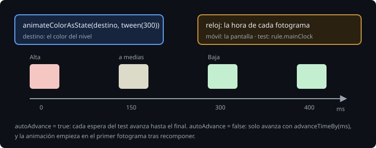

# Animar un valor, y el reloj

> Hasta ahora, cuando cambiaba el estado, la pantalla saltaba: la insignia de una observación pasaba del rosa de Alta al verde de Baja de un fotograma al siguiente. Un cambio que se ve llegar se entiende mejor. Esta teoría es la animación más pequeña de Compose, un valor que va del de antes al de después, y cómo se prueba en la JVM parando el reloj.

## 🎯 Objetivos

- Animar un valor con `animate*AsState` y elegir entre `tween` y `spring`
- Explicar de dónde saca el tiempo una animación de Compose
- Probar una animación a medias con `mainClock`

## 1. animate*AsState



```kotlin
val color by animateColorAsState(colorResource(level.color), tween(300), label = "badge")
```

Se le da el valor al que tiene que llegar. Mientras ese valor no cambia, devuelve el mismo. Cuando cambia, devuelve en cada fotograma uno intermedio, hasta llegar. Hay uno por tipo: `animateFloatAsState`, `animateDpAsState`, `animateColorAsState`, `animateIntOffsetAsState`... `label` es el nombre con que la ve el inspector de animaciones de Android Studio.

Lo que no hace es decidir nada: el estado sigue siendo el nivel, y el color animado se calcula a partir de él. Si la app muere a media animación, al volver el color es el del nivel, sin animar.

## 2. tween o spring

El segundo argumento dice cómo se va de un valor al otro:

- `tween(300)`: en 300 ms, con una curva de aceleración (por defecto, `FastOutSlowInEasing`). La duración está fijada.
- `spring()`: como un muelle, con su rigidez y su amortiguación. No tiene duración: llega cuando la distancia es menor que un umbral. Es el valor por defecto, y se puede interrumpir sin saltos: si el destino cambia a medias, sigue desde donde está y con la velocidad que lleva.

> 🔬 Medido en el ejercicio 01 (paso 5c): con el `spring()` por defecto en vez de `tween(300)`, a los 150 ms la insignia ya tiene el color de Baja: falla `theBadgeChangesColorIn300Milliseconds` con `Values should be different. Actual: Color(0.76862746, 0.93333334, 0.8156863, ...)`.

Para un color o una opacidad, un `tween` corto; para lo que se mueve y el usuario puede interrumpir (un arrastre, una fila que vuelve a su sitio), un `spring`.

## 3. El reloj

Una animación de Compose no lleva un temporizador propio. Cada fotograma, el `Recomposer` le da la hora del fotograma (un `MonotonicFrameClock`), y ella calcula su valor para esa hora. En un móvil, la hora la marca la pantalla, unas 60 o 120 veces por segundo.

En un test, el reloj es de la regla: `rule.mainClock`. Por defecto avanza solo (`autoAdvance = true`), y cada vez que el test espera a que Compose esté en reposo, avanza hasta que no queda ninguna animación.

> 🔬 Medido en la sonda: con el reloj automático, justo después de `performClick()`, la animación de 300 ms ya ha terminado, y `mainClock.currentTime` está en 400 ms.

Para ver una animación a medias, se para el reloj y se avanza a mano:

```kotlin
rule.mainClock.autoAdvance = false
rule.onNodeWithText("A-1").performTouchInput { longClick() }
rule.mainClock.advanceTimeBy(150)
// aquí, a medias
rule.mainClock.advanceTimeBy(250)
// aquí, ya en el de Baja
```

> 🔬 Medido en la sonda, de azul (`#0000FF`) a rojo con `tween(300)`: el rojo vale 0 a los 16 ms, 0.35 a los 100, 0.78 a los 150, 0.94 a los 200 y 1.0 a los 300.

El primer fotograma solo arranca la animación: hasta el siguiente no se mueve nada. Y si el estado cambia desde el test, sin un clic, hay que dejar que Compose recomponga antes de avanzar el reloj:

> 🔬 Medido en el proyecto: con `level = Level.LOW` desde el test y enseguida `advanceTimeBy(150)`, la insignia sigue en el color de Alta: la recomposición llega al final de esos 150 ms y la animación empieza ahí. Con `rule.waitForIdle()` entre las dos, que con el reloj parado recompone sin avanzarlo, a los 150 ms ya va a medias.

## 4. La escala de animación del sistema

En las opciones de desarrollador, y en las de accesibilidad como "Quitar animaciones", Android tiene una escala de duración de las animaciones (`Settings.Global.ANIMATOR_DURATION_SCALE`). Compose la aplica a sus animaciones en el móvil: con 0, llegan sin pasar por los intermedios. Por eso una animación no puede ser lo único que dice que algo ha pasado.

> 🔬 Medido en la sonda: en Robolectric, con esa escala a 0, la animación sigue en el color de antes tras dos fotogramas: en los tests manda `mainClock`, no la escala del sistema.

## ✅ Comprueba

- [ ] ¿Qué devuelve `animateColorAsState` mientras el valor de destino no cambia? ¿Y cuando cambia?
- [ ] ¿Cuándo usarías `tween` y cuándo `spring`?
- [ ] Un test pulsa y comprueba el color, y siempre ve el final. ¿Por qué, y cómo se ve la mitad?
