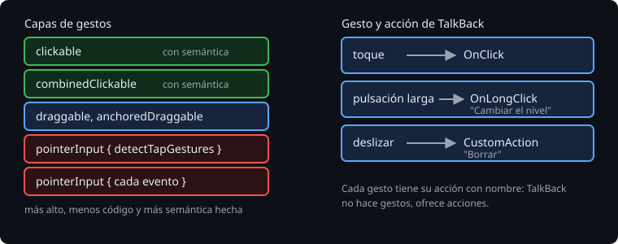

# Gestos

> Un toque abre, una pulsación larga cambia algo, deslizar borra. Los gestos dan atajos, pero tienen dos problemas: no se ven, y quien usa TalkBack no los puede hacer igual. Esta teoría es cómo recoge Compose un gesto, del más sencillo al más a mano, cómo se prueba en la JVM, y la regla que va con todos: cada gesto tiene su acción de accesibilidad.

## 🎯 Objetivos

- Recoger un toque y una pulsación larga con `combinedClickable`, con su etiqueta
- Saber cuándo bajar a `pointerInput`, `draggable` o `anchoredDraggable`
- Probar gestos con `performTouchInput`

## 1. Del más alto al más bajo



Compose tiene los gestos en capas. Se usa la más alta que sirva:

| Nivel | Qué es | Para qué |
| --- | --- | --- |
| `clickable` | Un toque, con su efecto visual y su semántica (`OnClick`, `Role`) | Abrir una fila |
| `combinedClickable` | Toque, doble toque y pulsación larga | Una fila con una acción secundaria |
| `draggable`, `anchoredDraggable` | Arrastrar en un eje; con anclas, hasta posiciones fijas | Un deslizador, una fila que se aparta |
| `pointerInput { detectTapGestures {} }`, `detectDragGestures {}` | El gesto a mano, con las posiciones | Un dibujo, un mapa |
| `pointerInput { awaitPointerEventScope {} }` | Cada evento del dedo | Casi nunca |

Las capas altas traen la semántica hecha: `clickable` dice que se puede pulsar y cómo se llama la acción. `pointerInput` no trae nada: el gesto existe para el dedo y no para TalkBack.

## 2. combinedClickable

```kotlin
Modifier.combinedClickable(
    onLongClickLabel = stringResource(R.string.change_level),
    onLongClick = onChangeLevel,
    onClick = onToggle,
)
```

TalkBack no hace pulsaciones largas: lee las acciones del nodo y ofrece la pulsación larga como una acción más, con esa etiqueta como nombre.

> 🔬 Medido en la sonda: un nodo con `combinedClickable` tiene en su semántica `Actions = [..., OnClick, OnLongClick, ...]`.

> 🔬 Medido en el ejercicio 01 (paso 5b): sin `onLongClickLabel`, la acción sigue ahí, pero sin nombre: falla `theLongPressHasALabel` con `expected:<Cambiar el nivel> but was:<null>`.

## 3. Probar un gesto

`performTouchInput` simula el dedo sobre un nodo:

```kotlin
rule.onNodeWithText("A-1").performTouchInput { longClick() }
rule.onNodeWithText("A-2 ·", substring = true).performTouchInput { swipeLeft() }
```

Hay `click()`, `doubleClick()`, `longClick()`, `swipeLeft()`, `swipeRight()`, `swipeUp()`, y a mano `down`, `moveBy` y `up`. Funcionan en Robolectric, en la JVM.

> 🔬 Medido en la sonda: `longClick()` sobre un `combinedClickable` llama a `onLongClick`, y `performClick()` a `onClick`.

Y para lo que hace TalkBack, la acción directamente, sin dedo: `performSemanticsAction(SemanticsActions.OnLongClick)`, o la acción propia de la [teoría 04](04-deslizar-para-borrar.md).

## 4. Un gesto, una acción

Un gesto sin acción es una función escondida para quien no lo descubre, e imposible para quien no puede hacerlo. La regla de la Bitácora:

- Cada gesto tiene una acción de semántica con nombre: `onLongClickLabel`, o una `CustomAccessibilityAction`.
- Lo que hace un gesto destructivo se puede deshacer.
- Un gesto no tiene dos sentidos que hagan cosas distintas sin que se vea cuál es cuál.

## ✅ Comprueba

- [ ] ¿Por qué empezar por `combinedClickable` y no por `pointerInput { detectTapGestures {} }`?
- [ ] ¿Qué lee TalkBack de una pulsación larga, y de dónde sale?
- [ ] ¿Cómo prueba un test un deslizamiento, y cómo lo que haría TalkBack en su lugar?
