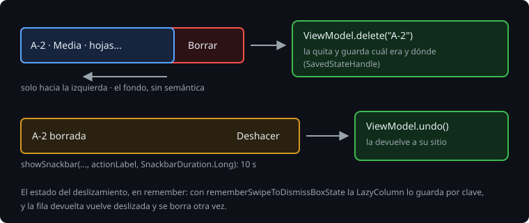

# Deslizar para borrar

> En la Bitácora no se podía borrar una observación: una equivocada se quedaba en la sesión. Deslizar una fila hacia un lado para borrarla es el gesto que conoce cualquiera que use el correo en el móvil. Esta teoría es `SwipeToDismissBox` de Material 3, lo que no hace solo (accesibilidad y deshacer), y un fallo que sale justo al deshacer.

## 🎯 Objetivos

- Borrar una fila deslizando con `SwipeToDismissBox`, en un solo sentido
- Hacer que TalkBack lea la fila sin el fondo y pueda borrarla
- Deshacer con un `Snackbar`, sin que la fila devuelta se vuelva a borrar

## 1. SwipeToDismissBox



```kotlin
SwipeToDismissBox(
    state = state,
    backgroundContent = { Text("Borrar", ...) },
    enableDismissFromStartToEnd = false,
    onDismiss = { onDelete() },
) {
    ObservationRow(...)
}
```

El contenido se arrastra encima del fondo; si se suelta pasado el umbral, sale de la pantalla y se llama a `onDismiss`. En Material 3 1.4.0 es estable, y `onDismiss` sustituye al viejo `confirmValueChange`.

> 🔬 Medido en la sonda: sin más, se borra en los dos sentidos: `swipeLeft()` da `EndToStart` y `swipeRight()` da `StartToEnd`.

Un gesto, una acción: con `enableDismissFromStartToEnd = false`, solo hacia la izquierda.

> 🔬 Medido en el ejercicio 02 (paso 5b): sin él, falla `swipingRightDoesNothing`: deslizar A-3 hacia la derecha también la borra.

El contenido necesita fondo propio (un `Surface`, o `background(colorScheme.surface)`): si no, se ve el "Borrar" de detrás a través de la fila.

## 2. Lo que lee TalkBack

`SwipeToDismissBox` no añade ninguna acción de accesibilidad, y el fondo está compuesto siempre, aunque no se vea.

> 🔬 Medido en la sonda: el árbol de semántica de una lista con `SwipeToDismissBox` no tiene ninguna acción para borrar, y cada fila tiene su nodo `Text = '[borrar]'` aunque no se haya deslizado. Con la fila unida (`mergeDescendants`), TalkBack lee `"borrar, fila A-1"`.

Dos arreglos:

```kotlin
backgroundContent = { Text(delete, Modifier.clearAndSetSemantics {}) },
// y en el nodo de la fila:
Modifier.semantics { customActions = listOf(CustomAccessibilityAction(delete) { onDelete(); true }) }
```

`clearAndSetSemantics {}` borra la semántica del fondo: solo se ve. `customActions` añade "Borrar" a las acciones de la fila: TalkBack la ofrece en su menú de acciones.

> 🔬 Medido en el ejercicio 02 (paso 5c): sin `clearAndSetSemantics`, falla `talkBackReadsOnlyTheRow` con `expected:<[A-1 · Alta · riego roto en el sector norte]> but was:<[Borrar, A-1 · Alta · riego roto en el sector norte]>`.

La acción tiene que ir en el nodo que TalkBack enfoca, el que tiene el texto de la fila: en la Bitácora, el de `ObservationRow`, que ya une su semántica con `clickable`.

## 3. Deshacer

Borrar con un gesto que se hace sin querer necesita deshacer. El `Snackbar` de Material lo ofrece abajo, sin bloquear la pantalla:

```kotlin
scope.launch {
    val result = snackbar.showSnackbar("A-2 borrada", actionLabel = "Deshacer", duration = SnackbarDuration.Long)
    if (result == SnackbarResult.ActionPerformed) onUndo()
}
```

`showSnackbar` es `suspend`: espera hasta que el aviso se va, y dice por qué. Va en una corrutina de `rememberCoroutineScope()`, y el `SnackbarHost` se pinta en la pantalla.

> 🔬 Medido en la sonda: con `actionLabel` y sin `duration`, el aviso no se va nunca: con una acción, la duración por defecto es `Indefinite`. Con `SnackbarDuration.Long`, sigue a los 9 s y se ha ido a los 11.

> 🔬 Medido en el ejercicio 02 (paso 5d): sin `SnackbarDuration.Long`, falla `theSnackbarGoesAwayAfterTenSeconds`: a los 11 s sigue el "Deshacer".

Qué borrar y cómo deshacerlo es del `ViewModel`: quita la observación y guarda cuál era y dónde estaba, para devolverla a su sitio. En la Bitácora, en el `SavedStateHandle`.

## 4. La fila que vuelve deslizada

`rememberSwipeToDismissBoxState()` guarda su estado con `rememberSaveable`, y una `LazyColumn` conserva el estado guardado de cada clave aunque la fila deje de estar, como si se hubiera ido de la pantalla con el scroll.

> 🔬 Medido en el ejercicio 02: con `rememberSwipeToDismissBoxState()`, al pulsar "Deshacer" la sesión hace `remove A-2`, `restore A-2` y otra vez `remove A-2`: la fila vuelve con su estado guardado, "deslizada", y `SwipeToDismissBox` llama otra vez a `onDismiss`. Falla `undoPutsItBackInItsPlace`.

El arreglo es no guardar ese estado, que solo vale mientras el dedo está encima:

```kotlin
val threshold = SwipeToDismissBoxDefaults.positionalThreshold
val state = remember { SwipeToDismissBoxState(SwipeToDismissBoxValue.Settled, threshold) }
```

## 5. Los códigos

Borrar destapa un fallo que estaba desde que se añaden observaciones: la siguiente se llamaba `"A-${size + 1}"`. Con A-1, A-2 y A-3, borrar A-2 y añadir una da otra A-3.

> 🔬 Medido en el proyecto: con el código de antes, borrar A-2, añadir una y bajar hasta ella cierra la app con `IllegalArgumentException: Key "A-3" was already used. If you are using LazyColumn/Row please make sure you provide a unique key for each item.`

El código de la siguiente es uno más que el mayor, y es una regla del dominio: va en `core`, con su test.

## ✅ Comprueba

- [ ] ¿Qué dos cosas no hace `SwipeToDismissBox` para TalkBack, y cómo se arreglan?
- [ ] Con `actionLabel` y sin `duration`, ¿cuánto dura un `Snackbar`?
- [ ] ¿Por qué la fila devuelta con "Deshacer" se volvía a borrar?
- [ ] ¿Qué pasaba con los códigos al borrar, y dónde se arregla?
