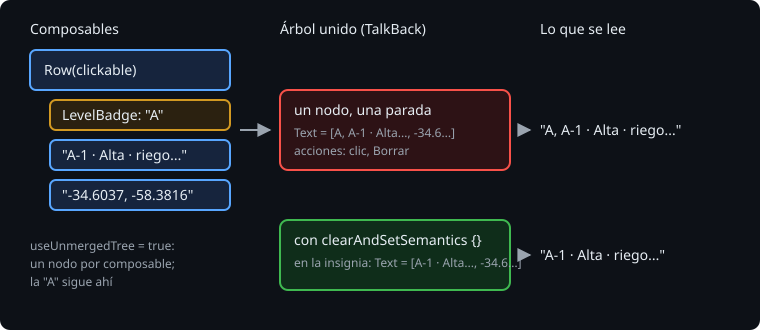

# Lo que lee TalkBack

> TalkBack no ve la pantalla. Recibe un árbol de nodos, cada uno con su texto, su papel, su estado y sus acciones, y va de uno a otro con el dedo. En Compose, ese árbol es el de semántica, y sale de los composables. Esta teoría es cómo se forma, qué llega de verdad al lector de pantalla, y cómo se quita lo que sobra.

## 🎯 Objetivos

- Distinguir el árbol de semántica unido del árbol sin unir
- Saber qué nodos son una parada de TalkBack y qué lee en cada una
- Quitar de lo que se lee lo que solo es decoración

## 1. El árbol de semántica



Cada `Text`, cada `Button` y cada modifier `clickable` o `semantics` añade un nodo con propiedades: `Text`, `ContentDescription`, `Role`, `OnClick`... Los tests de Compose buscan en ese árbol (`onNodeWithText` no mira píxeles), y Android lo convierte en los `AccessibilityNodeInfo` que lee TalkBack.

Un nodo puede **unir** a sus descendientes (`mergeDescendants`): `clickable`, `toggleable` y los botones de Material lo hacen. TalkBack se para en el nodo unido y lee los textos de todos sus hijos, en orden.

```kotlin
Row(Modifier.clickable { ... }) {       // un nodo unido: una parada
    LevelBadge(observation.level)       // Text("A")
    Text("A-1 · Alta · riego roto...")
    Text("-34.6037, -58.3816")
}
```

> 🔬 Medido en la Bitácora de la semana 25, pidiendo a Robolectric los `AccessibilityNodeInfo` de la pantalla: la fila es un nodo con `focusable=true` y la acción `Borrar`, con tres hijos `TextView`: `A`, `A-1 · Alta · riego roto en el sector norte` y `-34.6037, -58.3816`. TalkBack lee "A, A-1 · Alta...". El título, el resumen y cada botón son paradas sueltas.

Hay dos árboles. El **unido** (el que usan los tests por defecto) es lo que se convierte en nodos para TalkBack: un nodo por parada, con los textos de sus hijos juntos. El **sin unir** (`useUnmergedTree = true`) tiene un nodo por cada composable, y sirve para buscar una pieza concreta.

## 2. Lo que sobra

La letra de la insignia repite el nivel, que ya dice la línea. Es decoración: se ve, pero no se debe leer.

```kotlin
Box(modifier.size(40.dp).clip(...).drawBehind { ... }.clearAndSetSemantics {}) {
    Text(stringResource(level.short))
}
```

`clearAndSetSemantics {}` borra la semántica del nodo y la de todos sus hijos, y pone la que se le da: con `{}`, nada.

> 🔬 Medido en la Bitácora: con `clearAndSetSemantics {}` en la insignia, el texto de la fila en el árbol unido pasa de `[A, A-1 · Alta · riego roto en el sector norte, -34.6037, -58.3816]` a `[A-1 · Alta · riego roto en el sector norte, -34.6037, -58.3816]`, y el `TextView` "A" desaparece de los nodos de TalkBack.

> 🔬 Medido en la Bitácora: con `semantics { hideFromAccessibility() }` en la caja de la insignia, el `TextView` "A" sigue en los nodos de TalkBack, con `isImportantForAccessibility=true`: esconde la caja, no al `Text` de dentro. Para callar un composable entero, `clearAndSetSemantics {}`.

> 🔬 Medido en la Bitácora: con `clearAndSetSemantics {}`, `onNodeWithText("A", useUnmergedTree = true)` sigue encontrando la letra, y los tests de la semana 22 que la buscaban así siguen en verde. Lo que lee TalkBack se mira en el árbol unido.

## 3. Un texto para lo que no es texto

Un icono, un dibujo o una imagen no tienen texto: TalkBack los lee como "botón" sin más, o se los salta. Su nombre va en `contentDescription`:

```kotlin
Box(Modifier.clickable(role = Role.Button, onClick = onShare).semantics { contentDescription = share }) { ... }
```

`Icon` e `Image` lo piden como parámetro. Si es decoración, `contentDescription = null`; si hace algo, el nombre de lo que hace ("Compartir"), no de lo que se ve ("tres puntos"). Y siempre de los recursos: TalkBack lo lee en el idioma del móvil.

## ✅ Comprueba

- [ ] ¿Qué diferencia hay entre el árbol unido y el sin unir? ¿Cuál se convierte en lo que lee TalkBack?
- [ ] ¿Qué leía TalkBack de una fila de la Bitácora, y por qué empezaba por "A"?
- [ ] ¿Por qué `hideFromAccessibility()` en la caja no calla la insignia, y `clearAndSetSemantics {}` sí?
- [ ] ¿Qué `contentDescription` lleva un icono de decoración, y uno que hace algo?
