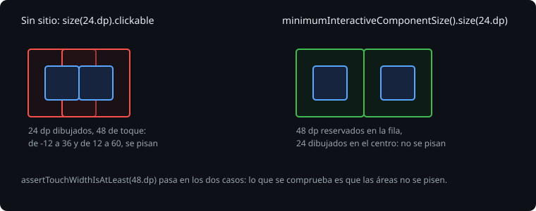

# Probar la accesibilidad

> Lo que lee TalkBack está en el árbol de semántica, y los tests de Compose ya lo leen: se puede comprobar en la JVM, sin móvil y sin TalkBack. Esta teoría es cómo, con qué comprobaciones (nombre, papel, área de toque y letra grande), y por qué la herramienta automática de Google no sirve aquí.

## 🎯 Objetivos

- Comprobar papel, estado, encabezados y regiones vivas con matchers de semántica
- Saber qué mide de verdad un área de toque, y cuándo dos se pisan
- Probar la letra al doble, y saber qué no comprueba Robolectric

## 1. Matchers de semántica

```kotlin
rule.onNodeWithText("A-1").assert(isHeading())
rule.onNodeWithText("Urgente")
    .assert(SemanticsMatcher.expectValue(SemanticsProperties.Role, Role.Switch))
    .assert(SemanticsMatcher.expectValue(SemanticsProperties.ToggleableState, ToggleableState.Off))
rule.onNodeWithContentDescription("Seguir").performClick()
```

Se buscan en el árbol unido, que es el de TalkBack: si un texto no está ahí como nodo propio (`onAllNodesWithText("A").assertCountEquals(0)`), TalkBack no se para en él. El texto completo de una parada, con sus hijos, está en `fetchSemanticsNode().config[SemanticsProperties.Text]`.

## 2. El área de toque

Un dedo necesita unos 48 x 48 dp. Material lo da en sus componentes; un `Box` con `clickable` mide lo que mida.



> 🔬 Medido en la sonda: un `Box` de 24 dp con `clickable` tiene `boundsInRoot` de 24 x 24 y `touchBoundsInRoot` de 48 x 48 (de -12 a 36): Compose agranda el área de toque sola. Pero no le hace sitio: con dos botones de 24 dp juntos, las áreas van de -12 a 36 y de 12 a 60, y se pisan.

Por eso `assertTouchWidthIsAtLeast(48.dp)` pasa siempre, y no basta. El arreglo es reservar el sitio con `minimumInteractiveComponentSize()`, **antes** del `size`:

```kotlin
Modifier.minimumInteractiveComponentSize().size(24.dp).toggleable(...)
```

> 🔬 Medido en la sonda: con `minimumInteractiveComponentSize()` antes de `size(24.dp)`, el botón ocupa 48 dp en la fila y se dibuja de 24 en el centro; después de `size(24.dp)` no hace nada (el `size` ya ha fijado los 24).

Lo que se comprueba entonces es que dos áreas no se pisen: `assertFalse(follow.overlaps(share))`.

## 3. La letra grande

Quien pone la letra al doble tiene que poder leerlo todo. Lo que se rompe es lo que corta (`maxLines`, alturas fijas) o lo que no cabe.

```kotlin
@Test
@Config(fontScale = 2f)
@GraphicsMode(GraphicsMode.Mode.NATIVE)
fun withBigTextTheLineIsNotCut() {
    val results = mutableListOf<TextLayoutResult>()
    rule.onNodeWithText("Alta · ...").fetchSemanticsNode().config[SemanticsActions.GetTextLayoutResult].action?.invoke(results)
    assertFalse(results.single().hasVisualOverflow)
}
```

> 🔬 Medido en el ejercicio 01: con `maxLines = 1` y `fontScale = 2f`, la línea tiene `hasVisualOverflow = true`. Sin `@GraphicsMode(NATIVE)`, Robolectric no mide el texto de verdad, y la línea sigue cortada aunque se quite `maxLines`: con los gráficos nativos, no.

## 4. Lo que no hace Robolectric

Google tiene una herramienta que revisa una pantalla entera (el Accessibility Test Framework, ATF): etiquetas, áreas de toque, contraste. En Compose se activa con `enableAccessibilityChecks()`, de `ui-test-junit4-accessibility`, que está en el BOM y trae `accessibility-test-framework` 4.1.1.

> 🔬 Medido en la sonda, con un botón de 20 dp, otro sin etiqueta y un texto gris claro sobre blanco: los cuatro tests pasan. El código de `enableAccessibilityChecks` mira si el `Build.FINGERPRINT` es de Robolectric y, si lo es, escribe en el log `Accessibility checks are currently not supported by Robolectric` y no comprueba nada.

Sirve en los tests instrumentados, en un móvil o un emulador. En la Bitácora, que se prueba en la JVM, no se añade: los tests de semántica de arriba hacen lo mismo con lo que importa, y una comprobación hecha a mano lo cubre todo:

```kotlin
for (node in rule.onAllNodes(hasClickAction()).fetchSemanticsNodes()) {
    val label = node.config.getOrNull(SemanticsProperties.Text).orEmpty() + node.config.getOrNull(SemanticsProperties.ContentDescription).orEmpty()
    assertTrue(label.isNotEmpty(), "sin etiqueta: ${node.config}")
}
```

El contraste (4.5:1 entre el texto normal y su fondo, 3:1 para el grande, según las WCAG) se cuida en el tema: los esquemas de Material 3 ya lo cumplen entre cada color y su `on...`. Lo que lo rompe es un color escrito a mano o un `alpha` bajo.

## ✅ Comprueba

- [ ] ¿Por qué `assertTouchWidthIsAtLeast(48.dp)` pasa con un botón de 24 dp? ¿Qué se comprueba en su lugar?
- [ ] ¿Dónde va `minimumInteractiveComponentSize()`, y qué pasa si va después de `size`?
- [ ] ¿Qué hace falta en un test de letra grande para que el texto se mida?
- [ ] ¿Qué hace `enableAccessibilityChecks()` en Robolectric, y dónde sí sirve?
