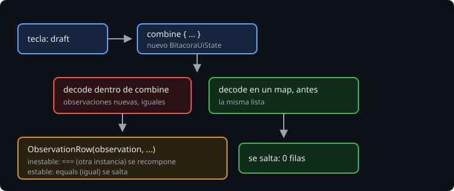

# Estabilidad y saltarse una composición

> Cuando cambia un estado, Compose vuelve a ejecutar las funciones que lo leen, y desde ahí baja por las que llaman. A cada una que se encuentra le pregunta si sus parámetros han cambiado; si no, se la salta. Esta teoría es cómo decide que "no han cambiado", por qué a veces no se fía, y cómo se ve lo que decide: con los informes del compilador.

## 🎯 Objetivos

- Saber qué compara Compose para saltarse una función, y con qué
- Leer un informe del compilador de Compose
- Hacer estable una clase, en un módulo con Compose y en uno sin él

## 1. Saltarse una función



El compilador de Compose marca cada `@Composable` como `restartable` (se puede volver a ejecutar sola) y, si puede, `skippable` (se la puede saltar). Al recomponer, una función `skippable` se salta si todos sus parámetros son iguales a los de la vez anterior.

"Iguales" depende de la **estabilidad** del tipo:

- **Estable**: Compose se fía de `equals`. Lo son los primitivos, `String`, los `enum`, las funciones, y las clases con solo `val` de tipos estables, compiladas por el compilador de Compose.
- **Inestable**: puede cambiar por dentro sin que Compose se entere (un `var`, una clase de otro módulo que no pasó por el compilador de Compose). Se compara con `===`: solo es igual si es la misma instancia.
- **Runtime**: depende de un tipo que no se conoce al compilar, como `List<T>` (una `List` puede ser una `MutableList`). Se decide al ejecutar.

Desde Kotlin 2.0.20 está activado el **strong skipping**: todas las funciones son `skippable`, también con parámetros inestables (comparados con `===`), y las lambdas se recuerdan solas según lo que capturan.

> 🔬 Medido en las métricas del ejercicio 02: `"StrongSkipping": true` en `featureFlags`, sin haberlo pedido.

## 2. Los informes

```kotlin
composeCompiler {
    reportsDestination = layout.buildDirectory.dir("compose")
    metricsDestination = layout.buildDirectory.dir("compose")
}
```

Al compilar, deja en `build/compose` tres archivos: `app-composables.txt` (cada función y la estabilidad de cada parámetro), `app-classes.txt` (cada clase y por qué es o no estable) y las métricas en JSON.

> 🔬 Medido en la Bitácora de la semana 25 (`./gradlew :app:compileFieldReleaseKotlin`):
> ```
> restartable skippable scheme("[androidx.compose.ui.UiComposable]") fun dev.bitacora.ObservationRow(
>   unstable observation: Observation
>   stable onClick: Function0<Unit>
>   stable modifier: Modifier? = @static <expression>
> )
> unstable class dev.bitacora.BitacoraUiState {
>   stable val draft: String
>   unstable val position: Position?
>   ...
> ```
> `Observation` y `Position` son `data class` de solo `val`, pero están en `core`, que no pasa por el compilador de Compose: para él son inestables.

> 🔬 Medido en el ejercicio 02: los archivos `.txt` los escribe cada compilación, también la de los tests, y la última gana. Tras `./gradlew test`, `app-composables.txt` tiene las funciones de los tests (ninguna), no las de la app. Para leerlo, `./gradlew :app:compileDebugKotlin --rerun` (o la variante que toque) justo antes.

## 3. Hacer estable una clase

Si la clase está en un módulo con Compose, se marca: `@Immutable` (nada cambia después de crearla) o `@Stable` (lo que cambia avisa a Compose, como un `mutableStateOf`). Es una promesa: Compose no la comprueba.

```kotlin
@Immutable
data class Item(val code: String, val level: Level, val description: String, val tags: List<String>)
```

> 🔬 Medido en el ejercicio 02: sin `@Immutable`, `runtime class dev.bitacora.Item` con `<runtime stability> = Uncertain(List)`, y el parámetro sale `row: Item`, sin `stable`. Con ella, `stable class dev.bitacora.Item` y `stable row: Item`.

Si la clase está en un módulo sin Compose, como `core` en la Bitácora (que no debe depender de Android ni de Compose), se dice desde fuera, con un **archivo de estabilidad**:

```kotlin
// app/build.gradle.kts
composeCompiler {
    stabilityConfigurationFiles.add(layout.projectDirectory.file("compose-stability.conf"))
}
```

```
// app/compose-stability.conf
dev.bitacora.core.*
```

> 🔬 Medido en la Bitácora: con el archivo, `stable observation: Observation` en `ObservationRow`, y `BitacoraUiState` pasa de `unstable` a `runtime` (le queda la `List`).

Como `@Immutable`, es una promesa: si alguien añade un `var` a una clase de `core`, Compose se saltará filas que sí han cambiado.

## ✅ Comprueba

- [ ] ¿Con qué compara Compose un parámetro estable, y con qué uno inestable con *strong skipping*?
- [ ] ¿Por qué `Observation`, una `data class` de solo `val`, salía `unstable` en el informe?
- [ ] ¿Por qué el informe puede estar vacío después de `./gradlew test`?
- [ ] ¿Qué se promete con `@Immutable` o con el archivo de estabilidad, y qué pasa si se rompe la promesa?
