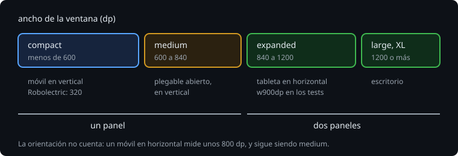

# Clases de tamaño de ventana

> Una app de Android no sabe en qué móvil está: puede estar en una tableta, en un plegable abierto, en la mitad de una pantalla partida o en una ventana de escritorio que el usuario estira con el ratón. Lo único que sabe es cuánto mide su ventana. Las clases de tamaño son los tramos en los que se reparte ese ancho, y cada tramo pide una forma de pantalla.

## 🎯 Objetivos

- Conocer los tramos de ancho (compact, medium, expanded) y dónde cambian
- Leer la clase de tamaño en Compose con `currentWindowAdaptiveInfoV2()`
- Saber por qué no se decide por la orientación ni por el modelo
- Simular ventanas de cualquier tamaño en Robolectric

## 1. Los tramos



Material 3 parte el ancho de la ventana en tramos, en dp:

| Clase | Ancho | Dónde se ve | Forma habitual |
| --- | --- | --- | --- |
| compact | menos de 600 | un móvil en vertical | un panel |
| medium | de 600 a 840 | un plegable abierto en vertical, una tableta pequeña en vertical | un panel, más ancho |
| expanded | de 840 a 1200 | una tableta en horizontal, un plegable abierto en horizontal | dos paneles |
| large y extra-large | 1200 o más, 1600 o más | escritorio, monitores | dos o tres paneles |

El alto también tiene tramos (compact por debajo de 480), pero casi siempre manda el ancho. Los números son de la clase `WindowSizeClass` de `androidx.window` (`WIDTH_DP_MEDIUM_LOWER_BOUND = 600`, `WIDTH_DP_EXPANDED_LOWER_BOUND = 840`...).

Una clase de tamaño no es un tamaño exacto: es "al menos tanto". Se pregunta así:

```kotlin
if (sizeClass.isWidthAtLeastBreakpoint(WindowSizeClass.WIDTH_DP_EXPANDED_LOWER_BOUND)) {
    // dos paneles
}
```

## 2. En Compose

`material3-adaptive` (`androidx.compose.material3.adaptive:adaptive`) lee la ventana y la da como estado:

```kotlin
@Composable
fun SessionScreen(observations: List<Observation>) {
    val info = currentWindowAdaptiveInfoV2()
    val twoPanes = info.windowSizeClass.isWidthAtLeastBreakpoint(WindowSizeClass.WIDTH_DP_EXPANDED_LOWER_BOUND)
    ...
}
```

`WindowAdaptiveInfo` trae dos cosas: `windowSizeClass` (los tramos) y `windowPosture` (la bisagra, teoría 03). Cuando la ventana cambia (girar, desplegar, estirar), cambia el estado y la pantalla se recompone.

> 🔬 Medido con adaptive 1.3.0: `currentWindowAdaptiveInfo()`, sin el `V2`, está deprecada, y con `allWarningsAsErrors` no compila ("Please use V2 version of this function to support L and XL width size classes"). La `V2` es la que conoce los tramos large y extra-large.

La decisión de la forma conviene sacarla a una función sin Compose, que se prueba sin pantalla:

```kotlin
fun layoutFor(sizeClass: WindowSizeClass, posture: Posture): Layout = when {
    posture.isTabletop -> Layout.TABLETOP
    sizeClass.isWidthAtLeastBreakpoint(WindowSizeClass.WIDTH_DP_EXPANDED_LOWER_BOUND) -> Layout.TWO_PANES
    else -> Layout.ONE_PANE
}

@Test
fun mediumHasOnePane() = assertEquals(Layout.ONE_PANE, layoutFor(WindowSizeClass(minWidthDp = 600, minHeightDp = 480), Posture()))
```

`WindowSizeClass` y `Posture` se construyen a mano: son clases de datos.

## 3. Lo que no se mira

- **La orientación.** Un móvil en horizontal mide unos 800 dp de ancho (medium) y 400 de alto; un plegable abierto en vertical, unos 670 de ancho. "Horizontal" no dice cuánto sitio hay.
- **El modelo o "si es una tableta".** En una tableta, la app puede estar en media pantalla, a 600 dp. En un móvil, en una ventana de escritorio, a 1200.
- **El tamaño de la pantalla.** Lo que cuenta es la ventana de la app, no la pantalla entera: con la pantalla partida, la pantalla mide 1280 y la ventana 640.

Según la documentación de Android 16 (API 36), con `targetSdk` 36 y en pantallas con un ancho mínimo (`sw`) de 600 dp o más, el sistema no hace caso de `screenOrientation` ni de `resizeableActivity="false"`: la app se estira. Quien bloqueaba la orientación para no pensar en pantallas grandes, ya no puede.

## 4. En Robolectric

Robolectric simula la ventana con los qualifiers de recursos:

```kotlin
@Test
@Config(qualifiers = "w900dp-h600dp")
fun expandedShowsBoth() { ... }
```

> 🔬 Medido: sin qualifiers, la ventana de Robolectric mide 320 x 470 dp, y `currentWindowAdaptiveInfoV2().windowSizeClass` es `WindowSizeClass(minWidthDp=0, minHeightDp=0)`: compact de ancho y de alto (470 < 480). Con `w900dp-h600dp`, `WindowSizeClass(minWidthDp=840, minHeightDp=480)`.

Fíjate en que la clase dice el tramo, no el tamaño: 900 dp se queda en 840, el principio de expanded.

Para cambiar el tamaño a mitad de un test (como al desplegar un plegable), `RuntimeEnvironment.setQualifiers` y recrear la actividad (teoría 03, apartado 4).

## ✅ Comprueba

- [ ] ¿En qué clase de ancho cae una ventana de 700 dp? ¿Y una de 840?
- [ ] ¿Por qué un móvil en horizontal no es una razón para poner dos paneles?
- [ ] ¿Qué devuelve `windowSizeClass` en una ventana de 900 x 600 dp, y por qué no dice 900?
- [ ] ¿Cómo pruebas la decisión de la forma sin pintar nada?
