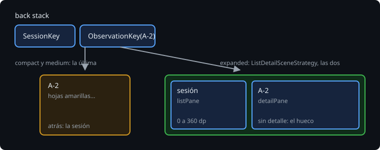

# List-detail con Navigation 3

> En la semana 24, el back stack de la Bitácora era una lista de claves y `NavDisplay` pintaba la última. En un móvil, eso es justo lo que se quiere. En una pantalla ancha, se quiere otra cosa: la sesión siempre a la izquierda y lo abierto a la derecha. Navigation 3 lo resuelve sin tocar el back stack: una estrategia de escenas decide cuántas entradas se pintan a la vez.

## 🎯 Objetivos

- Entender qué es una escena y qué hace una estrategia de escenas
- Marcar cada destino como panel de lista o de detalle
- Poner un hueco cuando no hay nada abierto
- Saber qué pasa con atrás y con abrir otro detalle cuando hay dos paneles

## 1. Escenas



Una **escena** es lo que `NavDisplay` pinta de una vez: una o varias entradas del back stack. Por defecto, la escena es la última entrada sola. Una **estrategia de escenas** (`SceneStrategy`) mira el back stack y decide si puede hacer una escena con varias entradas.

`adaptive-navigation3` (`androidx.compose.material3.adaptive:adaptive-navigation3`) trae `ListDetailSceneStrategy`: si el final del back stack es una entrada de lista seguida de una de detalle, y la ventana tiene sitio, las pinta juntas.

```kotlin
NavDisplay(
    backStack = backStack,
    onBack = { backStack.removeLastOrNull() },
    sceneStrategies = listOf(rememberListDetailSceneStrategy(backNavigationBehavior = BackNavigationBehavior.PopUntilContentChange)),
    entryProvider = entryProvider {
        entry<SessionKey>(metadata = ListDetailSceneStrategy.listPane(detailPlaceholder = { Choose() })) { ... }
        entry<ObservationKey>(metadata = ListDetailSceneStrategy.detailPane()) { key -> ... }
        entry<MapKey>(metadata = ListDetailSceneStrategy.detailPane()) { ... }
    },
)
```

El back stack no cambia: sigue siendo `[SessionKey, ObservationKey("A-2")]` en el móvil y en la tableta. Lo que cambia es cuántas entradas caben en la escena. Por eso los enlaces de la semana 24 siguen funcionando igual.

> 🔬 Medido con adaptive 1.3.0: `rememberListDetailSceneStrategy` y `listPane`/`detailPane` son `@ExperimentalMaterial3AdaptiveApi`, aunque la versión sea estable, y sin `@OptIn` no compila. Se pone en la función que los usa, no en todo el archivo.

## 2. Cuántos paneles

> 🔬 Medido en una sonda con `[L, D(1)]`: a 900 dp, dos paneles, la lista de 0 a 360 y el detalle de 384 a 900 (24 dp entre los dos), con `PaneTitle` "Secondary pane" y "Primary pane" para TalkBack. A 700 dp (medium) y a 320, uno solo, el detalle.

La estrategia mira la clase de tamaño (teoría 01): con expanded, dos paneles; con medium y compact, uno, el último. Un plegable abierto en vertical (unos 670 dp) es un móvil grande.

El **hueco** (`detailPlaceholder`) es lo que va a la derecha cuando el back stack solo tiene la lista: sin él, la lista ocuparía toda la pantalla ancha. En la Bitácora, "Elige una observación".

## 3. Abrir otro detalle

En el móvil, abrir una observación es añadir su clave: `[Sesión, A-2]`. Con dos paneles, la lista sigue a la vista y se puede tocar otra fila: con `backStack += ObservationKey("A-3")`, el back stack sería `[Sesión, A-2, A-3]`, y atrás volvería a A-2. Casi nunca es lo que se quiere: el detalle se cambia, no se apila.

```kotlin
// Abrir un detalle cambia el que hay: con dos paneles, atrás vuelve a la sesión, no al detalle anterior.
val open = { key: NavKey ->
    backStack.removeAll { it != SessionKey }
    backStack += key
}
```

En el móvil no cambia nada: desde la sesión, no hay detalle que quitar.

## 4. Atrás con dos paneles

`ListDetailSceneStrategy` tiene que decidir qué hace atrás. Por defecto (`BackNavigationBehavior.PopUntilScaffoldValueChange`), quita entradas hasta que cambie la forma de los paneles.

> 🔬 Medido en la Bitácora a 900 dp, con el hueco: desde `[Sesión, A-2]`, atrás **cerraba la app**. La sesión con A-2 y la sesión con el hueco son la misma forma (dos paneles abiertos), así que no había nada que quitar: `onBackPressedDispatcher.hasEnabledCallbacks()` era `false`, y atrás llegaba a la actividad. Con `BackNavigationBehavior.PopUntilContentChange` (quitar hasta que cambie lo que se ve), atrás quita A-2 y deja el hueco.

| `BackNavigationBehavior` | Quita entradas hasta que... |
| --- | --- |
| `PopLatest` | una, siempre |
| `PopUntilScaffoldValueChange` (por defecto) | cambie qué paneles se ven |
| `PopUntilCurrentDestinationChange` | cambie el destino en primer plano |
| `PopUntilContentChange` | cambie el contenido de algún panel |

Un test lo deja escrito:

```kotlin
@Test
@Config(qualifiers = "es-w900dp-h600dp")
fun backFromTheDetailKeepsTheApp() {
    val activity = launch()
    openRow("A-2 · Media")
    activity.back()
    rule.onNodeWithText("Elige una observación").assertExists()
    assertFalse(activity.isFinishing)
}
```

## ✅ Comprueba

- [ ] ¿Qué es una escena? ¿Cambia el back stack de la Bitácora entre el móvil y la tableta?
- [ ] ¿Cuántos paneles pinta `ListDetailSceneStrategy` a 700 dp, y por qué?
- [ ] ¿Para qué sirve `detailPlaceholder`?
- [ ] Con dos paneles y A-2 abierta, tocas A-3 y pulsas atrás. ¿Qué ves con `backStack += key`, y qué con `open`?
- [ ] ¿Por qué atrás cerraba la app con el comportamiento por defecto?
