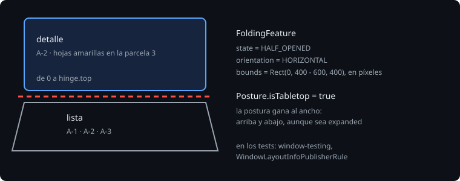

# Plegables y posturas

> Un plegable no es solo una pantalla que cambia de tamaño. Medio cerrado, tiene una bisagra que parte la pantalla en dos, y una postura: apoyado sobre la mesa como un portátil pequeño, o abierto en vertical como un libro. Una app que lo sabe pone cada cosa a un lado de la bisagra; una que no lo sabe pinta un botón justo en el pliegue.

## 🎯 Objetivos

- Leer la bisagra y la postura de la ventana
- Partir una pantalla por la bisagra en la postura de mesa
- Probar una bisagra en la JVM con `window-testing`
- Que la selección sobreviva a desplegar el móvil

## 1. La bisagra



Jetpack WindowManager (`androidx.window`) describe la pantalla con `DisplayFeature`s. La que importa es `FoldingFeature`, el pliegue:

| Propiedad | Valores |
| --- | --- |
| `state` | `FLAT` (abierto del todo) o `HALF_OPENED` (medio cerrado) |
| `orientation` | `HORIZONTAL` (de lado a lado) o `VERTICAL` (de arriba abajo) |
| `isSeparating` | si parte la pantalla en dos zonas (medio cerrado, o una bisagra física entre dos pantallas) |
| `bounds` | dónde está, en píxeles de la ventana; un pliegue sin hueco tiene alto 0 |

Las dos posturas con nombre:

- **Mesa** (*tabletop*): medio cerrado y en horizontal. La mitad de abajo está sobre la mesa: ahí van los controles; arriba, lo que se lee o se ve.
- **Libro** (*book*): medio cerrado y en vertical. Dos páginas: la lista a un lado, el detalle al otro.

## 2. En Compose

`currentWindowAdaptiveInfoV2().windowPosture` (teoría 01) ya traduce los `FoldingFeature` a una `Posture`:

```kotlin
val posture = currentWindowAdaptiveInfoV2().windowPosture
if (posture.isTabletop) {
    val hinge = posture.allHorizontalHingeBounds.first()   // un Rect, en píxeles
    with(LocalDensity.current) {
        Column {
            Detail(Modifier.fillMaxWidth().height(hinge.top.toDp()))
            ObservationList(Modifier.fillMaxWidth().padding(top = hinge.height.toDp()).weight(1f))
        }
    }
}
```

> 🔬 Medido con adaptive 1.3.0: `Posture` tiene `isTabletop` y `hingeList` (cada `HingeInfo` con `bounds`, `isFlat`, `isVertical`, `isSeparating` e `isOccluding`); las extensiones `allHorizontalHingeBounds`, `separatingVerticalHingeBounds` y compañía dan los `Rect` directamente. No hay `isBook`: un libro es una bisagra vertical que separa.

La postura gana al ancho: un plegable sobre la mesa puede medir 840 dp de ancho, y aun así lo que quiere es arriba y abajo, no izquierda y derecha. Por eso, en `layoutFor`, la mesa va primero.

Los `bounds` son de la ventana, no del composable. Si la pantalla no empieza en y = 0 (una barra de estado, un panel encima), hay que restarlo con `onGloballyPositioned`. En la sonda, la ventana empieza en 0.

## 3. Una bisagra en la JVM

`window-testing` (`androidx.window:window-testing`, solo en `testImplementation`) cambia lo que ve la app por lo que diga el test:

```kotlin
private val publisher = WindowLayoutInfoPublisherRule()
private val compose = createAndroidComposeRule<ComponentActivity>()

// La bisagra de mentira, por fuera: tiene que estar puesta antes de que arranque la actividad.
@get:Rule
val rules: RuleChain = RuleChain.outerRule(publisher).around(compose)

@Test
@Config(qualifiers = "w600dp-h800dp")
fun tabletopPutsTheDetailAboveTheHinge() {
    compose.setContent { BitacoraTheme { SessionScreen(observations) } }
    publisher.overrideWindowLayoutInfo(TestWindowLayoutInfo(listOf(FoldingFeature(compose.activity, state = HALF_OPENED, orientation = HORIZONTAL))))
    ...
}
```

`FoldingFeature(activity, ...)` pone el pliegue en el centro de la ventana, de alto 0.

> 🔬 Medido: en Kotlin son `FoldingFeature(...)` y `TestWindowLayoutInfo(...)`; los nombres `createFoldingFeature` y `createWindowLayoutInfo` son los de Java y no se resuelven. En 600 x 800 dp, el pliegue queda en `Rect(0, 400 - 600, 400)` y `isTabletop` pasa a `true`.

> 🔬 Medido en el ejercicio 01: con `createAndroidComposeRule<MainActivity>()`, que pinta la pantalla en `onCreate`, la bisagra de mentira **no llega**: `windowPosture` se queda sin bisagras aunque se espere, se avance el reloj o se recree la actividad. Con `createAndroidComposeRule<ComponentActivity>()` y `setContent` desde el test, llega. No está explicado; los tests de la bisagra pintan desde el test.

## 4. Desplegar es un cambio de configuración

Al abrir o cerrar un plegable, la ventana cambia de tamaño, y Android recrea la actividad, como al girar. Lo que estaba en un `remember` se pierde; lo que estaba en un `rememberSaveable` (o en un `ViewModel`, o en el back stack de Navigation 3) sigue.

```kotlin
@Test
fun unfoldingKeepsTheSelection() {
    compose.onNodeWithText("A-2 · Media").performClick()
    RuntimeEnvironment.setQualifiers("w900dp-h600dp")
    compose.activityRule.scenario.recreate()
    compose.onNodeWithText("hojas amarillas en la parcela 3").assertExists()
}
```

> 🔬 Medido en el ejercicio 01: con `remember`, tras recrear a 900 dp, la lista está pero el detalle es el hueco. Con `rememberSaveable`, el detalle de A-2, al lado de la lista.

## ✅ Comprueba

- [ ] ¿Qué es la postura de mesa? ¿Qué va arriba y qué abajo, y por qué?
- [ ] ¿Por qué la mesa gana al ancho en `layoutFor`?
- [ ] ¿En qué unidades vienen los `bounds` de la bisagra, y de qué son relativos?
- [ ] ¿Por qué el `WindowLayoutInfoPublisherRule` va por fuera de la regla de Compose? ¿Qué pasa si la pantalla se pinta en `onCreate`?
- [ ] ¿Qué se pierde al desplegar con `remember`, y qué lo arregla?
