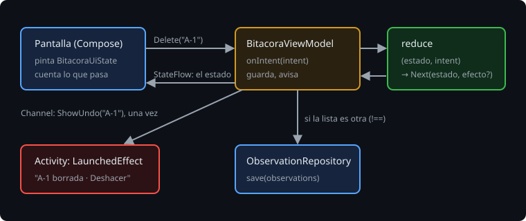

# El flujo unidireccional

> Hasta la semana 27, el ViewModel de la Bitácora tenía una función por cosa que pasaba (`add`, `delete`, `undo`, `located`...) y el estado salía de juntar cuatro flujos del `SavedStateHandle`. Funcionaba, pero cada función decidía y guardaba a la vez, y para probar una regla había que levantar el ViewModel entero. Esta semana se ordena: el estado baja en un solo valor, lo que pasa sube como un dato, y una función pura decide el paso de uno al otro.

## 🎯 Objetivos

- Saber qué es el flujo unidireccional de datos (UDF) y qué problema resuelve
- Juntar el estado de una pantalla en un solo `UiState`
- Ver, medido, qué pasa cuando el estado son varios flujos que cambian por separado
- Situar MVVM y MVI: qué añade MVI y qué no

## 1. Estado abajo, eventos arriba



En el **flujo unidireccional de datos** (*unidirectional data flow*, UDF), los datos van en un solo sentido:

1. El ViewModel tiene el estado y lo expone, de solo lectura, como un `StateFlow`.
2. La pantalla lo pinta. No lo cambia: cuando la persona hace algo, lo cuenta hacia arriba.
3. El ViewModel decide el estado nuevo, y vuelta al paso 1.

Ya lo hacías en parte desde la semana 21: el *state hoisting* de Compose es UDF dentro de la interfaz. Lo nuevo es llevarlo hasta el ViewModel, con una sola puerta de entrada.

La ventaja es saber siempre de dónde sale lo que ves: hay un solo sitio que cambia el estado. Si la pantalla enseña algo raro, el error está en ese sitio o en lo que entró por la puerta, no repartido por diez *callbacks*.

## 2. Un solo UiState

```kotlin
data class BitacoraUiState(
    val draft: String = "",
    val position: Position? = null,
    val locating: Locating = Locating.IDLE,
    val observations: List<Observation> = emptyList(),
    val deleted: Deleted? = null,
)
```

Todo lo que pinta la sesión va en un valor inmutable. Cada cambio es un `copy` nuevo, y la pantalla recibe estados completos, uno detrás de otro. Nunca ve la mitad de un cambio.

¿Y si en vez de uno hubiera varios `StateFlow`, uno por campo?

> 🔬 Medido con kotlinx.coroutines 1.11.0: dos `MutableStateFlow` (la lista y el borrador) y un `combine` que los junta. Al añadir, primero cambia la lista y después se vacía el borrador. Con un *dispatcher* que ejecuta en el momento (`UnconfinedTestDispatcher`, como `Dispatchers.Main.immediate` en Android), quien escucha recibe tres valores: `[agua]/GPS`, `[agua, GPS]/GPS` y `[agua, GPS]/`. El del medio no debería existir: "GPS" está en la lista y todavía en el campo. Con un *dispatcher* que encola (`StandardTestDispatcher`), el del medio no llega, porque `combine` se queda con el último. Que lo veas o no depende del hilo, no del código.

Con un solo `MutableStateFlow` y un `copy` que cambia los dos campos a la vez, ese estado intermedio no puede existir.

## 3. Qué no va en el UiState

- **Lo que se deriva**: el resumen ("3 observaciones · Baja: 1...") sale de la lista. Si también estuviese en el estado, podrían no coincidir.
- **Lo que pasa una vez**: un aviso, abrir el selector de compartir. Si va en el estado, se repite al girar el móvil (teoría 03).
- **Lo que es de la interfaz**: el desplazamiento de la lista, si un menú está abierto. Eso vive en Compose, con `remember` o `rememberSaveable`.

## 4. MVVM y MVI

**MVVM** (Model-View-ViewModel) dice dónde vive el estado: en un ViewModel que sobrevive a los cambios de configuración y que la vista observa. No dice cómo se cambia. La Bitácora de la semana 27 era MVVM con funciones públicas.

**MVI** (Model-View-Intent) añade una regla: lo que pasa es un dato, un **intent**, y hay una sola función que lo recibe. El estado nuevo sale de una función pura, el **reducer** (teoría 02). Lo que no es estado sale como **efecto** (teoría 03).

| | MVVM de la semana 27 | MVI de la semana 28 |
| --- | --- | --- |
| Entrada | Una función por acción | `onIntent(intent)` |
| Estado | Cuatro flujos del handle, juntados | Un `MutableStateFlow<BitacoraUiState>` |
| Reglas | Dentro de cada función | En `reduce`, sin Android |
| Avisos | Los lanza la pantalla | Efectos por un `Channel` |

No es "MVI contra MVVM": MVI es una forma de escribir el ViewModel de MVVM. Y el `intent` de MVI no tiene nada que ver con el `Intent` de Android de la semana 18; solo comparten nombre.

## 5. Cuándo no compensa

Un formulario de dos campos no necesita intents ni reducer: un ViewModel con dos funciones se lee mejor. MVI se paga en tipos (una clase por intent) y compensa cuando las reglas crecen, cuando varias cosas cambian el mismo estado, o cuando quieres probar las reglas sin Android. La Bitácora tiene las tres cosas.

## Para recordar

- UDF: el estado baja, lo que pasa sube, y un solo sitio decide.
- Un `UiState` inmutable, cambiado con `copy`: la pantalla nunca ve medio cambio.
- Varios `StateFlow` juntados con `combine` pueden enseñar estados que no existen, según el *dispatcher*.
- MVI es MVVM con una sola entrada, un reducer puro y los efectos aparte.
