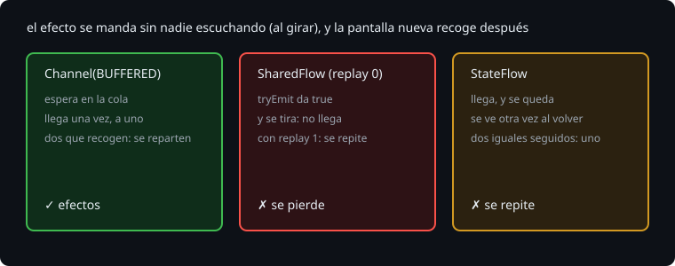

# Efectos de un solo uso

> Hay cosas que pasan una vez: el aviso "A-1 borrada" con su "Deshacer", el selector de compartir. No son estado: si se guardan en el `UiState`, al girar el móvil la pantalla nueva las vuelve a ver y las repite. Esta teoría compara las tres formas de mandarlas, con lo que hace cada una medido.

## 🎯 Objetivos

- Distinguir el estado de un efecto
- Mandar efectos con un `Channel` y recogerlos en Compose
- Ver, medido, qué pierden un `SharedFlow` y un `StateFlow`
- Conocer la alternativa de Google: el evento como estado

## 1. Estado o efecto

La pregunta es: si la pantalla se vuelve a pintar desde cero (girar, volver de segundo plano), ¿tiene que salir otra vez?

- La lista, el borrador, "Ubicando…": sí. Son **estado**.
- El aviso de borrada, abrir el selector de compartir, una vibración: no. Son **efectos**.

```kotlin
sealed interface BitacoraEffect {
    data class ShowUndo(val code: String) : BitacoraEffect
    data class Share(val observations: List<Observation>) : BitacoraEffect
}
```

## 2. Con un Channel



```kotlin
private val effects = Channel<BitacoraEffect>(Channel.BUFFERED)
val effect: Flow<BitacoraEffect> = effects.receiveAsFlow()

fun onIntent(intent: BitacoraIntent) {
    val (after, effect) = reduce(_state.value, intent)
    _state.value = after
    effect?.let(effects::trySend)
}
```

Un `Channel` es una cola: lo que entra espera hasta que alguien lo saca, y cada elemento sale **una vez, a uno solo**. `BUFFERED` le da sitio para 64; `trySend` no suspende, y con sitio, nunca falla.

> 🔬 Medido en el ejercicio 02, con kotlinx.coroutines 1.11.0:
> - Sin nadie escuchando, el efecto espera: quien recoge después, lo recibe (`aMessageWaitsForItsCollector`).
> - Recogido una vez, ya no está: un segundo `first()` se queda esperando (`aMessageIsDeliveredOnce`).
> - Con dos recogiendo a la vez, cada efecto le llega a uno: dos efectos, uno a cada uno (`twoCollectorsSplitTheMessages`). Un `Channel` reparte, no difunde: recoge los efectos en **un solo sitio**.

En la Bitácora, ese sitio es la actividad, dentro de `setContent`:

```kotlin
LaunchedEffect(Unit) {
    notes.effect.collect { effect ->
        when (effect) {
            is BitacoraEffect.ShowUndo -> launch {
                if (snackbar.showSnackbar(message, undo, duration = SnackbarDuration.Long) == SnackbarResult.ActionPerformed)
                    notes.onIntent(BitacoraIntent.Undo)
            }
            is BitacoraEffect.Share -> share(effect.observations)
        }
    }
}
```

`showSnackbar` suspende hasta que el aviso se cierra; con `launch`, el siguiente efecto no espera a que la persona decida. `LaunchedEffect` se cancela cuando la actividad se destruye (al girar) y empieza otra vez en la nueva; lo que llegue en medio espera en el `Channel`.

## 3. Con un SharedFlow

```kotlin
val effects = MutableSharedFlow<ChecklistEffect>(extraBufferCapacity = 1)
effects.tryEmit(ChecklistEffect.AllPacked) // true
```

> 🔬 Medido (`aSharedFlowLosesWhatNobodyHears`): sin suscriptores, `tryEmit` devuelve `true` y el efecto se tira; quien se suscribe después no recibe nada. El *buffer* solo sirve a los que ya están suscritos.

Justo cuando más falta hace (entre que la actividad vieja se va y la nueva se suscribe) se pierde. Con `replay = 1` no se pierde, pero se repite: la pantalla nueva vuelve a ver el último.

## 4. Con un StateFlow

```kotlin
val effect = MutableStateFlow<ChecklistEffect?>(null)
```

> 🔬 Medido (`aStateFlowMergesEqualEffects`): dos `AllPacked` seguidos son uno; quien escucha ve `[null, AllPacked]`. Un `StateFlow` no emite un valor igual al que tiene.

Y el último se queda: la pantalla nueva lo vuelve a ver, salvo que alguien lo ponga a `null`.

## 5. El evento como estado

La guía de arquitectura de Android propone otra cosa: guardar el evento en el `UiState` (`val undo: String?`) y que la pantalla, cuando lo ha enseñado, avise al ViewModel (`onIntent(UndoShown)`) para que lo quite. No se pierde nada nunca, porque es estado, y sobrevive también a la muerte del proceso si va al handle.

Lo que cuesta es un intent de vuelta por cada efecto, y acordarse de mandarlo. La Bitácora usa el `Channel` porque sus dos efectos se pueden perder sin daño si el proceso muere (el aviso de borrada caduca; compartir se vuelve a pulsar). Si el efecto no se puede perder (un pago confirmado, por ejemplo), como estado.

> El `Channel` tiene un caso raro: si la corrutina que recoge se cancela justo después de sacar el efecto y antes de usarlo, ese efecto se pierde. Recoger con `Dispatchers.Main.immediate` lo evita, porque el efecto se usa en el mismo paso en que se saca; `LaunchedEffect` usa el *dispatcher* de Compose, que no es `immediate`. No lo hemos reproducido en la Bitácora, pero es una razón más para no usar un `Channel` con lo que no se puede perder.

## Para recordar

- Estado: tiene que volver a salir al pintar de cero. Efecto: no.
- `Channel(BUFFERED)` + `receiveAsFlow()`: espera a quien recoja, y entrega una vez, a uno.
- `SharedFlow` sin replay pierde lo que nadie oye; `StateFlow` junta los iguales y repite el último.
- El evento como estado no pierde nada, a cambio de un intent de vuelta.
