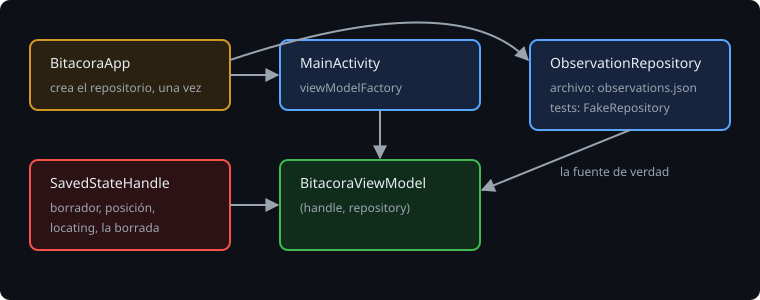

# El repositorio y la DI a mano

> Hasta ahora, las observaciones vivían en el `SavedStateHandle`: sobrevivían al giro y a la muerte del proceso, pero no a cerrar la app. Esta semana tienen dueño: un repositorio, detrás de una interfaz, que las guarda en un archivo. El ViewModel no sabe dónde están; recibe el repositorio por el constructor. Eso es inyectar dependencias, y de momento a mano: Hilt llega en la semana 29.

## 🎯 Objetivos

- Separar la fuente de verdad de la pantalla con una interfaz de repositorio
- Guardar en un archivo sin perder datos si el proceso muere a mitad
- Dar al ViewModel lo que necesita con `viewModelFactory` y un contenedor en `Application`
- Saber qué es del repositorio y qué sigue en el `SavedStateHandle`

## 1. La fuente de verdad



La **fuente de verdad** (*source of truth*) de un dato es el único sitio donde ese dato es el bueno; los demás son copias que se actualizan desde ahí. Para las observaciones, desde esta semana, es el repositorio:

```kotlin
interface ObservationRepository {
    val observations: Flow<List<Observation>>

    suspend fun save(observations: List<Observation>)
}
```

`observations` es un `Flow`: quien lo escucha recibe la lista y cada cambio, sin preguntar. `save` es `suspend`: guardar puede tardar, y quien llama no se bloquea.

La interfaz vive en `data`, que no depende de Android. Tiene dos implementaciones: el archivo de la app y, en los tests, una en memoria (`FakeRepository`). En la semana 30 llega la tercera, con Room, y el ViewModel no cambia.

Qué sigue en el handle: el borrador, la posición, "Ubicando…" y la última borrada. Son de esta sesión de la pantalla, no datos de la persona; no tienen que sobrevivir a cerrar la app, solo a la muerte del proceso.

## 2. El archivo

```kotlin
class JsonFileObservationRepository(
    private val file: File,
    initial: List<Observation> = emptyList(),
    private val io: CoroutineDispatcher = Dispatchers.IO,
) : ObservationRepository {
    private val state = MutableStateFlow(read(initial))
    private val writing = Mutex()

    override val observations: Flow<List<Observation>> = state.asStateFlow()

    override suspend fun save(observations: List<Observation>) {
        state.value = observations
        withContext(io) {
            writing.withLock {
                val temporary = File(file.path + ".tmp")
                temporary.writeText(encode(state.value))
                Files.move(temporary.toPath(), file.toPath(), ATOMIC_MOVE, REPLACE_EXISTING)
            }
        }
    }
}
```

Cuatro decisiones:

- **Primero la memoria**: `state.value` cambia antes de escribir, así que la pantalla tiene la lista nueva al momento, y el archivo se escribe después, fuera del hilo principal.
- **Escribir aparte y mover**: si el proceso muere a mitad de `writeText`, el que queda a medias es el `.tmp`; `observations.json` sigue entero. `ATOMIC_MOVE` hace el cambio de un golpe en el mismo sistema de archivos.
- **Un `Mutex`**: dos `save` seguidos, en `Dispatchers.IO`, podrían escribir el mismo `.tmp` a la vez. Con el `Mutex`, uno detrás de otro, y cada uno escribe `state.value`, lo último.
- **El `dispatcher` se inyecta**: en los tests, uno de pruebas (teoría 05).

Al leer, si el archivo no existe, las de partida (`Samples` en demo, ninguna en field). Si existe y no se puede leer, no se pisa:

> 🔬 Medido (`aBrokenFileIsKeptAside`): con `{ esto no es una lista` en el archivo, el repositorio empieza vacío y el archivo pasa a `observations.json.bad`, con lo que tenía. `SerializationException` hereda de `IllegalArgumentException`, igual que lo que lanza `Level.valueOf` con un nivel que no existe: un solo `catch` las coge las dos.

> Lee el archivo entero en el hilo que crea el repositorio, y lo reescribe entero en cada cambio. Con unas decenas de observaciones no se nota; con cientos, sí. Room lo resuelve en la semana 30.

## 3. Inyectar por el constructor

```kotlin
class BitacoraViewModel(private val handle: SavedStateHandle, private val repository: ObservationRepository) : ViewModel()
```

**Inyectar una dependencia** es que te la den, en vez de crearla tú. Si el ViewModel hiciera `JsonFileObservationRepository(File(...))` dentro, necesitaría un `Context` para saber la carpeta y no habría forma de probarlo con otro. Recibiéndola, en el test se le pasa `FakeRepository()` y ya.

## 4. Quién lo crea: el contenedor

Algo tiene que crear el repositorio una vez y dárselo a cada ViewModel. Lo que vive tanto como la app va en la `Application`:

```kotlin
class BitacoraApp : Application() {
    val repository: ObservationRepository by lazy {
        JsonFileObservationRepository(File(filesDir, "observations.json"), Samples.observations)
    }
}
```

```xml
<application android:name=".BitacoraApp" ...>
```

> 🔬 Medido en el starter, sin `android:name`: `ClassCastException: class android.app.Application cannot be cast to class dev.bitacora.BitacoraApp`. Sin la entrada, Android crea una `Application` normal.

Y la actividad le pasa al ViewModel lo que necesita con una *factory*:

```kotlin
private val notes: BitacoraViewModel by viewModels {
    viewModelFactory { initializer { BitacoraViewModel(createSavedStateHandle(), (application as BitacoraApp).repository) } }
}
```

`viewModelFactory` e `initializer` son de `lifecycle-viewmodel`: el bloque se ejecuta solo la primera vez; al girar, `viewModels` devuelve el mismo ViewModel. `createSavedStateHandle()` da el handle de esta entrada, que se guarda con el estado de la actividad.

Eso es todo el "framework" de la DI a mano: un sitio que crea las cosas (la `Application`) y constructores que las reciben. Funciona, y con una dependencia sobra. Cuando hay muchas y cada una necesita otras, la `Application` se llena de `lazy` y de orden de creación a mano. Eso es lo que automatiza Hilt.

## 5. Lo que entra en el build

`data` usa `Flow` en su interfaz, así que declara `kotlinx-coroutines-core` como `api` (semana 12): quien usa `data` también lo necesita para compilar. Los tests usan `kotlinx-coroutines-test`.

> 🔬 Medido al regenerar `verification-metadata.xml`: no entra ningún componente nuevo. Las dos, en la 1.11.0, ya estaban en el classpath: `core` con `lifecycle` y Compose, y `test` con `ui-test-android` de Compose, que pide la 1.9.0 y el BOM de coroutines sube a la 1.11.0. Declararlas no cambia lo que se descarga; deja escrito que las usas tú.

## Para recordar

- Cada dato tiene una fuente de verdad; las observaciones, el repositorio.
- Primero la memoria, después el disco; escribir aparte y mover; un archivo roto se aparta, no se pisa.
- Inyectar es recibir por el constructor: en los tests, otra implementación.
- DI a mano: la `Application` crea, `viewModelFactory` entrega. Con muchas dependencias, Hilt.
