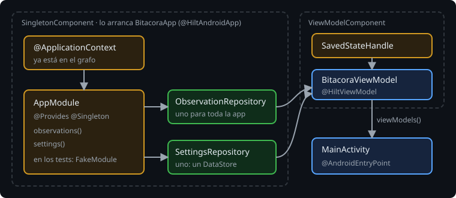

# Módulos y bindings

> Un grafo de Dagger es una lista de respuestas a "¿cómo consigo un X?". Cada respuesta es un *binding*. Algunas las da la propia clase, con `@Inject` en su constructor; otras, las que la clase no puede dar (una interfaz, algo que necesita un `Context`, una clase que no es tuya), van en un módulo.

## 🎯 Objetivos

- Distinguir los tres sitios de donde sale un binding: `@Inject`, `@Provides` y `@Binds`
- Escribir un módulo con `@InstallIn` y saber cuándo es `object` y cuándo `interface`
- Pasar al grafo un valor de fuera con `@BindsInstance` y usar `@ApplicationContext`
- Leer los dos errores de Dagger que más vas a ver: `MissingBinding` y `DuplicateBindings`

## 1. `@Inject` en el constructor



```kotlin
class Planner @Inject constructor(val repository: ChecklistRepository)
```

Le dice a Dagger dos cosas: cómo crear un `Planner` (con este constructor) y qué necesita (un `ChecklistRepository`). Dagger busca después cómo conseguir eso, y así hasta el final. Es el binding más barato: no hay que escribir nada más.

No sirve cuando lo que se pide es una **interfaz** (no tiene constructor), una clase de una biblioteca (no puedes anotarla) o algo que se crea con una función (`PreferenceDataStoreFactory.create(...)`).

## 2. `@Provides`: una función que lo crea

```kotlin
@Module
@InstallIn(SingletonComponent::class)
object AppModule {
    @Provides
    @Singleton
    fun settings(@ApplicationContext context: Context): SettingsRepository =
        DataStoreSettingsRepository(File(context.filesDir, "datastore/settings.preferences_pb"))
}
```

- `@Module` dice que la clase tiene bindings; `@InstallIn` dice en qué componente (teoría 03). Hilt no acepta un módulo sin `@InstallIn`.
- El tipo de retorno es lo que se pide (`SettingsRepository`); los parámetros, lo que necesita para crearlo, y Dagger se los da.
- `object`: las funciones no necesitan instancia, y Dagger las llama sin crear el módulo.
- `@ApplicationContext` es un *qualifier* que Hilt ya trae: el `Context` de la app, que vive tanto como ella. Hay otro, `@ActivityContext`, que solo existe dentro de los componentes de actividad.

Es lo que hace `AppModule` en la Bitácora con los dos repositorios: lo mismo que el `by lazy` de la semana 28, con nombre de función.

## 3. `@Binds`: esta interfaz es esta clase

Cuando la implementación sí tiene `@Inject constructor`, no hace falta escribir el `new`; basta con decir cuál es:

```kotlin
@Module
interface TripModule {
    @Binds
    fun repository(file: FileChecklistRepository): ChecklistRepository
}
```

El parámetro es la implementación, el retorno la interfaz. La función no tiene cuerpo: Dagger no la llama, solo lee la firma. Por eso el módulo es una `interface` (o una `abstract class`). Genera menos código que `@Provides`.

Si un módulo necesita los dos, `@Binds` va en la interfaz y los `@Provides` en un `companion object` dentro de ella, o en otro módulo.

## 4. Un valor de fuera: `@BindsInstance`

En el ejercicio 01 no hay Android ni `Context`, y el repositorio del archivo necesita una carpeta. Se la da quien crea el componente:

```kotlin
@Component.Factory
interface Factory {
    fun create(@BindsInstance dir: File): TripComponent
}

val trip = DaggerTripComponent.factory().create(carpeta)
```

A partir de ahí, quien pida un `File` recibe esa carpeta. En Hilt no lo escribes: el componente de la app ya trae la `Application` y el `@ApplicationContext` como instancias.

## 5. Varios del mismo tipo: *qualifiers*

Si la Bitácora tuviese dos `File` en el grafo (la carpeta de las observaciones y la de las fotos), Dagger no sabría cuál dar. Se distinguen con una anotación propia:

```kotlin
@Qualifier
@Retention(AnnotationRetention.BINARY)
annotation class PhotosDir

@Provides @PhotosDir
fun photos(@ApplicationContext context: Context): File = File(context.filesDir, "photos")

class Camera @Inject constructor(@PhotosDir private val dir: File)
```

`@Named("photos")` hace lo mismo con un texto, y el compilador no te avisa si te equivocas al escribirlo.

## 6. Cuando el grafo está mal

> 🔬 Medido con Dagger 2.60.1, en el ejercicio 01:
> - Quitando el binding de `ChecklistRepository`: `[Dagger/MissingBinding] dev.bitacora.ChecklistRepository cannot be provided without an @Provides-annotated method`, y debajo quién lo pedía.
> - Con dos `@Binds` para `ChecklistRepository` (el del archivo y el de memoria): `[Dagger/DuplicateBindings] dev.bitacora.ChecklistRepository is bound multiple times`, con los dos sitios.

Los dos salen en la tarea `kspKotlin` (en Android, `kspFieldDebugKotlin` y compañía), no al ejecutar. La línea que importa es la primera con `[Dagger/...]`; lo de debajo es el camino.

## Para recordar

- `@Inject constructor` si la clase es tuya y concreta; `@Binds` para decir qué implementación tiene una interfaz; `@Provides` para todo lo demás.
- Un módulo de Hilt lleva `@Module` y `@InstallIn`.
- Lo que no se puede crear dentro del grafo entra por `@BindsInstance`; en Hilt, el `Context` ya está.
- Dos del mismo tipo: un *qualifier*. Un error del grafo es un `[Dagger/...]` al compilar.
