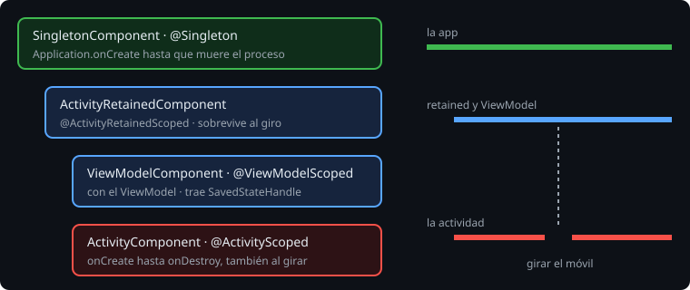

# Componentes y scopes

> Un binding dice cómo se crea algo; el *scope* dice cuántas veces. Sin scope, Dagger crea uno nuevo cada vez que alguien lo pide. Con `@Singleton`, uno por componente, y el componente de la app vive lo que vive el proceso. Para un ViewModel da igual; para un DataStore, que solo admite uno por archivo, es la diferencia entre funcionar y fallar.

## 🎯 Objetivos

- Conocer los componentes de Hilt, cuánto vive cada uno y qué se puede pedir dentro
- Entender qué quiere decir `@Singleton` y qué no
- Elegir el scope de un binding, y saber cuándo no ponerle ninguno
- Leer el error de un scope en el componente que no es

## 1. Los componentes de Hilt



| Componente | Scope | Nace | Muere | Ya trae |
| --- | --- | --- | --- | --- |
| `SingletonComponent` | `@Singleton` | `Application.onCreate` | Con el proceso | `Application`, `@ApplicationContext` |
| `ActivityRetainedComponent` | `@ActivityRetainedScoped` | Primer `onCreate` de la actividad | Al terminarla (no al girar) | |
| `ViewModelComponent` | `@ViewModelScoped` | Al crear el ViewModel | Con `onCleared` | `SavedStateHandle` |
| `ActivityComponent` | `@ActivityScoped` | `onCreate` | `onDestroy` (también al girar) | `Activity`, `@ActivityContext` |
| `FragmentComponent`, `ViewComponent`… | `@FragmentScoped`… | Con su clase | Con su clase | |

Cada uno es hijo del de encima: desde un ViewModel se puede pedir todo lo de `SingletonComponent`, pero no al revés. Un módulo con `@InstallIn(SingletonComponent::class)` vale para toda la app; uno con `@InstallIn(ViewModelComponent::class)`, solo para los ViewModels.

El `SavedStateHandle` del ViewModel de la Bitácora viene de `ViewModelComponent`: cada ViewModel tiene el suyo.

## 2. Qué es `@Singleton`

`@Singleton` no quiere decir "uno en todo el programa". Quiere decir "uno por instancia del componente". En una app, el componente de la app es uno solo, así que es lo mismo; en un test, o en el ejercicio 01, se nota:

```kotlin
@Test
fun twoComponentsTwoRepositories(@TempDir other: File) {
    assertNotSame(component().repository(), component(other).repository())
}
```

Dos `DaggerTripComponent`, dos repositorios. Cada test de Hilt crea su propio componente de la app (teoría 05), así que tampoco comparten nada entre tests.

El scope se pone en el binding, no en la clase que lo usa:

```kotlin
@Binds
@Singleton
fun repository(file: FileChecklistRepository): ChecklistRepository

@Singleton
@Component(modules = [TripModule::class])
interface TripComponent
```

Con Dagger a secas, el componente lleva también el scope. Con Hilt, `SingletonComponent` ya lo trae. También se puede poner `@Singleton` encima de la clase con `@Inject constructor`; en ese caso, cualquiera que la pida recibe la misma.

## 3. Sin scope, y con scope

> 🔬 Medido en el ejercicio 01: `Planner` no tiene scope y `trip.planner()` da uno nuevo cada vez (`assertNotSame`); los dos comparten el mismo repositorio, que sí lo tiene.

Un scope tiene coste: Dagger guarda la instancia y la protege con un cerrojo para que dos hilos no creen dos. Pónselo solo a lo que lo necesita:

- **Tiene estado que se comparte**: el repositorio de las observaciones. Si hubiese dos, uno no vería lo que guarda el otro.
- **Es caro de crear**: un cliente HTTP con su *pool* de conexiones (semana 31), una base de datos (semana 30).
- **Solo puede haber uno**: DataStore, uno por archivo y por proceso.

Lo que no tiene estado (un formateador, un caso de uso que solo llama al repositorio) va sin scope.

> 🔬 Medido: sin `@Singleton` en el `@Provides` de los ajustes, cada ViewModel recibe un `DataStoreSettingsRepository` nuevo sobre el mismo archivo. En `theFiltersSurviveClosingTheApp`, la segunda actividad (otro ViewModel, otro repositorio) da `There are multiple DataStores active for the same file` y el filtro no sale puesto. Al girar no pasa: el ViewModel es el mismo.

Ese fallo no lo ve Dagger: el grafo es correcto, lo que está mal es cuántas veces se crea.

## 4. Un scope en el componente que no es

Un binding con `@ActivityScoped` instalado en `SingletonComponent` no tiene sentido: el componente de la app no sabe cuándo muere una actividad. Un componente solo acepta bindings sin scope o con el suyo.

> 🔬 Medido en el ejercicio 01, quitando `@Singleton` del `@Component` y dejándolo en el `@Binds`: `[Dagger/IncompatiblyScopedBindings] dev.bitacora.TripComponent (unscoped) may not reference scoped bindings`. Un componente sin scope no tiene dónde guardar la instancia.

## 5. ¿Y el ViewModel?

El ViewModel no lleva scope de Dagger: cuánto vive lo decide el `ViewModelStore` de la actividad, como desde la semana 21. Hilt crea uno con `@HiltViewModel`, y el `ViewModelStore` lo guarda al girar. Si dentro necesitas algo que dure lo que el ViewModel y se comparta entre sus dependencias, `@ViewModelScoped`.

## Para recordar

- Cada componente de Hilt vive lo que su clase de Android; los hijos ven lo de los padres.
- `@Singleton` es uno por componente; en una app, uno por proceso.
- Sin scope, nuevo cada vez. Scope solo para estado compartido, lo caro y lo que solo puede ser uno.
- DataStore sin `@Singleton` compila y falla al ejecutar.
