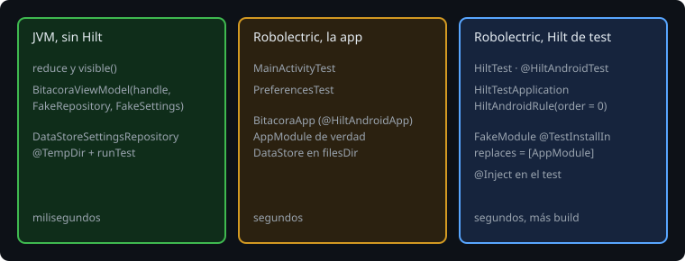

# Probar con Hilt

> Con la DI a mano, un test le pasaba al ViewModel un `FakeRepository` por el constructor. Con Hilt sigue pudiendo, y es lo primero que hay que intentar: la mayoría de los tests no necesitan Hilt. Para los que abren la actividad, Hilt monta un grafo de test por cada test, y un módulo de test ocupa el sitio del de verdad.

## 🎯 Objetivos

- Decidir qué tests necesitan Hilt y cuáles no
- Montar un test de Robolectric con `@HiltAndroidTest`, `HiltAndroidRule` y `HiltTestApplication`
- Cambiar un módulo entero con `@TestInstallIn`, y pedir dependencias al test con `@Inject`
- Probar DataStore en la JVM con `@TempDir` y `runTest`

## 1. Sin Hilt, primero



`@Inject constructor` no cambia nada para quien llama al constructor a mano. Los tests del reducer y del ViewModel siguen igual que en la semana 28:

```kotlin
@Test
fun changingThemSavesThem() {
    val settings = FakeSettings()
    val repository = FakeRepository(listOf(riego))
    BitacoraViewModel(SavedStateHandle(), repository, settings).onIntent(BitacoraIntent.ChangeSettings(ListSettings(onlyHigh = true)))
    assertEquals(ListSettings(onlyHigh = true), settings.settings.value)
    assertEquals(0, repository.saves)
}
```

Y `DataStoreSettingsRepository` se prueba en `data`, sin Android. Ninguno de estos sabe que Hilt existe, y son los más rápidos.

## 2. Un test con Hilt

Cuando lo que se prueba es la actividad (que crea su ViewModel con Hilt), hace falta el grafo:

```kotlin
@HiltAndroidTest
@RunWith(AndroidJUnit4::class)
@Config(application = HiltTestApplication::class, qualifiers = "+es")
class HiltTest {
    @get:Rule(order = 0)
    val hilt = HiltAndroidRule(this)

    @get:Rule(order = 1)
    val rule = createEmptyComposeRule()

    @Inject
    lateinit var repository: ObservationRepository

    @Before
    fun inject() = hilt.inject()
}
```

- `@HiltAndroidTest` hace que KSP genere un componente de la app solo para esta clase de test.
- `HiltTestApplication` sustituye a `BitacoraApp` en el test: una `Application` que Hilt prepara para usar ese componente. Con Robolectric va en `@Config`; en un test instrumentado, en un *runner* propio.
- `HiltAndroidRule` crea el componente antes de cada test. Va con `order = 0`: tiene que estar antes de que otra regla abra nada.
- `@Inject` en un campo del test, y `hilt.inject()` en `@Before`: el test recibe del grafo lo mismo que la app.

Cada test tiene su componente: lo `@Singleton` no pasa de un test al siguiente.

## 3. Cambiar un módulo: `@TestInstallIn`

```kotlin
@Module
@TestInstallIn(components = [SingletonComponent::class], replaces = [AppModule::class])
object FakeModule {
    @Provides
    @Singleton
    fun observations(): ObservationRepository = FakeRepository(listOf(Observation("A-7", Level.MEDIUM, "del módulo de los tests")))

    @Provides
    @Singleton
    fun settings(): SettingsRepository = FakeSettings()
}
```

En todos los `@HiltAndroidTest` del mismo *source set*, `FakeModule` está y `AppModule` no. Por eso `AppModule` va entero en un módulo aparte: lo que se cambia en los tests es un módulo, no un binding suelto.

Con `@Singleton`, el test y la actividad reciben el mismo `FakeRepository`: `theTestAndTheAppShareTheRepository` cambia la lista desde el test y la ve en la pantalla.

Para un solo test, `@UninstallModules(AppModule::class)` en la clase y los bindings que falten con `@BindValue` en campos del test. Funciona, pero cada clase que lo usa genera su propio componente y el build tarda más; si varios tests quieren lo mismo, `@TestInstallIn`.

## 4. Los tests que no son de Hilt, con Hilt en la app

Los tests de Robolectric de semanas anteriores (`MainActivityTest`, `PreferencesTest`…) no llevan `@HiltAndroidTest`: usan `BitacoraApp` de verdad, que ahora es `@HiltAndroidApp`, con `AppModule` y DataStore de verdad. Siguen funcionando sin cambiar una línea. La diferencia: sus repositorios son los del archivo, como en el móvil.

> 🔬 Medido en `PreferencesTest.theFiltersSurviveClosingTheApp`: sin `rule.waitForIdle()` antes de `rule.waitUntil { file.exists() }`, el `waitUntil` se agota a los 5 s y el archivo no llega. Como en `ArchitectureTest` de la semana 28: Compose tiene que terminar el clic para que salga el `edit`.

## 5. El tamaño de la pantalla en Robolectric

La fila de los filtros ocupa sitio. Robolectric simula un móvil de 320 × 470 dp, y en 470 dp la lista de la demo solo enseña la primera observación; los tests de la semana 27 que buscan la tercera fallan.

> 🔬 Medido: con `qualifiers=h540dp` en `robolectric.properties`, los tests de antes ven las mismas filas. Pero `@Config(qualifiers = "es")` sustituye todo lo de `robolectric.properties`, vuelve a 470 dp y `aRowShowsItsBadgeAndPlace` falla. Con `"+es"`, el idioma se añade a lo que ya había.

## 6. DataStore en la JVM

```kotlin
@Test
fun whatIsSavedIsRead() = runTest {
    val session = CoroutineScope(backgroundScope.coroutineContext + Job())
    DataStoreSettingsRepository(file, session).save(ListSettings(newestFirst = true))
    session.coroutineContext.job.cancelAndJoin()
    assertEquals(ListSettings(newestFirst = true), DataStoreSettingsRepository(file, backgroundScope).settings.first())
}
```

- El archivo, en un `@TempDir`: cada test empieza sin nada.
- El scope de DataStore, hijo del `backgroundScope` de `runTest`, con su propio `Job`: cancelarlo es "cerrar la app", y libera el archivo para el segundo DataStore. Sin cancelarlo, el segundo falla con `multiple DataStores active`.
- `first()` lee el primer valor del `Flow`, que es lo que hay en el archivo.

## Para recordar

- Si el test puede llamar al constructor, sin Hilt.
- `@HiltAndroidTest` + `HiltAndroidRule(order = 0)` + `HiltTestApplication` + `hilt.inject()`.
- `@TestInstallIn(replaces = ...)` cambia un módulo en todos los tests del *source set*.
- `"+es"`, no `"es"`, para no perder lo de `robolectric.properties`. DataStore en la JVM: `@TempDir` y un scope que se cancela.
