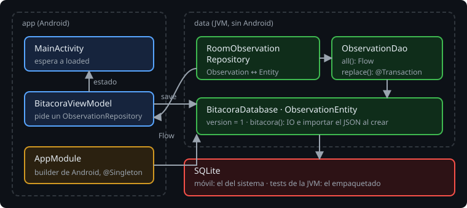

# Por qué Room

> Hasta ahora, las observaciones de la Bitácora viven en un archivo JSON que se lee entero al abrir y se reescribe entero con cada cambio. Con diez observaciones no se nota. Con mil sí, y además no hay forma de pedir "las altas del lote 2" sin leerlo todo. SQLite, que ya viene en cada Android, resuelve eso. Room pone encima lo que le falta a SQLite para usarlo desde Kotlin: comprueba el SQL al compilar, convierte las filas en objetos y avisa con un `Flow` cuando una tabla cambia.

## 🎯 Objetivos

- Ver qué se queda corto en un archivo JSON y qué añade una base de datos
- Saber qué pone Room encima de SQLite y qué genera KSP
- Conocer Room 3: el paquete `androidx.room3`, los *drivers* y lo que cambia frente a Room 2
- Situar Room en la Bitácora: `data` lo define, `app` lo crea, y la pantalla no se entera

## 1. Lo que se queda corto en el JSON

`JsonFileObservationRepository` (semana 28) hace lo justo y lo hace bien: escribe primero en un `.tmp` y lo mueve, para que un corte no deje medio archivo. Pero:

| | Archivo JSON | SQLite |
| --- | --- | --- |
| Un cambio | Reescribe el archivo entero | Toca las filas que cambian |
| Buscar | Leer todo y filtrar en memoria | `SELECT ... WHERE`, con índices |
| Relaciones | A mano, en el código | Claves foráneas que la base de datos hace cumplir |
| Dos cambios a la vez | Un `Mutex` en el repositorio | Transacciones |
| Cambiar el formato | Campos con valor por defecto y ya está | Versiones y migraciones (teoría 04) |

La última fila no es un punto a favor del JSON: sin versiones, un cambio de formato que no se pueda arreglar con un valor por defecto no tiene solución limpia.

## 2. Qué pone Room encima de SQLite

```kotlin
@Dao
interface ObservationDao {
    @Query("SELECT * FROM observations ORDER BY code")
    fun all(): Flow<List<ObservationEntity>>
}
```

- **El SQL se comprueba al compilar.** Si escribes `observation` en lugar de `observations`, o pides una columna que no existe, el error sale en `kspKotlin`, no en el móvil de la persona.
- **Las filas se convierten en objetos**: `ObservationEntity` tiene un campo por columna, y Room escribe el código que los lee y los escribe.
- **Un `Flow` que se actualiza solo**: Room sabe qué tablas lee cada consulta, y cuando una escritura cambia alguna, la vuelve a ejecutar y emite el resultado.
- **Versiones del esquema**, con migraciones que se pueden probar.

> 🔬 Medido: KSP escribe `BitacoraDatabase_Impl.kt` y `ObservationDao_Impl.kt` en `data/build/generated/ksp/main/kotlin/dev/bitacora/data/`. Son Kotlin, no Java: Room 3 solo genera Kotlin.

## 3. Room 3

Room 3 es una versión nueva, con otro paquete: `androidx.room3`, no `androidx.room`. Las dos conviven en Maven.

> 🔬 Consultado en el Maven de Google el 2026-11-08: `androidx.room:room-runtime` llega a 2.8.5; `androidx.room3:room3-runtime` tiene la 3.0.0 estable desde julio de 2026 y la 3.0.3 desde el 9 de septiembre. La 3.1 está en alpha. El bootcamp usa la 3.0.3.

Lo que cambia frente a Room 2:

- **Solo KSP**, nada de `kapt`, y solo genera Kotlin.
- **Multiplataforma**: el mismo código en Android, en la JVM y en iOS. Por eso `data`, que es un módulo de la JVM sin Android, puede tener la base de datos y probarla sin Robolectric.
- **Un *driver* de SQLite** en lugar de `SupportSQLiteOpenHelper`: en Android, el del sistema (`AndroidSQLiteDriver`); en la JVM, uno que trae su propio SQLite (`BundledSQLiteDriver`). Teoría 03.
- **Corrutinas primero**: las consultas son `suspend` o devuelven `Flow`, y las migraciones y los *callbacks* son `suspend`.
- **Algunos nombres**: el plugin de Gradle es `androidx.room3` y su bloque se llama `room3 { }`; `@Relation` pide listas (`parentColumns = ["id"]`), no un texto.

> 🔬 Medido: con `@Relation(parentColumn = "id", entityColumn = "tripId")`, como en Room 2, KSP da `No parameter with name 'parentColumn' found`.

Room 2 sigue manteniéndose, y casi todo lo que encuentres en internet es de Room 2. Las ideas son las mismas; cambian los paquetes y algunos nombres.

## 4. Room en la Bitácora



- `data` define la tabla (`ObservationEntity`), el DAO, la base de datos y `RoomObservationRepository`. No depende de Android.
- `app` la crea en `AppModule`, con el `Context` y la ruta de Android, y la entrega con `@Singleton`.
- El ViewModel sigue pidiendo un `ObservationRepository`. No sabe que detrás hay una base de datos: la interfaz de la semana 28 era para esto.

`ObservationEntity` no es `Observation`. `core` sigue sin saber nada de Room, y la tabla puede cambiar (una columna nueva, un nombre distinto) sin tocar el dominio. El repositorio traduce entre las dos.

## 5. Lo que cuesta

- **KSP en `data`**: un paso más en el build y un esquema que hay que versionar (teoría 04).
- **La lista ya no está al instante.** El JSON se leía al crear el repositorio, en el mismo hilo; la base de datos responde en otro hilo, después del primer fotograma. La pantalla tiene que saber esperar (teoría 03).
- **Más dependencias que verificar**: `room3-runtime`, `room3-compiler` y lo que traen. El compilador trae guava 33.2.1-jre, afectada por GHSA-xxph-c9ww-hj94; en el build se restringe a 33.7.2-jre, como la de Dagger en la semana 29.

## Para recordar

- JSON para unos pocos datos que se leen y se escriben enteros. Una base de datos cuando hay muchos, consultas, relaciones o cambios de formato.
- Room comprueba el SQL al compilar, convierte filas en objetos y emite un `Flow` cuando cambia una tabla.
- Room 3: `androidx.room3`, solo KSP, multiplataforma, con *drivers*. Room 2 es lo que vas a encontrar en los ejemplos.
- La entidad es de `data`; el dominio sigue siendo `Observation`.
