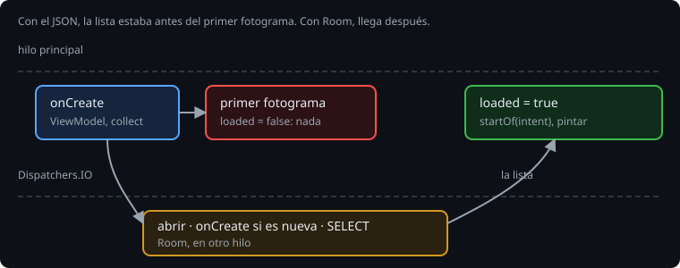

# Drivers, hilos y la primera carga

> Room no habla con SQLite directamente: lo hace a través de un *driver*. En el móvil, el SQLite del sistema; en la JVM, uno que viene dentro de una biblioteca. Las consultas van a otro hilo, y la respuesta llega cuando llega: después del primer fotograma. Con el JSON, la lista ya estaba al crear el ViewModel; con Room, la pantalla empieza sin ella, y quien decide algo con la lista (un enlace a la A-2) tiene que esperar.

## 🎯 Objetivos

- Elegir el *driver*: el del sistema o el empaquetado, y lo que cuesta cada uno
- Crear la base de datos en Android y en la JVM, una sola vez
- Saber en qué hilo van las consultas y cuándo llega la primera lista
- Esperar a la primera lista antes de resolver un enlace

## 1. Los dos *drivers*

| | `AndroidSQLiteDriver` | `BundledSQLiteDriver` |
| --- | --- | --- |
| SQLite | El del sistema: la versión depende del Android | El suyo, el mismo en todas partes |
| Dónde | Solo Android (y Robolectric) | Android, JVM, iOS |
| APK | Nada | Una biblioteca nativa por ABI |
| Dependencia | La trae `room3-runtime-android` | `androidx.sqlite:sqlite-bundled` |

> 🔬 Medido con Room 3.0.3: si en Android no llamas a `setDriver`, el builder usa `androidx/sqlite/driver/AndroidSQLiteDriver` (está en `RoomDatabase$Builder`, y la base de datos abre en Robolectric). Con `BundledSQLiteDriver`, el APK de field lleva `lib/<abi>/libsqliteJni.so` en cada ABI: 1 065 408 bytes en `arm64-v8a`, 1 038 064 en `x86`. Y en Robolectric no carga: `UnsatisfiedLinkError: no sqliteJni in java.library.path`, porque las bibliotecas son para Android, no para el ordenador.

La Bitácora usa el del sistema en el móvil y el empaquetado en los tests de `data`, donde no hay otro:

```kotlin
// data/build.gradle.kts
testImplementation(libs.sqlite.bundled)
```

El empaquetado tiene sentido en el móvil si necesitas una versión de SQLite concreta (una función que el Android más viejo que soportas no tiene) o el mismo comportamiento en Android y en iOS.

## 2. Crear la base de datos

El builder es distinto en cada plataforma: en Android necesita un `Context`; en la JVM, solo la ruta.

```kotlin
// app: AppModule
@Provides
@Singleton
fun database(@ApplicationContext context: Context): BitacoraDatabase =
    Room.databaseBuilder<BitacoraDatabase>(context, context.getDatabasePath("bitacora.db").path)
        .bitacora(File(context.filesDir, "observations.json"), Samples.observations)
        .build()

// data, en los tests
Room.databaseBuilder<BitacoraDatabase>(File(dir, "bitacora.db").path)
    .setDriver(BundledSQLiteDriver())
    .bitacora(json, initial)
    .build()
```

Por eso el builder no se llama dentro de `data`: `data` se compila contra la versión de la JVM de Room, y la app usa la de Android. Lo común (el hilo de las consultas y lo que hay que hacer al crear) va en `bitacora()`, una función de extensión sobre el builder que vale en los dos.

**Una sola instancia, `@Singleton`.** Cada `RoomDatabase` tiene sus conexiones y su registro de qué tablas han cambiado. Si hubiese dos sobre el mismo archivo, lo que escribe una no haría emitir los `Flow` de la otra.

> 🔬 Medido en la JVM: dos `LibretaDatabase` sobre el mismo archivo; se recoge `pending` en la primera y se inserta con la segunda. En 3 segundos, la primera no emite nada, aunque `itemsOf` en la primera ya devuelve la cosa nueva. La pantalla se quedaría con la lista vieja.

## 3. En qué hilo

```kotlin
fun RoomDatabase.Builder<BitacoraDatabase>.bitacora(legacy: File, initial: List<Observation>) = this
    .setQueryCoroutineContext(Dispatchers.IO)
    .addCallback(ImportJson(legacy, initial))
```

Las funciones `suspend` del DAO y los `Flow` trabajan en el contexto de `setQueryCoroutineContext`. Quien llama (`viewModelScope`, en el hilo principal) no se bloquea: suspende, y vuelve a su hilo con el resultado.

## 4. La primera lista llega tarde



1. `onCreate` crea el ViewModel, que empieza a recoger `repository.observations`.
2. La consulta va a `Dispatchers.IO`. Mientras tanto, el estado tiene la lista vacía, y Compose pinta el primer fotograma.
3. La base de datos responde y el estado cambia.

Para casi toda la pantalla es un parpadeo. Para lo que decide algo con la lista, no:

> 🔬 Medido: con Room y sin esperar, `startOf(intent)` busca la A-2 de `bitacora://observation/A-2` en una lista vacía, no la encuentra y abre la sesión. Fallan `aLinkOpensItsObservation` (no hay ningún nodo con `A-2`) y `backFromALinkGoesToTheSession`.

Por eso el estado sabe si ya ha llegado la lista:

```kotlin
data class BitacoraUiState(
    // ...
    val loaded: Boolean = false,
)

// BitacoraViewModel
repository.observations.collect { observations ->
    _state.update { it.copy(observations = observations, loaded = true) }
}

// MainActivity, dentro de setContent
if (!state.loaded) return@setContent
val start = remember { startOf(intent) { notes.observation(it) != null } }
```

Hasta que llega, la actividad no pinta nada; después, el enlace se resuelve con la lista entera. `remember` lo calcula una vez. Al girar el móvil, el ViewModel ya tiene `loaded` y la pila de navegación se restaura sola.

Una lista vacía y "todavía no lo sé" son cosas distintas. Si la persona borra todas sus observaciones, la lista está vacía y `loaded` sigue siendo `true`.

## 5. Lo que escribe la pantalla

El reducer sigue cambiando el estado al momento, y el ViewModel guarda la lista entera con `repository.save(...)`. La base de datos, al terminar, emite la lista que tiene, que es la misma. La pantalla ya la tenía, y no cambia nada.

`replace` reescribe todas las filas en cada cambio. Con una Bitácora de cientos de observaciones no se nota. Con miles, o cuando haya que saber qué cambió para subirlo a un servidor (semana 32), el repositorio tendrá un `add`, un `update` y un `delete`.

## Para recordar

- En el móvil, el SQLite del sistema (por defecto); en la JVM, el empaquetado. El empaquetado cuesta 1 MB por ABI y no carga en Robolectric.
- El builder de Android pide un `Context`; lo común va en una extensión. Una base de datos por archivo: `@Singleton`.
- Las consultas, en `Dispatchers.IO`; la primera lista llega después del primer fotograma.
- Lo que decide algo con la lista espera a `loaded`.
