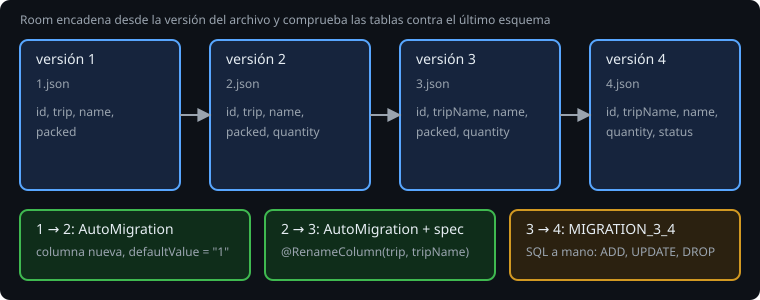

# Migraciones

> En el móvil de la persona hay una base de datos con la forma que tenía la tabla cuando instaló la app. Si la versión nueva añade una columna o cambia una de nombre, Room no puede abrirla tal cual: necesita saber cómo pasar de una forma a otra sin perder las filas. Eso es una migración. Room escribe sola las fáciles, tú escribes las demás, y las dos se prueban contra el esquema de cada versión, que está guardado en el repositorio.

## 🎯 Objetivos

- Entender qué es la versión de una base de datos y qué guarda el esquema exportado
- Escribir migraciones automáticas, con y sin *spec*
- Escribir una migración a mano en SQL
- Saber qué pasa si falta una, y cuándo vale borrar y empezar de cero
- Pasar los datos de un formato viejo (el JSON) a la base de datos, una sola vez

## 1. Versión y esquema

```kotlin
@Database(entities = [ObservationEntity::class], version = 1)
abstract class BitacoraDatabase : RoomDatabase()
```

SQLite guarda la versión dentro del archivo. Al abrir, Room la compara con la del código: si son iguales, abre; si la del archivo es menor, busca migraciones; si es mayor (una app más vieja que la base de datos), falla, salvo que el builder diga `fallbackToDestructiveMigrationOnDowngrade(true)`.

El plugin de Room escribe el esquema de cada versión en JSON:

```kotlin
// data/build.gradle.kts
room3 {
    schemaDirectory("$projectDir/schemas")
}
```

`schemas/dev.bitacora.data.BitacoraDatabase/1.json` tiene cada tabla con su `CREATE TABLE`, sus columnas, sus índices y un *hash* de todo. **Se sube al repositorio.** Es la única copia de cómo era la versión 1 cuando el código ya sea el de la 4, y de ahí salen las migraciones automáticas y los tests.

Mientras una versión no ha salido de tu máquina, puedes cambiarla sin migración: el `1.json` se reescribe al compilar. En cuanto alguien la tiene instalada, no se toca.

## 2. Migraciones automáticas



Añadir una columna:

```kotlin
data class Item(
    // ...
    @ColumnInfo(defaultValue = "1") val quantity: Int = 1,
)

@Database(entities = [Item::class], version = 2, autoMigrations = [AutoMigration(from = 1, to = 2)])
```

Room compara `1.json` con la entidad de ahora y escribe el `ALTER TABLE`. Las filas viejas reciben el `defaultValue`. El `= 1` de Kotlin no le sirve: es para los objetos que creas tú, no para las filas que ya están en el archivo.

> 🔬 Medido en el ejercicio 02, sin el `defaultValue`: `New NOT NULL column'quantity' added with no default value specified.Please specify the default value using @ColumnInfo.`, en `kspKotlin`.

Cambiar un nombre: Room ve una columna que desaparece y otra que aparece, y no sabe si es la misma. Se lo dices con un *spec*:

```kotlin
@RenameColumn(tableName = "items", fromColumnName = "trip", toColumnName = "tripName")
class TripRenamed : AutoMigrationSpec

AutoMigration(from = 2, to = 3, spec = TripRenamed::class)
```

> 🔬 Medido, sin el *spec*: `AutoMigration Failure: Please declare an interface extending 'AutoMigrationSpec', and annotate with the @RenameColumn or @DeleteColumn annotation to specify the change to be performed`, y debajo el código que tendrías que escribir.

Hay `@RenameColumn`, `@DeleteColumn`, `@RenameTable` y `@DeleteTable`. Un *spec* también puede tener `onPostMigrate`, para algo más después de la migración.

## 3. Migraciones a mano

Cuando el cambio no es solo de forma, Room no puede adivinarlo. En el ejercicio 02, `packed` (0 o 1) pasa a `status` (`PENDING` o `PACKED`):

```kotlin
val MIGRATION_3_4 = object : Migration(3, 4) {
    override suspend fun migrate(connection: SQLiteConnection) {
        connection.execSQL("ALTER TABLE items ADD COLUMN status TEXT NOT NULL DEFAULT 'PENDING'")
        connection.execSQL("UPDATE items SET status = 'PACKED' WHERE packed = 1")
        connection.execSQL("ALTER TABLE items DROP COLUMN packed")
    }
}

Room.databaseBuilder<LibretaDatabase>(path).addMigrations(MIGRATION_3_4)
```

- Es SQL a mano: no hay entidades, porque la entidad de ahora no es la de la versión 3.
- Room la ejecuta dentro de una transacción. Si algo falla, el archivo se queda en la 3.
- Después, Room comprueba que las tablas sean exactamente lo que dice la entidad de la versión 4.

> 🔬 Medido, sin el `DROP COLUMN`: `IllegalStateException: Migration didn't properly handle: items`, con lo que esperaba y lo que encontró. Sobra la columna `packed`.

`DROP COLUMN` y `RENAME COLUMN` están en SQLite desde la 3.35 y la 3.25. Con un Android viejo y el SQLite del sistema puede que no estén, y la forma clásica es crear la tabla nueva, copiar las filas, borrar la vieja y renombrar. Room hace eso mismo en las automáticas cuando hace falta.

Room encadena lo que haya: de la 1 a la 4 hace 1→2, 2→3 y 3→4, mezclando automáticas y a mano.

## 4. Si falta una

> 🔬 Medido en el ejercicio 02, con un archivo de la versión 3 y sin `MIGRATION_3_4`: `IllegalStateException: A migration from 3 to 4 was required but not found. Please provide the necessary Migration path via RoomDatabase.Builder.addMigration(...) or allow for destructive migrations via one of the RoomDatabase.Builder.fallbackToDestructiveMigration* functions.`

Sale al primer acceso a la base de datos, no al crearla. No borra nada: la app falla y los datos siguen ahí, para cuando salga una versión con la migración.

`fallbackToDestructiveMigration(true)` cambia eso: si falta una migración, borra las tablas y empieza de cero. Vale para una caché que se puede volver a bajar de un servidor. Para las observaciones de la persona, no.

## 5. Datos de un formato viejo

La semana 29 guardaba las observaciones en `observations.json`. La primera vez que se abre la versión con Room, hay que pasarlas a la tabla, y solo esa vez:

```kotlin
private class ImportJson(private val legacy: File, private val initial: List<Observation>) : RoomDatabase.Callback() {
    override suspend fun onCreate(connection: SQLiteConnection) {
        val observations = if (!legacy.exists()) initial else try {
            decode(legacy.readText())
        } catch (_: IllegalArgumentException) {
            legacy.renameTo(File(legacy.path + ".bad"))
            initial
        }
        connection.prepare("INSERT INTO observations VALUES (?, ?, ?, ?, ?, ?)").use { insert ->
            // un bind por columna, step(), reset() y clearBindings() por observación
        }
    }

    override suspend fun onOpen(connection: SQLiteConnection) {
        legacy.delete()
    }
}
```

- **`onCreate`** se llama cuando se crea el archivo, una sola vez en la vida de la app, dentro de la transacción que crea las tablas. Es el sitio de las observaciones de partida y del JSON viejo: si la persona las borra todas, al abrir no vuelven.
- Va con SQL y no con el DAO: la base de datos todavía se está creando.
- **`onOpen`** se llama cada vez que se abre, ya creada. Ahí el JSON ya está en la tabla y se puede borrar. Borrarlo en `onCreate` sería perderlo si la creación fallase después.
- Un JSON roto se aparta como en la semana 28: se puede recuperar a mano.

No es una `Migration` de Room porque no pasa de una versión de la base de datos a otra: pasa de no tener base de datos a tener la versión 1.

## Para recordar

- La versión va en `@Database`; el esquema de cada una, en `schemas/`, y se sube al repositorio.
- Columna nueva: `AutoMigration` y `defaultValue`. Nombre nuevo: `AutoMigration` con un *spec*. Lo demás: `Migration` con SQL.
- Room comprueba las tablas después de migrar; si falta una migración, no abre (y no borra).
- `fallbackToDestructiveMigration` solo para lo que se puede volver a bajar.
- Los datos de antes de la base de datos, en `onCreate`; lo viejo se borra en `onOpen`.
