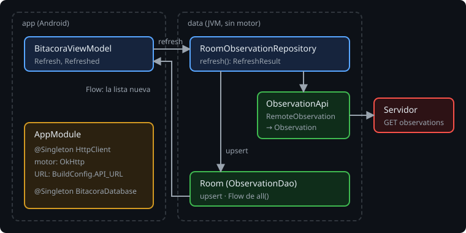

# HTTP en Android y Ktor

> Hasta ahora, todo lo que sabe la Bitácora está en el móvil. Esta semana pregunta a un servidor. HTTP es lo de siempre: una petición con un método, una URL y unas cabeceras, y una respuesta con un código y un cuerpo. Lo que cambia en Android es el contexto: hace falta un permiso, la red no puede bloquear el hilo principal, y el texto sin cifrar está cerrado por defecto. Para no escribir HTTP a mano se usa un cliente. El bootcamp usa Ktor client, de JetBrains, y lo compara con Retrofit, el clásico de Android.

## 🎯 Objetivos

- Saber qué pide Android antes de la primera petición: el permiso, el hilo y HTTPS
- Entender las piezas de Ktor client: el `HttpClient`, el motor y los plugins
- Comparar Ktor y Retrofit con la misma petición, y saber por qué el bootcamp elige Ktor
- Situar la red en la Bitácora: en `data`, sin motor, y con la base de datos como fuente de verdad

## 1. Lo que pide Android

**El permiso.** `android.permission.INTERNET` es un permiso normal: se declara en el manifiesto y no se pide a la persona.

```xml
<uses-permission android:name="android.permission.INTERNET" />
```

> 🔬 Medido: el APK de la Bitácora ya tenía `INTERNET` y `ACCESS_NETWORK_STATE` antes de esta semana, porque los mete `play-services-maps` (semana 27). Aun así, la app lo declara en su manifiesto: la red es suya, y si un día se quita el mapa, el permiso no se va con él. El APK no cambia: el manifiesto unido sigue con cinco permisos.

**El hilo.** Android lanza `NetworkOnMainThreadException` si una llamada de red bloquea el hilo principal. Con Ktor no se bloquea nada: `client.get(...)` es `suspend`, y el motor hace la espera en sus propios hilos. El ViewModel la lanza en `viewModelScope` y la pantalla sigue respondiendo.

**HTTPS.** Desde Android 9 (API 28), el texto en claro (`http://`) está cerrado por defecto: la petición falla con `CLEARTEXT communication ... not permitted by network security policy`. Para un servidor de pruebas en la red local se abre solo para ese dominio, con `res/xml/network_security_config.xml` y `android:networkSecurityConfig` en `<application>`; nunca para todos. La Bitácora habla solo HTTPS.

## 2. Ktor client: cliente, motor y plugins

```kotlin
val client = HttpClient(OkHttp) {
    install(ContentNegotiation) { json() }
}
val texto: String = client.get("https://api.bitacora.example/v1/observations").body()
```

- **`HttpClient`** es lo que usa tu código: `get`, `post`, `body()`. Es el mismo en Android, en la JVM y en iOS.
- **El motor** (*engine*) es quien abre las conexiones: `OkHttp` (Android y JVM, HTTP/2), `Android` (el `HttpURLConnection` del sistema), `CIO` (de Ktor, en corrutinas), `Darwin` (iOS). Se elige al crear el cliente, y el resto del código no se entera. En los tests, `MockEngine`, que no abre nada (teoría 05).
- **Los plugins** añaden comportamiento a todas las peticiones: `ContentNegotiation` (JSON), `DefaultRequest` (la URL base), `HttpTimeout`, `HttpRequestRetry`, `Logging`... Sin plugins, el cliente solo sabe mandar y recibir bytes.

> 🔬 Medido con Ktor 3.6.1: sin `ContentNegotiation`, `body<List<Dto>>()` lanza `NoTransformationFoundException: Expected response body of the type 'interface java.util.List ...' but was 'class io.ktor.utils.io.SourceByteReadChannel'`. El cliente no sabe convertir bytes en objetos hasta que se le dice cómo.

> 🔬 Consultado en Maven Central el 2026-11-11: Ktor 3.6.1 es la última estable (publicada el 2026-10-30); trae `kotlinx-coroutines` 1.11.0 y `kotlin-stdlib` 2.3.21, que Gradle sube a 2.4.21, la del bootcamp. El motor de OkHttp trae `okhttp` 5.5.1. Sin avisos en OSV para ninguno.

## 3. Ktor o Retrofit

La misma petición con Retrofit:

```kotlin
interface BitacoraService {
    @GET("observations")
    suspend fun observations(): ObservationsResponse
}

val service = Retrofit.Builder()
    .baseUrl("https://api.bitacora.example/v1/")
    .addConverterFactory(Json.asConverterFactory("application/json".toMediaType()))
    .build()
    .create(BitacoraService::class.java)
```

| | Ktor client | Retrofit |
| --- | --- | --- |
| Cómo se describe una petición | Código: `client.get("observations") { parameter(...) }` | Una interfaz con anotaciones (`@GET`, `@Query`, `@Body`), que Retrofit implementa al ejecutar |
| Dónde corre | Android, JVM, iOS, web (multiplataforma) | Android y JVM |
| Motor | El que elijas, y `MockEngine` en los tests | OkHttp, siempre |
| JSON | Plugin `ContentNegotiation` con kotlinx-serialization | Un *converter* (kotlinx-serialization, Moshi, Gson) |
| Probar | `MockEngine` en el mismo proceso | `MockWebServer` de OkHttp, un servidor local de verdad |
| Lo que añade | Más código por petición | Más magia: la interfaz no dice qué pasa al llamarla |

> 🔬 Consultado en Maven Central el 2026-11-11: Retrofit 3.0.0 (mayo de 2025) es la última. Sigue siendo la opción más vista en apps Android y en ofertas de trabajo.

El bootcamp usa Ktor: es multiplataforma como Room 3 (`data` sigue siendo de la JVM, sin Android), las peticiones son código normal que se lee sin conocer un procesador de anotaciones, y `MockEngine` hace los tests de la red tan rápidos como los del reducer. Lo que aprendas de HTTP aquí (códigos, tiempos, reintentos, errores con nombre) vale igual con Retrofit: cambia la sintaxis, no las decisiones.

## 4. La red en la Bitácora



- `data` tiene la red sin motor: las clases del servidor, `bitacoraClient(engine, baseUrl)` y `ObservationApi`. Depende de `ktor-client-core`, no de OkHttp.
- `app` elige el motor (OkHttp) y la URL del flavor, y crea el cliente una vez, en `AppModule`.
- La red no le habla a la pantalla. `refresh()` pide al servidor y escribe en Room; la pantalla ve el cambio por el `Flow` de la semana 30. La base de datos sigue siendo la fuente de verdad, y la app funciona sin red: enseña lo último que tiene.

## Para recordar

- `INTERNET` en el manifiesto, nada de llamadas bloqueantes en el hilo principal, y HTTPS (el texto en claro está cerrado desde Android 9).
- Ktor: el `HttpClient` es el mismo en todas partes; el motor, el que toque (OkHttp en el móvil, `MockEngine` en los tests); los plugins, lo que hace falta.
- Retrofit describe la API con una interfaz anotada; Ktor, con código. Las decisiones de HTTP son las mismas.
- La red escribe en la base de datos; la pantalla lee de la base de datos.
