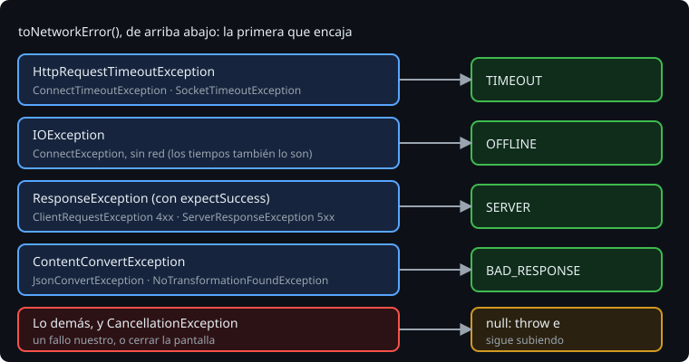

# Errores, tiempos y reintentos

> En el campo, la red falla más de lo que funciona: no hay cobertura, el servidor está en mantenimiento, la respuesta llega a medias. Una app que solo sabe el camino feliz se cuelga o se cierra. Esta teoría separa los fallos por lo que puede hacer la app con cada uno, les pone nombre, pone un tiempo máximo a cada petición y reintenta lo que tiene arreglo. Y cuida una excepción que no es un fallo: la cancelación.

## 🎯 Objetivos

- Saber qué excepción lanza Ktor en cada fallo, y cuáles son `IOException`
- Configurar los tres tiempos de `HttpTimeout`
- Convertir las excepciones en errores con nombre, sin tragarse la cancelación
- Reintentar con `HttpRequestRetry` solo lo que puede salir bien la segunda vez

## 1. Qué lanza cada fallo



| Fallo | Excepción | ¿`IOException`? |
| --- | --- | --- |
| Sin red, o nadie escucha en el puerto | `java.net.ConnectException` (o la `IOException` del motor) | sí |
| No se conecta a tiempo | `ConnectTimeoutException` | sí |
| La petición entera tarda demasiado | `HttpRequestTimeoutException` | sí |
| Un 4xx (con `expectSuccess`) | `ClientRequestException` | no |
| Un 5xx (con `expectSuccess`) | `ServerResponseException` | no |
| El JSON no encaja | `JsonConvertException` (un `ContentConvertException`) | no |
| El cuerpo no es JSON (`text/plain`, sin `Content-Type`) | `NoTransformationFoundException` | no |

> 🔬 Medido con Ktor 3.6.1: todo lo de la tabla, con `MockEngine` salvo las dos primeras filas, que son de OkHttp de verdad: `http://127.0.0.1:9` da `java.net.ConnectException: Failed to connect to /127.0.0.1:9`, y una IP que no contesta, con `connectTimeoutMillis = 2_000`, `ConnectTimeoutException: Connect timeout has expired [url=..., connect_timeout=2000 ms]`, con un `java.net.SocketTimeoutException` como causa.

**`expectSuccess`.** Sin él, un 503 es una respuesta más: `get` devuelve, y `body()` intenta leer como lista lo que sea que haya mandado el servidor. Con `expectSuccess = true`, cualquier código que no sea 2xx lanza una `ResponseException` (la madre de las dos), que lleva la respuesta: `e.response.status.value`.

> 🔬 Medido: sin `expectSuccess`, un 503 llega como `HttpStatusCode` `503 Service Unavailable` y no lanza nada. Con él, `ServerResponseException: Server error(GET https://api.bitacora.example/v1/observations: 503 Service Unavailable. Text: "{}"`.

## 2. Tiempos máximos

Ktor no pone ninguno: sin `HttpTimeout`, una petición a un servidor que no contesta espera lo que decida el motor, y con `MockEngine`, para siempre. Mejor decidirlo tú.

```kotlin
install(HttpTimeout) {
    connectTimeoutMillis = 5_000   // abrir la conexión
    socketTimeoutMillis = 10_000   // entre dos trozos de la respuesta
    requestTimeoutMillis = 15_000  // la petición entera, de principio a fin
}
```

- **`connectTimeoutMillis`**: cuánto se espera a que el servidor acepte la conexión. Sin cobertura, es lo primero que salta.
- **`socketTimeoutMillis`**: cuánto puede pasar sin recibir nada. Detecta una conexión que se ha quedado muda a mitad.
- **`requestTimeoutMillis`**: el total. Es el que ve la persona: cuánto tarda, como mucho, en saber si hay respuesta.

> 🔬 Medido: con `MockEngine` y un `delay(60_000)` en la respuesta, y sin `HttpTimeout`, `runTest` se rinde al minuto (`UncompletedCoroutinesError: After waiting for 1m, the test body did not run to completion`). Con `requestTimeoutMillis = 10_000`: `HttpRequestTimeoutException: Request timeout has expired [url=..., request_timeout=10000 ms]`.

Los tres tiempos agotados son `IOException`. Si se capturan las `IOException` como "sin red", los tiempos agotados se cuelan ahí, salvo que se miren antes.

## 3. Errores con nombre

La pantalla no debería saber qué es una `ServerResponseException`. Lo que necesita es poder decir algo útil:

```kotlin
enum class NetworkError { OFFLINE, TIMEOUT, SERVER, BAD_RESPONSE }

fun Throwable.toNetworkError(): NetworkError? = when (this) {
    is HttpRequestTimeoutException, is ConnectTimeoutException, is SocketTimeoutException -> NetworkError.TIMEOUT
    is IOException -> NetworkError.OFFLINE
    is ResponseException -> NetworkError.SERVER
    is ContentConvertException, is NoTransformationFoundException -> NetworkError.BAD_RESPONSE
    else -> null
}
```

- **El orden importa**: los tiempos agotados son `IOException`, así que van antes. Kotlin no avisa si una rama tapa a otra.
- **`null` es "no es de la red"**: un fallo de programación (un `NullPointerException`, un `IllegalStateException`) no se disfraza de "sin conexión". Sigue subiendo, y se ve.
- Si un error necesita datos (el código HTTP, cuántos segundos esperar), el `enum` pasa a `sealed interface` con `data class` (ejercicio 02).

> 🔬 Medido en el ejercicio 02: con el `catch (IOException)` antes del `catch (HttpRequestTimeoutException)`, un servidor lento da `Offline` en lugar de `Timeout`, sin ningún aviso del compilador.

## 4. La cancelación no es un error

Cuando la persona cierra la pantalla, `viewModelScope` cancela la petición. La corrutina recibe una `CancellationException`, que tiene que seguir subiendo: así es como la corrutina termina.

```kotlin
override suspend fun refresh(): RefreshResult {
    val received = try {
        api.observations()
    } catch (e: Exception) {
        return RefreshResult.Failed(e.toNetworkError() ?: throw e)
    }
    dao.upsert(received.map { it.toEntity() })
    return RefreshResult.Done(received.size)
}
```

`CancellationException` no es ninguna de las del `when`, así que `toNetworkError()` da `null` y se relanza. Si en lugar de eso se convirtiese en `OFFLINE`, el código de después seguiría como si nada: escribiría en la base de datos o enseñaría un aviso en una pantalla que ya no existe.

> 🔬 Medido en el proyecto: con `?: NetworkError.OFFLINE` en lugar de `?: throw e`, la corrutina cancelada sigue ejecutando lo que viene detrás de `refresh()`, y `cancellingIsNotAnError` falla. Ojo con cómo se prueba: `await()` sobre un `Deferred` cancelado lanza `CancellationException` aunque el código lo haya tragado, así que ese test no ve nada. Hay que mirar si el código de después se ejecutó (teoría 05).

`runCatching` tiene el mismo problema: captura todo, también la cancelación. En código de corrutinas, mejor un `try` con lo que se sabe tratar.

## 5. Reintentar lo que tiene arreglo

Un 503 (servidor ocupado) o un corte de red pueden salir bien un segundo después. Un 404 o un 400, no: la petición está mal, y repetirla da lo mismo.

```kotlin
install(HttpRequestRetry) {
    retryOnServerErrors(maxRetries = 2)
    exponentialDelay(randomizationMs = 0)
}
```

- **`retryOnServerErrors`**: solo los 5xx. Con `maxRetries = 2`, hasta tres llamadas.
- **`exponentialDelay`**: cada espera es el doble que la anterior, para no machacar a un servidor que ya va mal.
- **La parte al azar** (`randomizationMs`, 1 000 ms por defecto) evita que mil móviles que perdieron la red a la vez reintenten en el mismo milisegundo. En la app se deja; en el ejercicio se quita para que los tests sepan cuándo llega cada intento.

> 🔬 Medido en el ejercicio 02, en tiempo virtual: con tres 503, las llamadas llegan a los 0, 1 000 y 3 000 ms, y la respuesta es el error del último intento. Con un 404, una sola llamada. Y una sorpresa: `retryOnServerErrors` no quita el reintento por excepciones que el plugin trae de serie, así que sin red también hay tres llamadas. Los tiempos agotados no se reintentan (`retryOnTimeout` es `false` por defecto).

La Bitácora no reintenta en el cliente: si la red no está, la persona lo sabe al momento y puede volver a tocar «Actualizar». Reintentar sin que nadie espere delante de la pantalla, cuando vuelva la red, es trabajo de WorkManager (semana 32).

## Para recordar

- Con `expectSuccess`, los 4xx y 5xx son `ResponseException`. Sin red y los tiempos agotados son `IOException`. Un JSON que no encaja es `ContentConvertException`.
- Siempre `HttpTimeout`: `requestTimeoutMillis` es lo que espera la persona.
- Los errores, con nombre de la app. Los tiempos agotados, antes que `IOException`. Lo que no es de la red, que siga subiendo.
- La cancelación no se captura: ni `catch (e: Exception)` sin relanzarla, ni `runCatching`.
- Se reintentan los 5xx y los cortes, con espera exponencial y algo de azar. Los 4xx, nunca.
