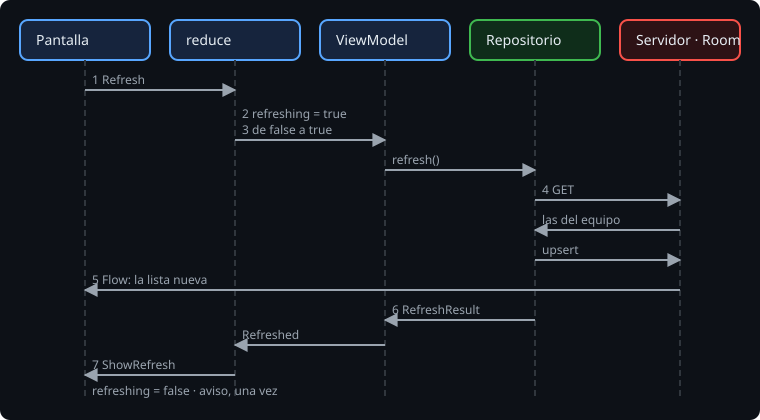

# La red en la Bitácora

> La Bitácora ya tiene una fuente de verdad: Room. La red no la cambia, la alimenta. «Actualizar» pide al servidor las observaciones del equipo, las traduce a la forma de la app y las escribe en la base de datos; la pantalla se entera como se entera de todo, por el `Flow`. El cliente se crea una vez, en el grafo de Hilt, con el motor del móvil y la URL del flavor. Y la pantalla dice qué ha pasado con palabras de la app.

## 🎯 Objetivos

- Separar las tres formas de una observación: la del servidor, la de la tabla y la del dominio
- Escribir lo que llega en Room, sin que la red le hable a la pantalla
- Llevar una petición por el reducer y el ViewModel: `Refresh`, `Refreshed` y un efecto
- Crear el cliente en `AppModule`, con OkHttp y la URL del flavor desde `BuildConfig`
- Saber lo que la red añade al build y al APK

## 1. Tres clases para una observación

| Clase | Módulo | Tiene la forma de | Cambia cuando |
| --- | --- | --- | --- |
| `RemoteObservation` | `data` | el JSON del servidor: `lat`, `lng`, el nivel en minúsculas | cambia el servidor |
| `ObservationEntity` | `data` | la tabla de Room | hay una versión nueva de la base de datos |
| `Observation` | `core` | el dominio | cambia lo que la app entiende por una observación |

Parece mucho para lo mismo, y con un solo campo distinto lo sería. Pero cada una cambia por motivos distintos, y separarlas es lo que deja que el servidor renombre un campo sin una migración de Room, o que la tabla añada una columna sin tocar la API. La traducción va en `data`, en dos funciones privadas: `RemoteObservation.toObservation()` y `Observation.toEntity()`.

```kotlin
// Un nivel que la app no conoce (una versión nueva del servidor) se salta: las demás llegan igual.
private fun RemoteObservation.toObservation(): Observation? {
    val level = Level.entries.find { it.name.equals(level, ignoreCase = true) } ?: return null
    val position = if (latitude != null && longitude != null) Position(latitude, longitude) else null
    return Observation(code, level, description, position)
}
```

## 2. La red escribe en Room

```kotlin
class RoomObservationRepository(database: BitacoraDatabase, private val api: ObservationApi) : ObservationRepository {
    override val observations = dao.all().map { list -> list.map { it.toObservation() } }

    override suspend fun refresh(): RefreshResult {
        val received = try {
            api.observations()
        } catch (e: Exception) {
            return RefreshResult.Failed(e.toNetworkError() ?: throw e)
        }
        dao.upsert(received.map { it.toEntity() })
        return RefreshResult.Done(received.size)
    }
}
```

- **`refresh()` no devuelve la lista.** Devuelve qué ha pasado. La lista ya llega por `observations`, que es lo que lee la pantalla desde la semana 30: lo que entra con `upsert` sale por el `Flow`, como lo que se añade a mano.
- **El servidor gana**, con `@Upsert` (semana 30): la A-1 del servidor pisa a la A-1 de aquí, y la A-5, que solo está aquí, se queda. Es una regla simple, y tiene un techo: si aquí se cambió la A-1 y aún no se ha subido, el cambio se pierde. La semana 32 pone una cola de cambios pendientes y una regla de conflictos.
- **Sin red, la app sigue funcionando** con lo último que tiene. La red añade; no es condición para abrir.

## 3. Por el reducer y el ViewModel



La petición sigue el camino de todo lo demás desde la semana 28: un *intent* sube, el reducer decide el estado, el ViewModel hace lo que el reducer no puede hacer.

```kotlin
BitacoraIntent.Refresh -> if (state.refreshing) Next(state) else Next(state.copy(refreshing = true))
is BitacoraIntent.Refreshed -> Next(state.copy(refreshing = false), BitacoraEffect.ShowRefresh(intent.result))
```

```kotlin
// En onIntent, después de reduce:
if (after.refreshing && !before.refreshing) viewModelScope.launch { onIntent(BitacoraIntent.Refreshed(repository.refresh())) }
```

- **Una petición a la vez**: un segundo toque mientras `refreshing` no cambia el estado, y el ViewModel solo lanza cuando `refreshing` pasa de `false` a `true`. El botón, además, está desactivado.
- **El resultado vuelve como *intent***: el reducer sigue siendo el único que cambia el estado, y se prueba sin red.
- **El aviso es un efecto**, no estado: si fuese estado, se repetiría al girar el móvil (semana 28).
- **En `viewModelScope`**: si se cierra la sesión a mitad, la petición se cancela, y por eso `refresh()` no se traga la cancelación (teoría 03).

La pantalla elige el texto por el error de la app:

```kotlin
fun Resources.refreshMessage(result: RefreshResult): String = when (result) {
    is RefreshResult.Done -> getString(R.string.refreshed, result.received)
    is RefreshResult.Failed -> getString(
        when (result.error) {
            NetworkError.OFFLINE -> R.string.offline
            NetworkError.TIMEOUT -> R.string.timeout
            NetworkError.SERVER -> R.string.server_error
            NetworkError.BAD_RESPONSE -> R.string.bad_response
        },
    )
}
```

«Sin conexión» y «El servidor tarda demasiado» piden cosas distintas a la persona: buscar cobertura, o esperar. Por eso son errores distintos.

## 4. El cliente en el grafo

```kotlin
@Provides
@Singleton
fun client(): HttpClient = bitacoraClient(OkHttp.create(), BuildConfig.API_URL)

@Provides
@Singleton
fun observations(database: BitacoraDatabase, client: HttpClient): ObservationRepository =
    RoomObservationRepository(database, ObservationApi(client))
```

- **`@Singleton`**: un cliente, un motor, una reserva de conexiones para toda la app (teoría 02).
- **El motor se elige aquí**, en `app`, con `ktor-client-okhttp`. `data` solo depende de `ktor-client-core`, y sus tests usan `MockEngine`.
- **`FakeModule`** (semana 29) sustituye a `AppModule` en los tests de Hilt: con el `FakeRepository`, la pantalla se prueba sin cliente y sin red (teoría 05).

## 5. La URL de cada flavor

La demo no debe tocar los datos de verdad. Cada flavor tiene su servidor, y la URL va en `BuildConfig`, que AGP genera por variante:

```kotlin
productFlavors {
    create("demo") {
        buildConfigField("String", "API_URL", "\"https://demo.bitacora.example/v1/\"")
    }
    create("field") {
        buildConfigField("String", "API_URL", "\"https://api.bitacora.example/v1/\"")
    }
}
buildFeatures {
    buildConfig = true
}
```

> 🔬 Medido con AGP 9.4.1: sin `buildFeatures.buildConfig = true`, `BuildConfig` no se genera (semana 20). Con él, `app/build/generated/source/buildConfig/field/debug/dev/bitacora/BuildConfig.java` tiene `public static final String API_URL = "https://api.bitacora.example/v1/";`, y el de `demo/debug`, la de la demo.

`.example` es un dominio reservado (RFC 2606): no existe ningún servidor detrás. En el móvil, «Actualizar» acaba en uno de los errores de la red, y eso es lo que se ve en clase. Para probar con un servidor de verdad, se cambia la URL del flavor.

## 6. Lo que añade la red

> 🔬 Medido en la Bitácora: Ktor 3.6.1 y el motor de OkHttp meten 61 componentes nuevos en `verification-metadata.xml`, todos sin avisos en OSV. Entre ellos, `ktor-serialization-kotlinx` trae `ktor-openapi-schema`, y este, `kaml`, `snakeyaml-engine-kmp` y `kotlinx-datetime`: un lector de YAML en una app que no usa YAML. El APK de release (sin R8) pasa de 10 537 835 a 12 302 627 bytes, 1,7 MB más.

R8 (`isMinifyEnabled`) quitaría casi todo lo que no se usa, y la Bitácora aún no lo tiene activado. Mientras tanto, cada dependencia nueva se mira dos veces: lo que trae, y si hace falta.

> 🔬 Medido en los tests de `data`: Ktor escribe por `slf4j-api`, y sin una implementación, cada ejecución saca `SLF4J(W): No SLF4J providers were found.` en la salida de error. No es un fallo: los registros se descartan.

## Para recordar

- Tres clases, tres motivos para cambiar: el servidor, la tabla, el dominio. La traducción, en `data`.
- La red escribe en Room y devuelve qué ha pasado; la pantalla lee del `Flow`.
- `Refresh` y `Refreshed` por el reducer, la petición en `viewModelScope`, el aviso como efecto.
- Un `HttpClient` `@Singleton` con OkHttp en `AppModule`; la URL, por flavor en `BuildConfig`.
- Cada dependencia trae otras: mírala en la verificación y en el APK.
