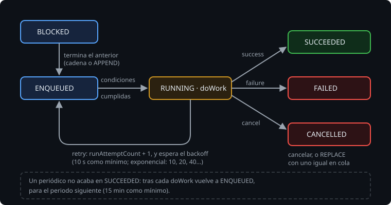

# Peticiones, condiciones y trabajo único

> Un worker dice qué hacer; la petición dice cuándo y cómo. Esta teoría arma peticiones: una vez o cada cierto tiempo, con las condiciones que el móvil tiene que cumplir (red, batería, carga), con la espera entre intentos, y con un nombre para que pedirla dos veces no haga dos trabajos. Al final, cómo saber en qué estado está cada uno.

## 🎯 Objetivos

- Construir peticiones de una vez y periódicas, y conocer sus mínimos
- Poner condiciones: tipo de red, batería, carga
- Elegir la espera entre reintentos
- Encolar trabajo único y elegir qué pasa con el que ya estaba
- Leer el estado de un trabajo con `WorkInfo`

## 1. Una vez, o cada cierto tiempo

```kotlin
val once = OneTimeWorkRequestBuilder<BackupWorker>().build()
val daily = PeriodicWorkRequestBuilder<BackupWorker>(24, TimeUnit.HOURS).build()
WorkManager.getInstance(context).enqueue(once)
```

Un periódico se repite hasta que se cancela: tras cada `doWork()` no acaba, vuelve a la cola para el periodo siguiente. Por eso nunca llega a `SUCCEEDED`.



> 🔬 Medido con WorkManager 2.12.0: un periódico de 5 minutos se guarda con `repeatIntervalMillis = 900000`, 15 minutos: es el mínimo, y WorkManager sube lo que sea menor sin avisar. Sin condiciones, el periódico corre en cuanto se encola, y otra vez al cumplirse el periodo; después de cada vez vuelve a `ENQUEUED`.

## 2. Condiciones

```kotlin
.setConstraints(
    Constraints(
        requiredNetworkType = NetworkType.UNMETERED,
        requiresBatteryNotLow = true,
        requiresCharging = true,
    ),
)
```

| Condición | Cuándo se cumple |
| --- | --- |
| `NetworkType.CONNECTED` | hay una red con salida |
| `NetworkType.UNMETERED` | hay una red que no se paga por dato (wifi, normalmente) |
| `NetworkType.NOT_ROAMING` | hay red y no es de otro país |
| `requiresBatteryNotLow` | la batería no está en el aviso de baja |
| `requiresCharging` | está cargando |
| `requiresDeviceIdle` | el móvil lleva un rato sin usarse |
| `requiresStorageNotLow` | queda espacio |

El trabajo espera en `ENQUEUED` hasta que se cumplen todas. Si deja de cumplirse una mientras corre (se pierde el wifi), WorkManager lo para (la corrutina de `doWork()` se cancela) y lo vuelve a poner en la cola.

La Bitácora solo pide `CONNECTED`: unas observaciones son unos pocos kilobytes, y que lleguen pronto importa más que gastar datos. La copia de seguridad del ejercicio 01 pide wifi y batería: es un archivo entero, y puede esperar a la noche.

## 3. La espera entre intentos

Cuando `doWork()` devuelve `retry()`, el trabajo vuelve a la cola y espera. Cuánto, lo dice el *backoff*:

```kotlin
.setBackoffCriteria(BackoffPolicy.EXPONENTIAL, 30, TimeUnit.SECONDS)
```

- **`EXPONENTIAL`**: la espera se dobla en cada intento: 30 s, 60 s, 120 s... Es el de serie, con 30 s.
- **`LINEAR`**: crece lo mismo cada vez: 20 s, 40 s, 60 s...

Hay un máximo de 5 horas: más allá, la espera ya no crece.

> 🔬 Medido: con `LINEAR` y 1 segundo, la petición se guarda con `backoffDelayDuration = 10000`: 10 s es el mínimo, y lo que sea menor se sube sin avisar. Con `EXPONENTIAL` y ese mínimo, el primer reintento queda programado a unos 10 s y el segundo a unos 20 s (`WorkInfo.nextScheduleTimeMillis`).

La espera exponencial tiene la misma razón que en la semana 31: un servidor que va mal no mejora si mil móviles le insisten cada 10 segundos.

## 4. Trabajo único

`enqueue` encola siempre uno nuevo. Si la Bitácora encolase una sincronización por cada cambio, tres cambios sin red serían tres sincronizaciones esperando, y al volver la red correrían las tres. El trabajo único lleva un nombre, y una política dice qué hacer si ya hay uno con ese nombre sin acabar:

```kotlin
workManager.enqueueUniqueWork("sync", ExistingWorkPolicy.REPLACE, request)
```

| Política | Si ya hay uno sin acabar |
| --- | --- |
| `KEEP` | se queda el de antes; el nuevo se descarta |
| `REPLACE` | el de antes se cancela (aunque esté corriendo) y entra el nuevo |
| `APPEND` | el nuevo va detrás del de antes, en `BLOCKED` hasta que acabe; si el de antes falla, el nuevo también |
| `APPEND_OR_REPLACE` | como `APPEND`, pero si el de antes ya falló o se canceló, empieza de cero |

> 🔬 Medido: dos `enqueueUniqueWork` seguidos con el mismo nombre, sin red, dejan con `REPLACE` y con `KEEP` un solo trabajo (`[ENQUEUED]`); con `APPEND`, `[BLOCKED, ENQUEUED]`; con `APPEND_OR_REPLACE`, `[ENQUEUED, BLOCKED]`.

¿Cuál para cada cosa?

- **Una copia que tarda y no cambia** (ejercicio 01): `KEEP`. Pedirla otra vez mientras espera no aporta nada.
- **Una sincronización que lee la cola entera** (la Bitácora): `REPLACE`. Un cambio que llega mientras una sincronización corre la cancela, y la nueva lee la cola con ese cambio. Con `KEEP`, ese cambio esperaría a la siguiente. Cancelar a mitad no estropea nada porque subir es idempotente (teoría 03).
- **Pasos que dependen del anterior**: `APPEND`, o una cadena.

Para los periódicos, `enqueueUniquePeriodicWork` con `ExistingPeriodicWorkPolicy`: `KEEP` (lo normal: encolarlo en cada arranque de la app sin duplicarlo), `UPDATE` (cambia la petición sin perder la programación) o `CANCEL_AND_REENQUEUE`.

**Cadenas.** Para pasos en orden, cada uno con sus condiciones:

```kotlin
workManager.beginUniqueWork("backup", ExistingWorkPolicy.KEEP, compress)
    .then(upload)
    .enqueue()
```

El `Data` de salida de `compress` llega como entrada de `upload`. Si uno falla, los de detrás acaban en `FAILED` sin correr. La Bitácora no las necesita: su sincronización es un solo paso.

## 5. Etiquetas y estado

Cada trabajo tiene un `id` (un `UUID`) y puede llevar etiquetas (`addTag("backup")`). Con cualquiera de las tres cosas (id, nombre único o etiqueta) se pide su estado:

```kotlin
workManager.getWorkInfoById(id)            // ListenableFuture<WorkInfo?>
workManager.getWorkInfosForUniqueWork("sync")
workManager.getWorkInfosByTag("backup")
workManager.getWorkInfoByIdFlow(id)        // Flow<WorkInfo?>, para una pantalla
```

`WorkInfo` lleva `state`, `runAttemptCount`, `outputData`, `constraints`, `nextScheduleTimeMillis` y, en los periódicos, `periodicityInfo`. Una pantalla que quiera enseñar «sincronizando...» lo recoge con el `Flow`. Y para parar uno: `cancelUniqueWork("sync")`, `cancelAllWorkByTag(...)` o `cancelWorkById(id)`.

## Para recordar

- Una vez (`OneTimeWorkRequest`) o periódico, con 15 minutos como mínimo; un periódico nunca acaba en `SUCCEEDED`.
- Las condiciones se cumplen todas o el trabajo espera. Si dejan de cumplirse mientras corre, se para y vuelve a la cola.
- El backoff exponencial de 30 s es el de serie; el mínimo es 10 s.
- Trabajo único con nombre: `KEEP` si el que está ya sirve, `REPLACE` si el nuevo sabe más, `APPEND` si van en orden.
- El estado, por id, nombre o etiqueta, en `WorkInfo`.
