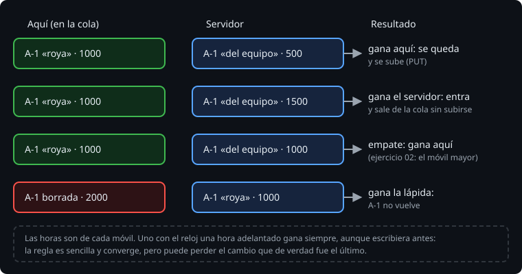

# Offline-first: la cola y los conflictos

> Offline-first quiere decir que la app funciona igual sin red: lo que se apunta se guarda y se ve al momento, y llega al servidor cuando se pueda. La Bitácora ya era medio offline-first desde la semana 30 (Room es la fuente de verdad), pero en la 31, «Actualizar» pisaba los cambios de aquí con los del servidor. Esta teoría monta la otra mitad: una cola de cambios sin subir, el orden de la sincronización, y una regla para cuando el mismo dato ha cambiado en dos sitios.

## 🎯 Objetivos

- Explicar qué cambia en una app cuando el servidor no está siempre
- Diseñar una cola de cambios pendientes en la base de datos, con los borrados
- Ordenar una sincronización: bajar, decidir, subir
- Aplicar «gana el último» y conocer su punto débil
- Hacer que repetir una sincronización no estropee nada

## 1. La pantalla no espera a la red

En una app que depende de la red, guardar es una petición: la pantalla espera, y sin red, falla. En una offline-first, guardar es escribir en la base de datos local; la pantalla lo ve por el `Flow` de siempre, y subirlo es otro trabajo, en otro momento.

```
save(lista)  ──>  Room (la lista + la cola)  ──>  Flow  ──>  pantalla     (ya)
                          │
                          └──>  WorkManager  ──>  servidor                  (cuando haya red)
```

La pantalla nunca sabe si el cambio ha llegado al servidor. Si quisiera enseñarlo («2 sin subir»), lo leería de la cola, también con un `Flow`.

## 2. La cola de cambios

Para subir lo que ha cambiado, primero hay que saber qué ha cambiado. Se guarda en una tabla aparte, en la misma transacción que el cambio:

```kotlin
@Entity(tableName = "pending")
data class PendingChange(
    @PrimaryKey val code: String,  // una fila por observación: el último cambio
    val deleted: Boolean,
    val updatedAt: Long,
)
```

Tres decisiones de diseño:

- **En la misma transacción.** Si el proceso muere entre escribir la observación y escribir la cola, el cambio no se subiría nunca. Con `@Transaction`, o las dos cosas o ninguna.
- **Una fila por código.** Tres cambios a la A-1 sin red no son tres subidas: es una, con lo último. La clave primaria es el código, y `@Upsert` sustituye la fila.
- **Los borrados también.** Una observación borrada ya no está en la tabla: hay que recordar que se borró, y cuándo, para decírselo al servidor. Es una **lápida** (*tombstone*): `deleted = true`.

Y una más, de la Bitácora: `save` recibe la lista entera (semana 28). Para saber qué ha cambiado, se compara con lo que había: las nuevas, las que no son iguales y las que ya no están entran en la cola; las demás conservan su hora.

## 3. La hora de cada cambio

Cada observación lleva `updatedAt`, cuándo cambió por última vez, aquí o en el servidor. Es lo que decide quién gana. Dos detalles:

- **El reloj, de fuera.** El repositorio recibe `clock: () -> Long`: en la app, `System::currentTimeMillis`; en los tests, una variable que el test cambia. Sin eso, los tests de conflictos dependerían de cuánto tarda el ordenador.
- **Un reloj que no repite.** Dos cambios en el mismo milisegundo tendrían la misma hora, y el reloj del sistema puede ir hacia atrás cuando el móvil corrige la hora por la red. El ejercicio 02 hace un `Clock` que nunca da dos veces la misma hora ni retrocede: `maxOf(system(), last + 1)`.

## 4. El orden: bajar, decidir, subir

Con cambios aquí y cambios en el servidor, la sincronización de la Bitácora hace tres cosas, en este orden:

1. **Bajar**: `GET observations`, con la hora de cada una.
2. **Decidir**: cada observación que llega se compara con la cola. Si aquí hay un cambio sin subir más nuevo, se queda el de aquí; si no, entra la del servidor, y si había un cambio en la cola, más viejo, sale de ella sin subirse.
3. **Subir**: lo que queda en la cola es lo que ha ganado aquí. Un `PUT` por cada cambio, un `DELETE` por cada lápida, con su hora.



¿Por qué no subir primero? También funciona, pero entonces quien decide es el servidor, y el móvil solo puede creerle: para probarlo, el servidor de mentira de los tests tendría que aplicar la regla. Bajando primero, la regla vive en el móvil, en una función que se prueba con datos escritos a mano. El servidor sigue comprobando: si entre el `GET` y el `PUT` alguien ha subido una versión más nueva, contesta **409 Conflict**, y el cambio de aquí sale de la cola; la versión nueva llega en la siguiente sincronización.

**Borrar de la cola, solo si es el mismo cambio.** Mientras se sube la A-1 de las 10:00, la persona la vuelve a cambiar a las 10:01. Si al terminar el `PUT` se borra «la fila de la A-1», el cambio de las 10:01 se pierde. Se borra «la fila de la A-1 con hora 10:00»: si ya es otra, se queda.

```sql
DELETE FROM pending WHERE code = :code AND updatedAt = :updatedAt
```

## 5. Gana el último

La regla de la Bitácora (*last write wins*, LWW): de dos versiones del mismo dato, gana la de hora mayor. Es sencilla, no necesita guardar historia, y todas las copias acaban igual si todas la aplican igual.

**Los empates.** Con la misma hora, hace falta un desempate, y que sea el mismo en todas partes. En la Bitácora, al bajar gana lo de aquí, y si el servidor tiene otra versión con la misma hora, al subir contesta 409 y se queda la suya: las dos copias acaban igual. En el ejercicio 02 no hay servidor que arbitre, y el desempate es el nombre del móvil: así una versión nunca se gana a sí misma y, de dos, solo gana una.

> 🔬 Medido en el ejercicio 02: con `device >= other.device` en lugar de `>`, una versión se gana a sí misma (`aVersionDoesNotBeatItself` falla). Y si `merge` tira las lápidas, `aNewerDeletionWins` falla.

Sin la lápida, la nota borrada desaparece de esa lista, pero en la siguiente sincronización con otro móvil que aún la tenga, vuelve: ya no queda nada que diga que se borró.

**El punto débil: los relojes.** `updatedAt` es la hora del móvil que hizo el cambio. Un móvil con el reloj una hora adelantado gana siempre, aunque escribiera antes. El ejercicio 02 lo deja escrito en un test (`aClockAheadAlwaysWins`). Las salidas, de más simple a más complicada:

- **La hora del servidor.** El servidor pone la hora al recibir. Pero el cambio se hizo sin red, a las 10:00, y llega a las 18:00: gana sobre uno de las 12:00 que se subió al momento.
- **Números de versión.** Cada versión lleva un contador; el servidor solo acepta un `PUT` sobre la versión que tiene («cambio la 7»). Si no coincide, 409, y el móvil tiene que decidir: preguntar a la persona, o juntar los cambios.
- **Juntar en lugar de elegir.** Si los datos lo permiten (dos campos distintos, o una lista a la que dos añaden), se guardan los dos cambios. Las estructuras que juntan siempre sin conflicto se llaman CRDT.

Para la Bitácora, donde cada observación la escribe casi siempre una persona, «gana el último» basta. Lo importante es saber qué puede perder.

## 6. Repetir no estropea nada

WorkManager reintenta, y `REPLACE` puede cancelar una sincronización a medias. Por eso cada paso tiene que poder hacerse dos veces con el mismo resultado (ser **idempotente**):

- **Bajar** dos veces: la misma regla con los mismos datos da lo mismo.
- **Subir con `PUT`** dos veces la misma versión: el servidor la tiene igual. Con `POST` («crea una»), dos subidas serían dos observaciones.
- **`DELETE`** dos veces: la segunda contesta 404, y para la Bitácora un 404 al borrar es «ya está borrada»: sale de la cola.

> 🔬 Medido en el ejercicio 02: juntar el resultado con una de sus partes otra vez no cambia nada (`mergingTwiceChangesNothing`), y el orden en que se juntan dos listas tampoco (`theOrderDoesNotMatter`).

## Para recordar

- Guardar es escribir en local; subir es otro trabajo. La pantalla no espera a la red.
- La cola, en la misma transacción que el cambio; una fila por dato; los borrados, como lápidas.
- Bajar, decidir, subir. La cola se vacía solo si sigue siendo el mismo cambio.
- «Gana el último» converge si todos usan la misma regla y el mismo desempate; con relojes desajustados, puede perder el cambio que de verdad fue el último.
- Cada paso, idempotente: `PUT` y `DELETE`, no `POST`.
