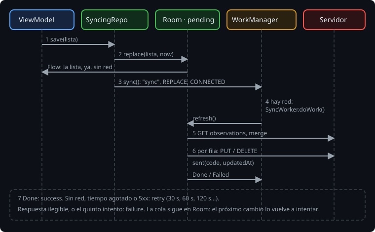

# La sincronización en la Bitácora

> Las teorías 01 a 03 dan las piezas: un worker, una petición con condiciones, una cola y una regla. Esta las monta en la Bitácora, capa por capa: la versión 2 de la base de datos, el repositorio que encola y sincroniza, el worker, la fábrica en el grafo de Hilt, y el arranque de WorkManager. Y cuenta los tres errores que salen por el camino.

## 🎯 Objetivos

- Migrar la base de datos a la versión 2 con una migración automática
- Escribir la cola y la regla en el DAO, en transacciones
- Conectar el worker con el repositorio a través de una `WorkerFactory` inyectada
- Arrancar WorkManager con la configuración de la app
- Encolar la sincronización sin que el ViewModel sepa nada

## 1. La versión 2



La tabla `observations` gana una columna, `updatedAt`, y aparece la tabla `pending`. Ninguna de las dos cosas pide SQL a mano: Room compara `schemas/1.json` con el esquema nuevo y escribe la migración.

```kotlin
@Entity(tableName = "observations")
data class ObservationEntity(
    // ...
    @ColumnInfo(defaultValue = "0") val updatedAt: Long = 0,
)

@Database(
    entities = [ObservationEntity::class, PendingChange::class],
    version = 2,
    autoMigrations = [AutoMigration(from = 1, to = 2)],
)
```

El `defaultValue` no es para el código (eso es el `= 0` de Kotlin): es para SQLite, que tiene que poner algo en las filas que ya existen.

> 🔬 Medido con Room 3.0.3: sin `@ColumnInfo(defaultValue = "0")`, KSP para con `New NOT NULL column'updatedAt' added with no default value specified.Please specify the default value using @ColumnInfo.` (el texto es así, sin espacios). Las filas de la versión 1 quedan con `updatedAt = 0`: más viejas que cualquier cambio, así que la primera versión del servidor que llegue gana.

**La trampa del `INSERT`.** El callback `onCreate` de la semana 30 importaba el JSON con `INSERT INTO observations VALUES (?, ?, ?, ?, ?, ?)`: seis valores para seis columnas. Con siete, falla.

> 🔬 Medido: `SQLiteException: Error code: 1, message: table observations has 7 columns but 6 values were supplied`, en tres tests de `RoomTest`. Con la lista de columnas (`INSERT INTO observations (code, level, description, latitude, longitude, photo) VALUES ...`), la séptima toma su valor por defecto. Un `INSERT` sin columnas se rompe con la primera migración que añada una.

## 2. El DAO: la cola y la regla

Lo que tiene que ser todo o nada va en métodos `@Transaction` del DAO, como el `replace` de la semana 30.

**Guardar** compara la lista nueva con la que había:

```kotlin
@Transaction
suspend fun replace(observations: List<ObservationEntity>, now: Long) {
    val before = snapshot().associateBy { it.code }
    val after = observations.map { new ->
        val old = before[new.code]
        if (old != null && old.copy(updatedAt = 0) == new.copy(updatedAt = 0)) old else new.copy(updatedAt = now)
    }
    val gone = before.keys - observations.map { it.code }.toSet()
    deleteOthers(observations.map { it.code })
    upsert(after)
    queue(after.filter { it.updatedAt == now }.map { PendingChange(it.code, false, now) } + gone.map { PendingChange(it, true, now) })
}
```

La lista que llega del ViewModel no sabe de horas (el dominio no tiene `updatedAt`): por eso se compara sin ella (`copy(updatedAt = 0)`), y la que no ha cambiado conserva la suya.

**Juntar** lo que llega del servidor, con «gana el último» frente a la cola:

```kotlin
@Transaction
suspend fun merge(received: List<ObservationEntity>) {
    val waiting = pending().associateBy { it.code }
    val newer = received.filter { remote -> waiting[remote.code].let { it == null || it.updatedAt < remote.updatedAt } }
    upsert(newer)
    unqueue(newer.map { it.code }.filter { it in waiting })
}
```

El `<` estricto es el desempate: con la misma hora, gana lo de aquí (teoría 03, apartado 5).

## 3. El repositorio: bajar, decidir, subir

`ObservationApi` gana `put` y `delete`, y `observations()` devuelve ahora las clases del servidor (`RemoteObservation`, con `updated_at`): traducirlas a la tabla, con su hora, es del repositorio. El dominio sigue sin saber de horas.

```kotlin
override suspend fun refresh(): RefreshResult = try {
    val received = api.observations().mapNotNull { it.toEntity() }
    dao.merge(received)
    for (change in dao.pending()) {
        try {
            if (change.deleted) api.delete(change.code, change.updatedAt) else dao.find(change.code)?.let { api.put(it.toRemote()) }
        } catch (e: ClientRequestException) {
            if (e.response.status != HttpStatusCode.Conflict && e.response.status != HttpStatusCode.NotFound) throw e
        }
        dao.sent(change.code, change.updatedAt)
    }
    RefreshResult.Done(received.size)
} catch (e: Exception) {
    RefreshResult.Failed(e.toNetworkError() ?: throw e)
}
```

- **409 y 404 sacan de la cola.** El servidor tiene uno más nuevo, o ya no tiene la que se borra: no hay nada que subir.
- **Cualquier otro fallo para todo.** La excepción sale del `for` antes de `sent`: ese cambio y los de detrás siguen en la cola.
- **La cancelación sigue subiendo**, como en la semana 31: `toNetworkError()` da `null`, y el `throw e` la relanza. Ahora importa más: `REPLACE` cancela sincronizaciones a medias.

El `try` envuelve ahora también las escrituras en Room. No cambia nada: lo que no es de la red no tiene nombre (`null`) y se relanza.

## 4. El worker y su fábrica

```kotlin
class SyncWorker(context: Context, params: WorkerParameters, private val repository: ObservationRepository) :
    CoroutineWorker(context, params) {
    override suspend fun doWork(): Result = when (val result = repository.refresh()) {
        is RefreshResult.Done -> Result.success()
        is RefreshResult.Failed ->
            if (result.error == NetworkError.BAD_RESPONSE || runAttemptCount + 1 >= MAX_ATTEMPTS) Result.failure() else Result.retry()
    }
}
```

`refresh()` ya dice qué ha pasado con palabras de la app; el worker solo lo traduce. Sin red, tiempo agotado o error del servidor: `retry`. Una respuesta que no se entiende no mejora repitiendo: `failure`. Y al quinto intento se rinde: la cola sigue en Room, y el próximo cambio encola otra sincronización.

La fábrica la crea Hilt (`@Inject constructor`), y recibe el repositorio como `Provider<ObservationRepository>`:

```kotlin
class SyncWorkerFactory @Inject constructor(private val repository: Provider<ObservationRepository>) : WorkerFactory() {
    override fun createWorker(appContext: Context, workerClassName: String, workerParameters: WorkerParameters) =
        if (workerClassName == SyncWorker::class.java.name) SyncWorker(appContext, workerParameters, repository.get()) else null
}
```

¿Por qué `Provider`? Por el orden en que nacen las cosas. Hilt inyecta la fábrica en `BitacoraApp` al arrancar. Si la fábrica pidiese el repositorio directamente, Hilt lo crearía en ese momento; el repositorio llama a `WorkManager.getInstance(context)`, que pide la configuración a `BitacoraApp`, que lee la fábrica... que aún no está asignada.

> 🔬 Medido: con `SyncWorkerFactory @Inject constructor(private val repository: ObservationRepository)`, todos los tests que abren la actividad con la app de verdad fallan con `UninitializedPropertyAccessException: lateinit property workerFactory has not been initialized`. Con `Provider`, el repositorio se pide al crear el primer worker, cuando todo ya existe.

## 5. El arranque de WorkManager

WorkManager se arranca solo: un inicializador de `androidx.startup` lo crea con la configuración de serie al abrir la app. Esa configuración no sabe de `SyncWorkerFactory`. Para darle la nuestra, dos cambios:

```kotlin
@HiltAndroidApp
class BitacoraApp : Application(), Configuration.Provider {
    @Inject
    lateinit var workerFactory: SyncWorkerFactory

    override val workManagerConfiguration: Configuration
        get() = Configuration.Builder().setWorkerFactory(workerFactory).build()
}
```

```xml
<provider
    android:name="androidx.startup.InitializationProvider"
    android:authorities="${applicationId}.androidx-startup"
    android:exported="false"
    tools:node="merge">
    <meta-data
        android:name="androidx.work.WorkManagerInitializer"
        android:value="androidx.startup"
        tools:node="remove" />
</provider>
```

Sin el inicializador automático, WorkManager arranca la primera vez que alguien llama a `WorkManager.getInstance(context)`, y entonces pide la configuración a la aplicación. Se quita solo esa entrada (`tools:node="remove"` en el `meta-data`), no el proveedor entero: lo usan otras bibliotecas.

> 🔬 Medido: en la Bitácora, el proveedor de `androidx.startup` lleva también los inicializadores de maps-compose (`AttributionIdInitializer`) y de OkHttp, entre otros. Quitar el proveedor entero los quitaría a todos.

> 🔬 Medido: el proveedor de `androidx.startup` sigue en el manifiesto final, sin `androidx.work.WorkManagerInitializer` entre sus `meta-data` (`theAutomaticInitializerIsRemoved`).

Si se olvida el manifiesto, en el móvil WorkManager arrancaría con la configuración de serie y `SyncWorker` acabaría en `FAILED` (teoría 01, apartado 5).

## 6. Encolar sin que el ViewModel lo sepa

¿Quién llama a `sync()`? El ViewModel no debería: no sabe de WorkManager, y sus tests no lo tienen. El repositorio de `data` tampoco puede: es un módulo de la JVM, sin Android. Queda la app, que envuelve al repositorio:

```kotlin
class SyncingRepository(private val repository: ObservationRepository, private val workManager: WorkManager) :
    ObservationRepository by repository {
    override suspend fun save(observations: List<Observation>) {
        repository.save(observations)
        workManager.sync()
    }
}
```

`by repository` es la delegación de Kotlin: `observations` y `refresh()` pasan tal cual al de dentro, y solo `save` cambia. `AppModule` devuelve este en lugar del de Room, y nadie más se entera:

```kotlin
fun observations(@ApplicationContext context: Context, database: BitacoraDatabase, client: HttpClient): ObservationRepository =
    SyncingRepository(RoomObservationRepository(database, ObservationApi(client)), WorkManager.getInstance(context))
```

```kotlin
fun WorkManager.sync() {
    val request = OneTimeWorkRequestBuilder<SyncWorker>()
        .setConstraints(Constraints(requiredNetworkType = NetworkType.CONNECTED))
        .setBackoffCriteria(BackoffPolicy.EXPONENTIAL, 30, TimeUnit.SECONDS)
        .build()
    enqueueUniqueWork(SYNC_WORK, ExistingWorkPolicy.REPLACE, request)
}
```

¿Y lo que quedó en la cola de la última vez, si la app se cerró? No hace falta encolar nada al arrancar: la sincronización encolada vive en la base de datos de WorkManager y sigue ahí.

«Actualizar» no cambia: llama a `refresh()` directamente, porque la persona está mirando. Ahora, además de bajar, sube la cola.

## 7. Lo que entra en el build

- **Dependencias.** `work-runtime` en la app, `work-testing` en sus tests, `room3-testing` en los tests de `data`. 21 componentes nuevos en `verification-metadata.xml`, sin avisos en OSV.
- **Permisos.** Los tres de WorkManager (teoría 01, apartado 2): el `BuildTest` de la raíz se llama ahora `onlyTheExpectedPermissionsShip`.
- **Tamaño.** El APK `field` de release, de 12,30 MB a 12,67 MB.

## Para recordar

- `AutoMigration` con `@ColumnInfo(defaultValue)` para la columna nueva; los `INSERT`, siempre con la lista de columnas.
- La cola y la regla, en transacciones del DAO; el repositorio baja, decide y sube, y solo vacía la cola de lo que sigue igual.
- El worker traduce `RefreshResult` a `success`, `retry` o `failure`.
- La fábrica, inyectada, con `Provider` para no pedir el repositorio antes de tiempo.
- `Configuration.Provider` en la app y el inicializador fuera del manifiesto, los dos o ninguno.
- La sincronización se encola envolviendo al repositorio: el ViewModel no cambia.
