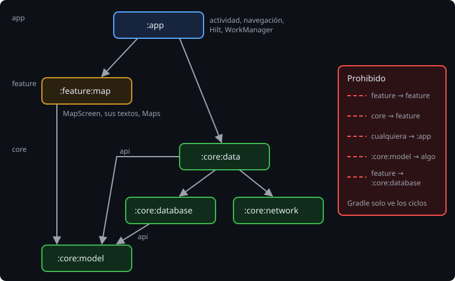

# Por qué partir una app en módulos

> En la semana 10 partiste un build de Kotlin en tres módulos y viste qué recompila `api` y qué `implementation`. La Bitácora tiene hoy tres: `:core` (el dominio), `:data` (Room, Ktor, DataStore y el repositorio, todo junto) y `:app` (todo lo demás). Esta semana se parte como se parte una app grande: módulos `:core:*` por capa y módulos `:feature:*` por pantalla. Antes de mover un archivo, esta teoría cuenta qué se gana, qué cuesta y con qué reglas se decide.

## 🎯 Objetivos

- Saber qué se gana al modularizar una app: build, límites y equipos
- Conocer los tres tipos de módulo de una app: app, feature y core
- Dibujar el grafo de la Bitácora y las reglas que lo mantienen limpio
- Saber cuándo no merece la pena

## 1. Qué se gana

**Límites que el compilador vigila.** En un solo módulo, cualquier archivo puede usar cualquier clase pública. La pantalla del mapa podría llamar al DAO de Room, y nada lo impediría. Si el mapa está en su módulo y ese módulo no depende de la base de datos, el `import` no compila. Una regla de arquitectura deja de ser un acuerdo y pasa a ser un error de compilación.

**Encapsulación de verdad.** `internal` en Kotlin significa «visible en este módulo». Con un solo módulo, `internal` es lo mismo que `public`. Con varios, lo de dentro de `:core:network` (el JSON, los timeouts, cómo se traduce una excepción de Ktor) se queda dentro.

**Builds que hacen menos.** Gradle compila cada módulo por separado. Si cambias el mapa, `:core:database` no tiene nada que hacer, y los módulos que no dependen el uno del otro se compilan a la vez (`org.gradle.parallel=true`, ya activo en el `gradle.properties` de la Bitácora). La teoría 05 mide cuánto se ahorra en la Bitácora.

**Tests más cerca de lo que prueban.** El mapa se puede probar en su módulo, sin Hilt, sin la base de datos y sin `MainActivity`. Un test que no arranca la app entera es más rápido y falla por menos motivos.

**Equipos que no se pisan.** En una app grande, cada equipo es dueño de unos módulos. El archivo `CODEOWNERS` de GitHub asigna revisores por carpeta, y una carpeta por módulo encaja con eso.

## 2. Qué cuesta

- **Más archivos de build.** Cada módulo tiene su `build.gradle.kts`. Los convention plugins de la fase 2 (semanas 11 y 12) existen para que no se repitan.
- **Más configuración.** Gradle configura cada módulo en cada build; con la caché de configuración (semana 13), solo la primera vez.
- **Decisiones de frontera.** Qué va en qué módulo, qué es `api` y qué `implementation`, quién depende de quién. Una mala frontera cuesta más que no tener ninguna: dos módulos que siempre cambian juntos son uno partido en dos.
- **Sorpresas pequeñas.** Kotlin deja de hacer *smart cast* de una propiedad de otro módulo. Cada módulo de Android tiene su propia clase `R`. Cada módulo resuelve sus dependencias por su cuenta. Las teorías 02 y 03 las enseñan una a una, medidas.

## 3. Tres tipos de módulo

| Tipo | Qué tiene | Quién lo usa | En la Bitácora |
| --- | --- | --- | --- |
| **app** | La `Application`, la actividad, la navegación, Hilt: lo que junta las piezas | nadie | `:app` |
| **feature** | Una pantalla o un flujo: sus composables, sus textos, sus dependencias propias | solo la app | `:feature:map` |
| **core** | Lo que comparten varias features: el dominio, la base de datos, la red, el repositorio | features, app y otros core | `:core:model`, `:core:database`, `:core:network`, `:core:data` |

Es el reparto de la guía de modularización de Android y del proyecto de ejemplo *Now in Android*, que tiene muchos módulos `core` y una feature por pantalla. La Bitácora es pequeña: tendrá cuatro `core` y una feature.

## 4. El grafo de la Bitácora



```
:app ──► :feature:map ──► :core:model
  │
  └────► :core:data ──► :core:database ──► :core:model
                   └──► :core:network
```

Las flechas van hacia abajo. Lo de arriba cambia a menudo (la pantalla) y lo de abajo, poco (el dominio). Un cambio en `:core:model` recompila todo, y uno en `:feature:map`, solo la app.

Las reglas que mantienen el grafo así:

1. **Nadie depende de `:app`.** Está arriba del todo.
2. **Una feature no depende de otra feature.** Si el mapa necesita abrir una observación, no importa la pantalla de la observación: recibe una lambda `onOpen`, y la app decide adónde ir.
3. **`core` no sabe de features.** Una feature puede desaparecer sin que `core` lo note.
4. **`:core:model` no depende de nada.** Es la hoja del grafo, y lo usan todos.
5. **Una feature no toca la base de datos ni la red.** Lee y escribe a través de `:core:data`.

Gradle no las conoce: solo prohíbe los ciclos. El ejercicio 02 las convierte en un plugin que para el build en cuanto alguien declara una dependencia prohibida.

## 5. Cuándo no

Modularizar no es gratis, y no todo proyecto lo necesita:

- **Una app de una persona, con un build de segundos,** gana poco en tiempo. Los límites sí ayudan, pero `internal` y la disciplina también.
- **Un módulo por clase** convierte cada cambio en tocar cinco `build.gradle.kts`. La unidad es una capa o una pantalla, no un archivo.
- **Partir antes de saber dónde están las fronteras** las pone en el sitio equivocado. La Bitácora llega a esta semana con 32 semanas de código, y sus costuras se ven: `data` ya mezclaba tres cosas que cambian por motivos distintos.

## Para recordar

- Modularizar convierte las reglas de arquitectura en errores de compilación, deja `internal` con sentido y hace que cada build compile solo lo que ha cambiado.
- Tres tipos: **app** (junta), **feature** (una pantalla) y **core** (lo compartido). Las flechas van de la pantalla al dominio.
- Gradle solo prohíbe ciclos. Las demás reglas (features que no se conocen, `core` sin features, una hoja sin dependencias) son tuyas, y se pueden comprobar en el build.
- Cuesta archivos, configuración y alguna sorpresa del compilador. Merece la pena cuando las fronteras ya se ven.
